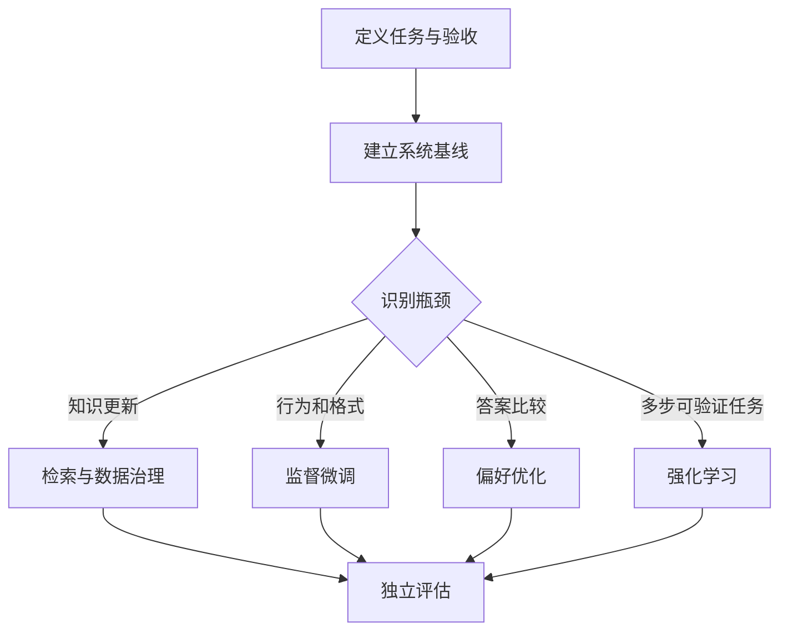

# 01 从目标看训练全景

你手上的模型可能无法稳定遵守格式，对专业术语不熟，或者能写代码却无法可靠完成整个任务。这些症状不一定指向同一种训练。提示、检索、工具、约束解码和程序校验也能改变系统行为，因此先建立不训练的基线。

这是一张决策图，不是每个项目必须依次经过的流水线。训练改变参数，但损失下降不等于产品成功。代码 Agent 的训练损失下降后，仍可能改错文件或破坏测试，因此应观察端到端通过率、错误修改、延迟和单位成功任务成本。

预训练通过大量数据学习通用分布；继续预训练适应新的数据分布；监督微调（SFT）学习示范行为；偏好优化学习候选回答的相对优劣；强化学习根据反馈优化生成策略；蒸馏尝试将教师能力转移给学生。这些方法的数据与目标各不相同，可按需求组合。[TRL 官方文档](https://huggingface.co/docs/trl/index)

**贯穿案例：**输入 bug 描述和仓库上下文，输出待检查文件与编辑策略。先评估现有模型及检索，再用训练仓库构建 SFT 数据，保留未见过的仓库做独立测试。文件召回率、误修改率和完整修复通过率分别衡量不同阶段，不能互相替代。

**向下探索：**token 是分词器处理文本的单位，既不一定是一个字，也不一定是一个词。上下文长度是单次计算处理的序列范围；训练总 token 数是训练过程中处理的数据量，两者不能混同。参数量也不等于训练显存：梯度、优化器状态、激活和临时缓冲均占空间。
