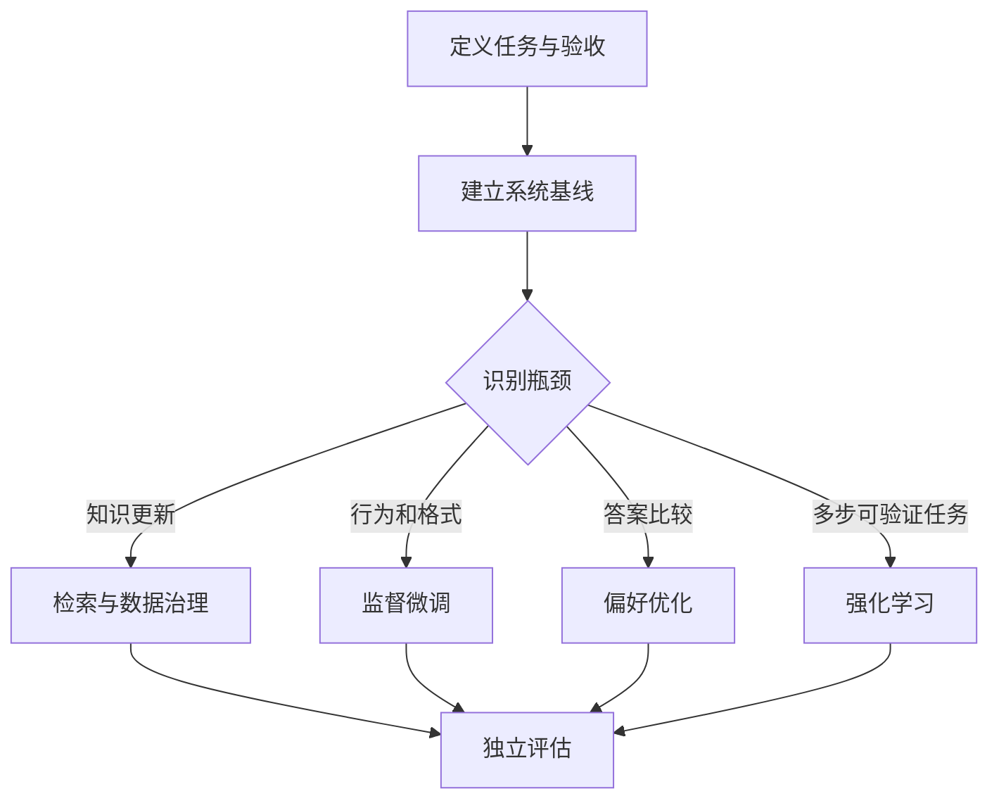

# 01 从目标看训练全景

你手上的模型可能无法稳定遵守格式，对专业术语不熟，或者能写代码却无法可靠完成整个任务。这些症状不一定指向同一种训练。提示、检索、工具、约束解码和程序校验也能改变系统行为，因此先建立不训练的基线。

这是一张决策图，不是每个项目必须依次经过的流水线。训练改变参数，但损失下降不等于产品成功。代码 Agent 的训练损失下降后，仍可能改错文件或破坏测试，因此应观察端到端通过率、错误修改、延迟和单位成功任务成本。

预训练通过大量数据学习通用分布；继续预训练适应新的数据分布；监督微调（SFT）学习示范行为；偏好优化学习候选回答的相对优劣；强化学习根据反馈优化生成策略；蒸馏尝试将教师能力转移给学生。这些方法的数据与目标各不相同，可按需求组合。[TRL 官方文档](https://huggingface.co/docs/trl/index)

**贯穿案例：**输入 bug 描述和仓库上下文，输出待检查文件与编辑策略。先评估现有模型及检索，再用训练仓库构建 SFT 数据，保留未见过的仓库做独立测试。文件召回率、误修改率和完整修复通过率分别衡量不同阶段，不能互相替代。

**向下探索：**token 是分词器处理文本的单位，既不一定是一个字，也不一定是一个词。上下文长度是单次计算处理的序列范围；训练总 token 数是训练过程中处理的数据量，两者不能混同。参数量也不等于训练显存：梯度、优化器状态、激活和临时缓冲均占空间。

## 用一个需求贯穿整本书

假设我们维护一个代码助手，希望它从问题描述中决定先读哪些文件。用户说「登录后刷新页面会回到未登录状态」，仓库有数百个文件。模型需要选择检查会话持久化、客户端状态初始化和服务端鉴权相关代码，而不是看到「页面」就修改样式文件。这个任务把模型训练的几个层次区分得很清楚。

第一层是输入是否充分。模型没有文件列表、依赖关系和搜索工具，无法凭空知道仓库结构。即使训练得很好，它也可能只是根据文件名猜测。工程上应先提供目录、符号检索结果或工具访问能力；训练不能替代缺失的信息。第二层是输出行为。模型已经看到了正确线索，却总是写一大段散文，无法被下一步程序执行，这适合用结构化示范和输出校验处理。第三层是判断质量。输出 JSON 格式正确，但选择了错误文件，这才需要分析训练数据、基座能力和评价信号。

我们可以把输入写成一个任务描述和候选文件摘要，把输出写成文件路径与检查理由。训练样本里的理由必须来自可核查证据，而不是从最终补丁反推一个听起来合理的故事。例如真实补丁修改 `session.ts`，不等于模型仅凭 bug 描述就有充分证据直接定位该文件；如果答案依赖执行测试后才得到的线索，训练轨迹就应包含这个观察过程。否则模型学到的是无根据的自信。

## 第一次实验应该回答什么

不要一开始就问「训练后提升多少」。先建立两个基线：现有模型直接选择文件，以及现有模型使用检索结果后选择文件。固定测试任务，保存每题输入、输出、调用次数、时延与成功判定。假设检索后文件召回从很差变为较好，但错误编辑仍频繁，说明继续优化定位可能不是下一步最有价值的工作；需要检查编辑策略和执行反馈。

再构建监督微调实验：训练集与测试集按仓库隔离，防止同一个项目的复制代码跨集合出现。学生模型学习任务到定位决策的映射。评测不能只看与教师输出的文本重合度，因为两个不同的检查顺序都可能有效；应衡量是否找到必要代码、额外读取了多少内容、最终任务是否成功。一个召回更多文件但每题读取几十万 token 的模型，可能在费用和时延上不适用。

如果已有强教师，可以先比较教师示范与人工示范；如果任务有可靠执行反馈，再考虑在线强化学习。每增加一层，都需要回答新增成本买到了什么。教师更强不代表它生成的每条标签正确；测试可运行不代表奖励不会被绕过；训练 loss 下降不代表未见仓库上的效果变好。

## 怎样阅读后面的章节

数据章解决「模型究竟从什么证据学习」；方法章解释相同样本如何通过不同目标改变参数；系统章解决显存、通信和故障；蒸馏章解释如何利用教师信号；实验章把这些要素组合成可检查的程序。工具链章节作为工程参照阅读，不应取代这些核心知识。即使暂时不读公式，也应能沿着输入、目标、更新和验证这条线理解每一步；需要修改训练代码时，再进入损失、梯度和数值细节。

本书把教学示例、可执行的小实验和未实测的 GPU 配置分别标明。任何性能数字都需要硬件、软件、数据、计数口径和运行条件；缺少这些信息的「快几倍」无法用于预算决策。我们最终要学会的不是记住某个框架的参数名，而是能够判断自己的数据、训练和评测是否真的回答了最初的问题。

## 从完整工程进入具体实现

建议继续阅读[顶层工程设计](16-engineering-design.md)，先看到目标、算力、数据、成本和发布如何形成闭环；随后通过[训练计算原理](17-computation-depth.md)理解参数更新，再沿[Hugging Face 单卡工作流](18-hf-workflow.md)、[NeMo 与 Megatron 集群工作流](19-nemo-megatron-workflow.md)和[verl 在线 RL 工作流](20-verl-workflow.md)逐步进入实现。工具名称本身不构成知识：输入如何变化、哪些假设成立、结果如何验证，才是这些章节的阅读重点。
