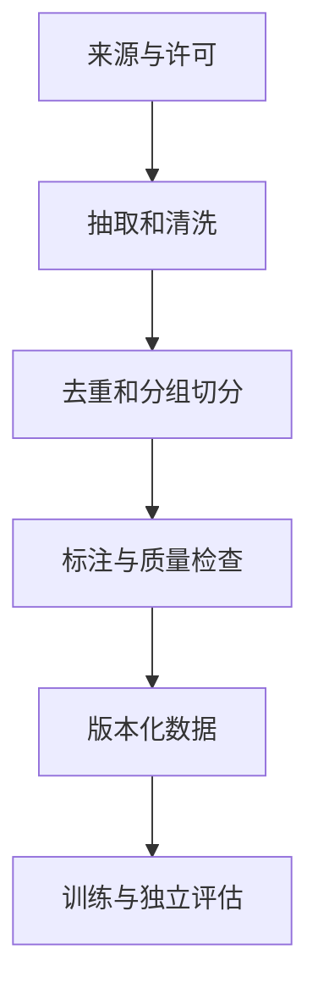

# 02 数据：先把训练输入做对

数据是一条可追踪的生产线：记录来源与许可，抽取和规范化，清理敏感信息，过滤和去重，划分训练与评估集，标注与抽样审查，最后固定版本。代码规范化可能破坏缩进；每一步都需要保留规则及抽样检查。

预训练样本通常是文本；SFT 是输入与示范输出；偏好数据包含同一上下文中的候选及比较；RL 样本还可能包含环境、工具和奖励。训练时需要明确哪些 token 参与损失、如何截断以及消息和工具调用的模板。

代码数据容易跨集合泄漏：仓库副本、相邻提交、复制的函数及相似 issue 都可能让测试题间接出现在训练集中。应按仓库、组织或时间划分，再检测近似重复；任何一种切分都不能独自保证无泄漏。

数据卡至少记录来源、许可、采集时间、切分方法、处理脚本版本、规模、抽检方法、已知缺陷和哈希。自动验证可以排除部分错误，但测试通过不等于行为一定正确；还需检查验证器覆盖与副作用。
