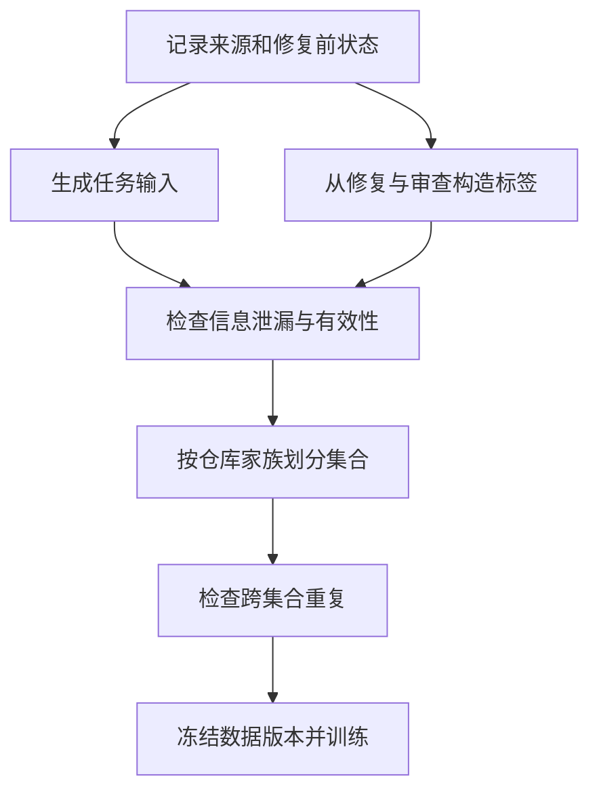

# 02 数据工程：把一次代码决策变成可信的训练样本

假设团队已经选好一个基础模型，希望它收到 bug 描述后，先检查正确文件，再提出合理的修改方向。最容易开始的做法是收集 issue 和修复提交，把它们拼成问答。但这样做往往会训练出一种看似聪明的模型：它会引用最终补丁中的函数名，却不能在修复前的仓库里找到问题。训练没有失败，失败的是样本定义——答案的信息提前进入了输入。

本章从这一任务出发，说明数据如何产生、如何检查以及怎样进入训练。它不要求读者立即收集百万条样本。先把几十条样本逐条解释清楚，比把不可追踪的海量文本送进 GPU 更有价值。文中的数据结构与代码是教学实现，不代表已经完成真实仓库数据采集或大模型训练。

## 2.1 先定义模型在什么时候作决定

同一个修复过程可以产生不同任务。如果模型尚未查看任何代码，那么它只能根据报告和文件树选择下一步阅读对象；如果已经收到几个函数，它可以判断哪个函数值得检查；如果已经执行测试，它还可以根据失败输出修改策略。这些状态不能随意混在一起，否则输出标签可能要求模型利用它没有看到的信息。

我们先定义一个窄任务：输入包含问题描述、修复前文件树及少量检索候选，输出包括最多五个待检查文件和下一步行动。目标不是直接写出补丁，而是帮助后续 Agent 分配阅读预算。一条样本至少需要记录以下事实：

| 字段 | 示例含义 | 为什么保留 |
| --- | --- | --- |
| `sample_id` | 内部稳定 ID | 关联原始记录、清洗日志和训练输出 |
| `repo_family` | 同源仓库及 fork 的共同标识 | 防止同源代码跨越训练与测试集合 |
| `base_commit` | 修复前提交 | 明确模型当时能够看到的代码 |
| `issue` | 问题描述 | 任务本身，必须检查是否已含答案 |
| `files` | 当时存在的路径 | 防止输出标签指向未来新建文件 |
| `target` | 待检查路径及行动 | 监督学习目标 |
| `provenance` | 来源、日期和许可记录 | 追踪授权与数据来源 |

“修复中改过的文件”可以成为定位标签的候选，却不天然等于全部正确标签。补丁可能包含格式化、测试和发布文件，也可能只修改调用者以绕过深层错误。因此要制定标注规则：比如正文代码文件作为主要目标，测试文件单独标记，机械性修改不作为定位真值。对于需要先检查配置的任务，配置文件也应被允许，而不是为了统一指标强迫所有问题都对应某个函数。

样本合同还决定指标。如果规定最多输出五个路径，就可以测 recall@5；若不限制输出数量，模型输出整个文件树可能获得很高召回，却没有节约任何阅读成本。必须同时记录精确率、输出数量和下游修复效果，避免模型利用指标的空隙。[SWE-bench](https://arxiv.org/abs/2310.06770) 提供了以真实仓库问题和修复环境组织任务的参考，但本章的定位任务与 SWE-bench 的完整修复任务并不相同。[^swe]

## 2.2 数据流水线首先保护信息边界



输入和标签应从两条独立路径构造。输入读取修复前的状态，标签可以读取后续修复，但后续信息不得返回输入路径。实践中可以给构建器建立不同接口，甚至让生成输入的步骤完全无法访问补丁文件。这样比要求开发者“记得不要泄漏”更可靠。

考虑一个具体错误：检索候选使用修复后的全文索引。尽管输入没有显式显示 diff，检索器仍可能因为新增加的错误处理函数而把正确文件排在首位。训练和评测都将高估真实定位能力。正确做法是用 `base_commit` 构建或恢复索引，并保存索引版本、检索模型和检索配置；如果索引更新成本太高，宁可先限制实验规模，也不要用未来状态冒充历史状态。

另一个边界是任务运行时能够得到的证据。若报告只说“有些输入会报错”，训练目标却解释完整根因，模型可能只能模仿推理措辞。可以把标签拆成“下一步检查”和“最终诊断”，仅对当时可支持的行动提供监督。轨迹训练中更应如此：每个动作必须对应动作之前的观察，而不是把最后的测试结果塞回第一步。

## 2.3 去重不是删除相同字符串那么简单

精确去重容易实现：规范化指定字段，计算哈希，相同哈希只保留一条。但规范化需要保持任务语义。自然语言描述可去掉行尾空格；Python 代码的缩进不能随意折叠；路径大小写也不能在大小写敏感的仓库里统一为小写。规范化的对象和规则必须明确记录。

同一仓库的两个提交可能只有一行差异，精确哈希无法发现这种近重复。fork、模板项目和复制的文件还可能跨越不同仓库名称。分组切分应使用代码来源关系，而不是直接使用 URL。建立 `repo_family` 后，可以先按家族划分，再检查跨集合的文件指纹、函数片段和文本相似度。分组本身仍不保证无污染：一段代码可能来自公共库，而多个仓库家族都复制了它。

发现跨集合重复后，也不应机械删除所有相似内容。文件头、许可证文本、标准接口和短函数天然相似；误删可能损害数据分布。可以先设置阈值生成审查报告，再对足够长的实质性片段判断。近重复算法的阈值、最短长度、tokenization 和排除规则都属于数据版本。关于大规模去重与其影响，可参考 Deduplicating Training Data Makes Language Models Better；它说明重复值得重视，但不提供适用于所有代码任务的统一阈值。[^dedup]

## 2.4 一个可运行的最小构建器

下面程序只使用 Python 标准库。输入是一行一个 JSON 对象的 `raw.jsonl`，输出三个集合与一份构建报告。它执行结构校验、精确重复检查和仓库家族切分；**不执行近重复检测，不验证代码行为，也不检查许可证的法律含义**。这些边界写清楚，才能知道输出到底保证了什么。

```python
# prepare_dataset.py
import hashlib
import json
from pathlib import Path

ROOT = Path("dataset-v1")
ROOT.mkdir(exist_ok=True)
SEED = "split-v1"  # 修改它会改变划分，必须形成新的数据版本。

def stable_digest(value):
    payload = json.dumps(value, ensure_ascii=False, sort_keys=True)
    return hashlib.sha256(payload.encode("utf-8")).hexdigest()

def choose_split(family):
    # 同一仓库家族永远落入同一集合，不依赖输入行顺序。
    key = hashlib.sha256((SEED + ":" + family).encode()).hexdigest()
    bucket = int(key[:8], 16) % 100
    return "train" if bucket < 80 else "validation" if bucket < 90 else "test"

def validate(record):
    required = ["sample_id", "repo_family", "base_commit", "issue", "files", "target"]
    if any(name not in record for name in required):
        raise ValueError("missing required field")
    for name in ["sample_id", "repo_family", "base_commit", "issue"]:
        if not isinstance(record[name], str) or not record[name].strip():
            raise ValueError("empty or invalid text field: " + name)
    files, target = record["files"], record["target"]
    if not isinstance(files, list) or not all(isinstance(x, str) for x in files):
        raise ValueError("files must be a list of paths")
    if not isinstance(target, dict):
        raise ValueError("target must be an object")
    paths = target.get("inspect_files")
    if not isinstance(paths, list) or not 1 <= len(paths) <= 5:
        raise ValueError("expected one to five target paths")
    if not all(isinstance(x, str) for x in paths):
        raise ValueError("target path must be text")
    if len(set(paths)) != len(paths) or not set(paths).issubset(set(files)):
        raise ValueError("duplicate or nonexistent target path")
    if not isinstance(target.get("next_action"), str) or not target["next_action"].strip():
        raise ValueError("missing next action")

seen_ids = set()
seen_inputs = {}
accepted = {name: [] for name in ["train", "validation", "test"]}
rejected = []
with Path("raw.jsonl").open(encoding="utf-8") as handle:
    for line_number, line in enumerate(handle, 1):
        try:
            record = json.loads(line)
            validate(record)
            if record["sample_id"] in seen_ids:
                raise ValueError("duplicate sample_id")
            seen_ids.add(record["sample_id"])
            # 不把标签放入输入指纹，才能发现相同输入却不同标签的冲突。
            fingerprint = stable_digest({
                "repo_family": record["repo_family"],
                "base_commit": record["base_commit"],
                "issue": record["issue"].strip(),
                "files": sorted(record["files"]),
            })
            if fingerprint in seen_inputs:
                previous = seen_inputs[fingerprint]
                if previous != record["target"]:
                    raise ValueError("conflicting labels: requires review")
                raise ValueError("exact duplicate")
            seen_inputs[fingerprint] = record["target"]
            accepted[choose_split(record["repo_family"])].append(record)
        except (ValueError, TypeError) as error:
            rejected.append({"line": line_number, "reason": str(error)})

for name, records in accepted.items():
    destination = ROOT / (name + ".jsonl")
    with destination.open("w", encoding="utf-8") as handle:
        for record in records:
            handle.write(json.dumps(record, ensure_ascii=False) + "\n")
report = {
    "split_seed": SEED,
    "counts": {name: len(records) for name, records in accepted.items()},
    "families": {name: len({r["repo_family"] for r in records})
                 for name, records in accepted.items()},
    "rejected": rejected,
    "file_sha256": {name: hashlib.sha256((ROOT / (name + ".jsonl")).read_bytes()).hexdigest()
                    for name in accepted},
}
(ROOT / "report.json").write_text(
    json.dumps(report, ensure_ascii=False, indent=2), encoding="utf-8")
print(report["counts"])
```

哈希划分使每个家族独立落入约 80/10/10 的桶，但小数据集的实际比例可能差很多，甚至某个集合为空。程序没有自动修正这种情况，因为随意把几条记录搬过去会破坏家族隔离。实际项目可以在构建前先对全部家族做确定性的分层分配，再冻结分配清单。还应把 rejected 中的冲突输入整体送去复核：本程序保留先遇到的记录用于简单演示，严谨生产流程应将涉及冲突的全部记录从训练发布版隔离，避免输入顺序决定标签。

如何验收这个构建器？准备几条人工构造的记录：同一家族的两个样本、完全重复的一条、标签指向不存在路径的一条，以及相同输入不同标签的两条。检查报告是否拒绝预期错误，并验证每个家族只出现在一个集合。再改变输入行顺序：划分应不变，但重复和冲突的保留策略可能改变，因此需要记录输入文件哈希。上述程序未在本章声称经过真实数据验证；读者可以将这些测试作为进入训练前的最低检查。

## 2.5 从样本字段到模型实际看到的 token

数据文件正确，不代表训练目标正确。聊天模型一般使用模板把角色与内容转换成 token：系统说明、用户问题、助手回答之间可能包含专用标记。训练时若手写另一种拼接方式，模型可能学到与推理不同的格式。应使用所选 tokenizer 的聊天模板，查看渲染后的文本及 token IDs，并记录 tokenizer 的具体修订版。Hugging Face 的聊天模板文档解释了 `apply_chat_template`、特殊 token 及生成提示的关系。[^template]

监督微调中，可以只对助手回答计算损失，也可以对全部序列计算。对本章任务，如果用户输入包含长文件树而回答很短，训练全部输入 token 可能使“复述仓库上下文”占去大量目标权重。是否只计算回答部分需要与任务设计一致，不能把它当作永远正确的设置。无论采用哪种方式，都要解码参与损失的位置，确认没有把回答全部 mask 掉，也没有将 padding 或后续标签泄漏当作目标。TRL SFT 文档提供不同数据格式与损失 mask 的实现说明。[^sft]

截断是另一个隐蔽错误。按序列尾部截断可能完整保留问题，却删除助手答案；按头部截断可能保留答案却丢失关键错误描述。实践中应统计每条样本的输入长度、回答长度和截断位置，抽检超长样本，必要时重建上下文而不是简单切掉。Packing 减少 padding，但要核对样本边界、位置编号与注意力隔离是否符合训练器实现；不要凭“一个 batch 中放了两条对话”就假定它们互不可见。

## 2.6 质量不是一个通过率

训练发布前至少做两种审查。结构审查发现解析、字段、路径和 tokenization 错误；语义审查判断任务是否可解决、标签是否合理、证据是否充分。一个 schema 合法的样本仍可能要求检查不存在于当时版本中的逻辑；一个能跑通的测试也可能只覆盖了标签的一小部分。

抽样不能只抽“正常样本”。按来源、仓库规模、输入长度、修复类型和生成方式分层，每层记录错误类型。如果长样本错误率高，整体随机抽样可能因为长样本较少而掩盖问题。对教师模型生成的解释，需要分别检查最终路径是否正确、下一步行动是否可执行、说明是否捏造了尚未观察到的内容。教师自评与教师生成并非独立证据。

发现问题后要能定向回退。比如某版清洗器误删代码缩进，应通过处理版本和来源 ID 找出受影响样本，重新构建相应 shard，而不是把整个数据集重新生成并失去差异。每次发布保留原始快照、处理代码、参数、输出哈希、审查报告和已知限制，训练作业只引用冻结版本。数据治理的价值在这里体现：当模型性能退化时，团队能解释变化来自数据、模板还是算法，而不是只能猜测。

最后，数据与模型的许可是两件事；公开可访问也不等于允许任意再分发。记录来源和使用限制，特别注意个人信息、密钥、内部代码和教师 API 输出的使用条件。本章提供工程追踪方法，不代替具体项目的许可审查。可参考 Hugging Face Dataset Cards 对数据来源、组成、偏差与限制的记录要求。[^card]

## 本章练习：解释一条坏样本

选择一条定位失败的样本，先不要调学习率。恢复它的修复前状态，手工重建模型实际看到的输入，再解码参与损失的回答。问三个问题：输入是否足以支持正确动作？标签是否真的代表值得执行的下一步？独立评测是否奖励了真正有用的行为？如果任意问题无法回答，先修数据合同；更复杂的优化器不会自动修复错误任务。

[^swe]: Jimenez 等，SWE-bench，原始论文与任务定义：https://arxiv.org/abs/2310.06770 。
[^dedup]: Lee 等，Deduplicating Training Data Makes Language Models Better：https://arxiv.org/abs/2107.06499 。
[^template]: Hugging Face Transformers，Chat templates：https://huggingface.co/docs/transformers/chat_templating 。
[^sft]: Hugging Face TRL，SFT Trainer：https://huggingface.co/docs/trl/sft_trainer 。具体参数须按固定版本验证。
[^card]: Hugging Face Hub，Dataset Cards：https://huggingface.co/docs/hub/datasets-cards 。
