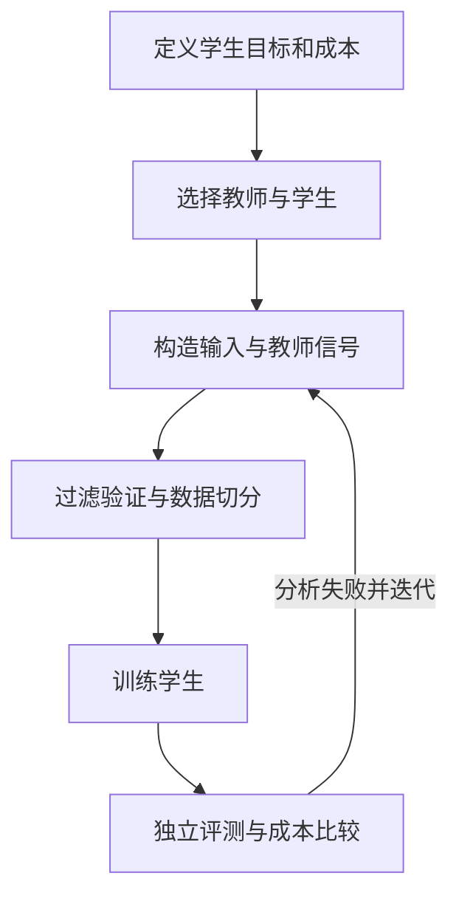

# 05 蒸馏：把教师能力转移到学生模型

蒸馏用教师模型或教师系统提供的信号训练学生。目标可以是降低延迟与成本，也可以把特定领域、格式、推理或工具使用行为转给更易部署的模型。它并非某个固定阶段：预训练、后训练和部署优化都可能使用蒸馏，也可以与 SFT 或强化学习交替。

## 传递什么

| 类型 | 教师提供 | 学生学习 | 适用条件和限制 |
| --- | --- | --- | --- |
| 序列蒸馏 | 最终回答或轨迹 | 将生成结果当作示范进行 SFT | 只需文本输出；教师错误与风格也会被学习 |
| 分布蒸馏 | 每一步 logits 或概率 | 对齐预测分布 | 需要教师分布；词表或 tokenizer 不一致时需要额外处理 |
| 中间表示蒸馏 | 隐藏状态、注意力或特征 | 对齐选定内部表示 | 需要内部访问，层数和维度不同须设计映射 |
| 在线或 on-policy | 学生生成的轨迹及教师反馈 | 学生自己容易遇到的状态 | 采样和教师评分成本高；具体方法与反馈形式不同 |
| 多教师与系统蒸馏 | 多个模型、工具或搜索结果 | 综合后的示范或反馈 | 需解决冲突、来源追踪和许可证问题 |

序列蒸馏与一般 SFT 的训练形式可以相同，区别在示范来自教师。概率分布包含教师对候选 token 的相对偏好，但不是保证提升的魔法信号。最简单的起点通常是建立教师样本与人工/规则验证的流水线；再用相同预算对比更复杂方法。

## 四个关键工程选择

**教师和学生。** 教师不一定对目标任务全面正确。先对教师做独立评估；学生的基础能力、词表、上下文和目标硬件同样决定结果。检查教师输出的使用条款、数据授权和学生模型许可证。

**输入分布。** 仅使用简单问题，学生可能在真实难题上失效。覆盖典型、边界和失败案例，按来源、难度和任务类型分层；保留按项目划分的独立测试集，避免教师生成过程看到测试答案。

**过滤与验证。** 代码任务可以执行测试，数学问题可以用校验器或多种方法检查；记录失败和不确定案例。通过公开测试并不保证正确，隐藏测试、人工抽样及副作用检查仍然必要。生成推理轨迹也需要核查过程是否可信，不能只因为答案正确就认定每一步正确。

**训练信号。** 序列蒸馏需要输入与教师输出；分布蒸馏需要更丰富的教师访问能力。在线方法让学生生成并由教师反馈，有机会降低固定示范与部署时状态之间的偏差，但需要更多采样和评分资源。[GKD 论文](https://arxiv.org/abs/2306.13649)；[TRL GKD 文档](https://huggingface.co/docs/trl/main/gkd_trainer)。后者接口处于实验区域，应固定版本核对。

## 贯穿实验：代码决策小模型

1. 以同一批未见仓库的任务评估原学生和教师，记录文件召回、误修改、端到端通过率、延迟和总成本。
2. 只在训练仓库上收集教师的定位与编辑建议；用静态检查、执行和人工抽检核查，保存模型版本、提示与来源。
3. 固定学生、训练 token 和预算，对比原始学生、人工示范 SFT、教师示范 SFT；若具备教师 logits，再加入分布蒸馏对照。
4. 在独立仓库评测质量与退化，统计分任务结果、失败案例、峰值显存、训练时间及每成功任务成本。若质量差异很小，重复实验并报告不确定性。
5. 如需进一步探索 on-policy，让学生产生轨迹并收集教师反馈；评估额外成本是否带来真实任务收益。

这是实验设计，尚未实际运行。教师样本、学生输出或测试通过均不能单独证明已掌握可靠修复能力。

## 真实案例与工具

[DeepSeek-R1 论文](https://arxiv.org/abs/2501.12948) 报告通过强模型生成的推理数据训练较小模型，是后训练阶段蒸馏推理行为的案例；其具体模型、数据和指标应按论文阅读，不能推断任意教师和学生均有相同收益。[NVIDIA Model Optimizer](https://nvidia.github.io/Model-Optimizer/guides/4_distillation.html) 提供蒸馏 API，也覆盖其他模型优化技术；[TRL](https://huggingface.co/docs/trl/main/gkd_trainer) 提供 GKD 相关训练器。是否支持某模型、词表或硬件需要按固定版本验证。

## 向下探索：软标签和损失

对同一个前缀，教师和学生产生 token 概率分布。分布蒸馏可以最小化两者之间的差异，例如 KL 散度；温度参数会改变分布的平滑程度，实践中通常还要明确损失方向、温度缩放和与标准交叉熵的权重。学生与教师词表不同时，不能直接把下标当作同一 token 比较。
