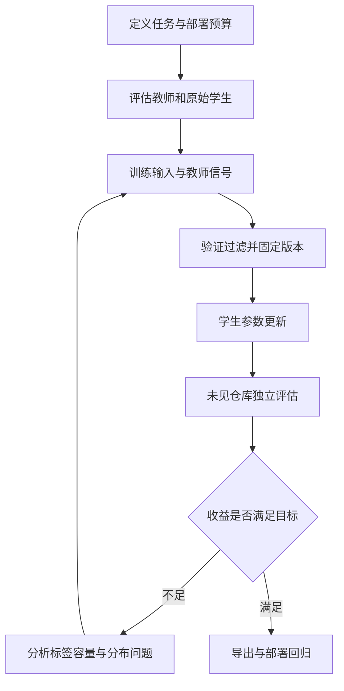
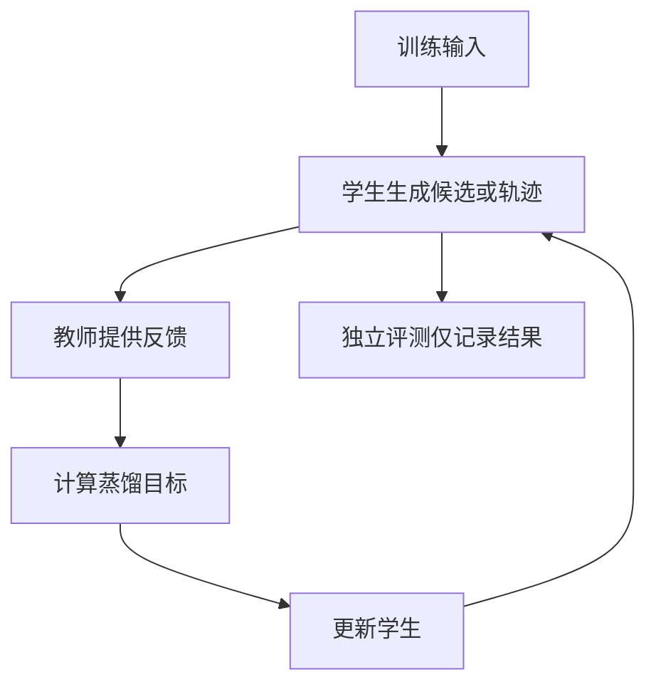

# 05 蒸馏：把教师能力变成学生可以使用的能力

假设团队有一个大型代码模型，能判断函数是在读取外部输入、执行危险操作，还是对输入做了可靠校验。现在希望把这项能力放进编辑器：每保存一个文件就分析一次，延迟最好短、成本可控，而且输出必须符合固定格式。直接调用大型模型可以做原型，却未必适合高频使用。我们希望训练一个小模型，专门完成这项决策。

这就是本章的贯穿案例。输入是一段函数和必要上下文，输出包括 `source`、`sink`、`sanitizer` 或 `other` 分类，以及证据位置。这里的标签是分析线索，不是漏洞结论：一个函数可能同时具有多种角色；所谓 sanitizer 是否有效还取决于后续操作、数据类型与调用环境。为了先讲清训练，我们将第一版任务限制为「在明确给定的分析规则下选择主要角色」，随后再扩展为多标签与上下文分析。

蒸馏的目标不是让学生在所有方面复制教师，而是把我们需要的行为转移到资源更少、部署更方便的模型。教师可以生成示范，也可以提供概率或中间表示；学生则用这些信号更新参数。蒸馏不保证成功：教师会犯错，学生容量有限，训练问题也可能与实际使用问题不同。只有独立评估能判断这次转移是否值得。

## 5.1 先把目标说清楚：压缩什么，保留什么

我们先定义一个部署约束：输入最多包含函数及少量调用上下文；输出为一个 JSON 对象；服务端必须能够校验字段；评估按未见仓库划分。接着建立两个基线：原始小模型和教师模型。假如教师本身经常把 `html.escape` 当作 SQL 参数化的替代，那么学生学习得再忠实，也只会把错误学得更稳定。

因此应先抽取一批人工审查样本，记录教师在哪些类型上可靠、在哪些类型上依赖缺失的上下文。比如 `request.args.get` 是外部输入线索，`subprocess.run` 的风险取决于参数形式和 `shell` 配置，而仅仅调用 `strip()` 通常不能证明数据对特定危险操作安全。分类规则应明确这些边界，并允许 `uncertain`，而不是迫使教师为每个片段给出自信答案。

这一准备决定了后续指标。总体准确率可能掩盖罕见类别的失败：如果九成函数都是 `other`，总猜 `other` 就能得到看似不错的成绩。应报告每类 precision、recall、混淆矩阵、证据准确性、格式错误和不确定覆盖率；如果最终用于辅助程序分析，还要观察它对下游分析的增益与误报，而不是把分类分数当作完整安全能力。

## 5.2 三类知识信号并不等价

| 信号 | 教师输出 | 学生如何学习 | 工程条件 |
| --- | --- | --- | --- |
| 序列示范 | 分类、解释或工具轨迹 | 把教师文本当作目标回答做 SFT | 教师 API 返回文本即可；要处理错误与模板偏差 |
| 概率分布 | 候选类别或每个 token 的概率 | 让学生分布接近教师分布 | 需要分布访问与标签/词表对齐 |
| 中间表示 | 隐藏状态、特征或注意力 | 对齐选定层的表示 | 需要内部访问和层/维度映射 |

这三类不是简单的由低到高。对于固定四分类任务，类别概率就可能是足够丰富且经济的信号；对于开放生成任务，完整词表分布更丰富，却会增加存储、通信和教师前向成本。中间表示的维度高，并不意味着它对学生的实际目标更有效。

[Hinton 等人的知识蒸馏论文](https://arxiv.org/abs/1503.02531)讨论软目标和温度；[DistilBERT](https://arxiv.org/abs/1910.01108)展示了将蒸馏用于语言模型预训练的具体方法。两者提供机制与实例，不能据此承诺任意教师—学生组合都有相同收益。



*图 5-1：蒸馏是一条带反馈的数据和模型流水线。评估集始终在生成与训练之外。*

## 5.3 序列蒸馏：先把正确示范做出来

最容易落地的做法是让教师为训练输入生成回答，然后用普通 SFT 训练学生。对我们的分类器，一条样本可以是：

```json
{"id":"train-017","repository":"repo-a","input":"def read_name(request):\n    return request.args.get('name')","answer":{"label":"source","evidence":"request.args.get","reason":"在本任务规则下，该调用读取 HTTP 请求参数。"}}
```

不要把长解释默认当成更好的监督。如果部署时只需要类别和证据，过长解释会增加生成成本，并可能引入学生需要学习的多余风格。可先比较「类别」「类别加证据」「类别加短解释」三个版本。在同样预算下，较短输出可能允许更多训练样本；较长输出也可能提供有用的中间监督，实际结果由任务决定。

教师生成流水线应保存原始输出，而不是只保留解析后的最终 JSON。否则当错误出现时，无法区分教师推理错误、解析错误和数据清洗错误。记录教师版本、提示词版本、采样参数、生成时间、输入哈希、验证结果和人工修订；教师版本改变之后，重新生成的数据也应有新版本。

以下程序展示一个可执行的数据验证边界。它不调用教师，也不执行输入代码；它读取教师已经生成的 JSONL，验证结构与证据，并去除相同输入的重复记录。真实代码归一化不应随意删除缩进，因此这里仅统一换行并去掉两端空白。

```python
# python validate_distill.py raw.jsonl clean.jsonl
import hashlib
import json
import sys
from pathlib import Path

ALLOWED = {"source", "sink", "sanitizer", "other", "uncertain"}
seen = set()
accepted = []
rejected = []

for number, line in enumerate(Path(sys.argv[1]).read_text().splitlines(), 1):
    try:
        row = json.loads(line)
        code = row["input"].replace("\r\n", "\n").strip()
        answer = row["answer"]
        if not code or not row.get("repository"):
            raise ValueError("缺少代码或仓库标识")
        if answer["label"] not in ALLOWED:
            raise ValueError("未知类别")
        evidence = answer.get("evidence", "")
        # 证据存在于输入中只证明位置可追溯，并不证明标签正确。
        if evidence and evidence not in code:
            raise ValueError("证据未出现在代码中")
        fingerprint = hashlib.sha256(code.encode()).hexdigest()
        if fingerprint in seen:
            raise ValueError("重复输入")
        seen.add(fingerprint)
        row["input"] = code
        row["input_sha256"] = fingerprint
        accepted.append(row)
    except (KeyError, TypeError, ValueError) as error:
        rejected.append({"line": number, "error": str(error)})

Path(sys.argv[2]).write_text(
    "".join(json.dumps(x, ensure_ascii=False) + "\n" for x in accepted)
)
Path(sys.argv[2] + ".rejected.json").write_text(
    json.dumps(rejected, ensure_ascii=False, indent=2)
)
print({"accepted": len(accepted), "rejected": len(rejected)})
```

这段程序只是格式与来源检查。它不能证明 sanitizer 真正安全，也不能发现改名后的近重复函数。训练前仍需按仓库或项目族划分，再检查镜像、复制代码和相邻提交。若先随机切分函数再去重，很容易让同一项目的高度相似片段同时出现在训练和测试中。

SFT 时还要明确损失范围：如果任务目标是回答分类，通常需要确认训练器对助手回答的监督符合预期，而不是无意中让模型主要学习复述输入代码。数据模板、助手边界、EOS 和截断规则必须与实际部署一致。[TRL 的 SFT 文档](https://huggingface.co/docs/trl/sft_trainer)说明数据格式、completion-only 或 assistant-only 等配置语义；具体选项应按锁定版本核对。

## 5.4 概率蒸馏：学习教师的犹豫

硬标签只告诉学生「答案是 source」。概率分布还可能告诉学生：「source 很可能，other 次之，sanitizer 几乎不可能」。这种相对关系有时比单一标签提供更多训练信号，尤其是边界样本。但如果教师犹豫是因为缺少上下文，学生不应被迫把不确定性解释为某种稳定的语义规律。

令教师与学生对类别的 logits 分别为 \(z_t\) 和 \(z_s\)，使用温度 \(T\) 得到概率：

\[
p_i^{(T)}=\frac{\exp(z_i/T)}{\sum_j\exp(z_j/T)}.
\]

温度较高时分布更平滑。一个常见训练目标把真实标签交叉熵与教师到学生的 KL 散度混合：

\[
L=(1-\alpha)L_{CE}+\alpha T^2 D_{KL}(p_t^{(T)}\Vert p_s^{(T)}).
\]

这里的 \(\alpha\) 控制两种目标的权重，\(T^2\) 是常见的梯度尺度补偿。不要把公式中的 KL 方向随意交换：两种方向对低概率区域的行为不同。也不要把教师分布直接当作真实标签；它只是一个有偏的训练信号。

下面的 PyTorch 函数实现固定类别分类任务的这一损失。输入必须是同一批样本、同一类别顺序的 logits。代码用于教学，尚未在本书环境运行；它不适合直接套到词表不一致的两个生成模型。

```python
import torch
import torch.nn.functional as F

def distillation_loss(student_logits, teacher_logits, labels,
                      temperature=2.0, alpha=0.5):
    if temperature <= 0 or not 0 <= alpha <= 1:
        raise ValueError("temperature 必须大于零，alpha 必须在 [0, 1]")
    if student_logits.shape != teacher_logits.shape:
        raise ValueError("教师和学生的批量、类别维度必须一致")
    # float() 让概率与损失计算使用 FP32，减少低精度下的数值问题。
    student_log_probs = F.log_softmax(
        student_logits.float() / temperature, dim=-1
    )
    # 教师在本步骤中只提供监督，不计算教师参数梯度。
    teacher_probs = F.softmax(
        teacher_logits.detach().float() / temperature, dim=-1
    )
    soft_loss = F.kl_div(
        student_log_probs, teacher_probs, reduction="batchmean"
    ) * temperature ** 2
    hard_loss = F.cross_entropy(student_logits.float(), labels)
    return alpha * soft_loss + (1 - alpha) * hard_loss
```

PyTorch 的 `kl_div` 接受对数形式的输入和默认普通概率形式的目标，上面对应的是教师到学生方向。[PyTorch KLDivLoss 文档](https://docs.pytorch.org/docs/stable/generated/torch.nn.KLDivLoss.html)。如果把这个函数扩到生成模型，必须只计算有效目标位置，正确处理 padding 和 mask；`batchmean` 的归一化也需根据实际 token 目标重新设计。

更隐蔽的问题是 tokenizer。教师的第 123 个词表元素与学生的第 123 个元素不一定表示相同文本。即使词表大小相同，token 边界也可能不同。固定类别任务可以先把教师信号映射到共同类别空间；开放生成任务则需要专门对齐策略，或者回到序列示范。把两个 logits 张量强行拼成相同形状并不解决语义对应关系。

## 5.5 为什么学生生成自己的轨迹很重要

离线蒸馏通常在教师写出的前缀上训练学生。然而学生部署时会产生自己的错误前缀：字段名拼错、判断过程走偏，或者遗漏了一个关键调用。在这些状态上，学生可能从未见过正确反馈。于是训练集里表现很好，真正生成时却逐步偏离。

On-policy 蒸馏的一种思路是让学生先生成，再由教师在学生实际访问的状态上提供指导。它与固定教师样本相比改变的是采样分布，并不意味着必然使用某一种 RL 算法。具体方法可能用 token 分布、修改后的示范或其他反馈；不能把所有在线反馈都叫成同一个算法。[GKD 原论文](https://arxiv.org/abs/2306.13649)研究了学生生成序列上的知识蒸馏；[TRL GKD 文档](https://huggingface.co/docs/trl/main/gkd_trainer)提供对应实现入口，接口成熟度和实验命名空间需按版本核对。



*图 5-2：在线蒸馏让训练覆盖学生访问到的状态。独立评测不参与教师反馈或参数更新。*

对我们的代码分类器，如果只生成一个类别，状态分布偏差相对有限；如果学生需要按工具调用检查文件、追踪调用者并输出证据，轨迹分布就更复杂。此时要保存工具响应、token 边界、模板与环境版本，并区分哪些 token 是模型生成、哪些是工具返回。把工具输出也当作学生必须预测的答案，可能改变训练目标并浪费预算。

在线方法的成本也更高：学生采样、教师前向、环境执行和参数更新需要协调。每个样本的序列长度差异会导致长尾等待；训练端和生成端的权重同步错误，会让所谓「当前策略」实际上使用旧参数。采用现成框架时，要检查它对版本、采样策略、权重同步和错误恢复的定义，而不只看支持算法的列表。

## 5.6 一次有解释力的实验怎样安排

第一轮不要同时更换模型、数据、模板、序列长度和优化器。先固定学生与训练预算，比较以下方案：原始学生、少量人工示范 SFT、教师示范 SFT，以及在条件允许时的概率蒸馏。在线方案作为第二轮，引入后单独记录额外采样与教师成本。

训练仓库和最终测试仓库应隔离，开发集用于选择超参数。若多次根据测试结果修改过滤规则，测试集已经参与开发，应另建最终保留集。每次结果至少包含样本数、逐类指标、格式错误、平均与尾部延迟、输入长度分布、失败实例及训练量。重要差异应做配对分析或重复实验，避免把少数样本波动写成稳定收益。

一个实用的成本口径是：

\[
C_{total}=C_{teacher\ generation}+C_{validation}+C_{student\ training}+C_{evaluation}+C_{serving}.
\]

教师成本不能只看生成 token：重试、过滤失败和人工抽检也需要计入。部署节约则取决于实际调用次数和学生所需重试。如果学生只有通过多次采样才能接近教师，小模型单次便宜并不意味着每个成功任务便宜。盈亏平衡可以用「前期蒸馏成本 ÷ 每次调用节省」作粗估，但两条路线的任务质量必须先满足同一个最低要求。

## 5.7 失败时不要立即换算法

| 观察到的现象 | 可以检查的原因 | 有解释力的下一步 |
| --- | --- | --- |
| 训练损失下降，未见仓库不提升 | 重复、项目特征泄漏、训练分布过窄 | 按仓库族重切分，并逐类抽查 |
| 学生稳定复现教师错误 | 教师标签有系统偏差 | 建人工审查集，对教师先评估和修订 |
| JSON 正确但证据错误 | 只学格式或证据监督不足 | 单独测证据定位，增加反例而非只加解释长度 |
| 稀有类召回差 | 数据不平衡、规则不明确 | 分类别评测，检查采样和标签一致性 |
| 概率蒸馏不如 SFT | 类别/词表不对齐、温度与权重问题 | 用小批次检查分布、损失和梯度 |
| 在线训练不稳定 | 反馈噪声、旧权重、轨迹 mask 或长尾 | 固定小任务回放并检查同步与有效 token |

每种排查都应尽量减少变量。比如怀疑教师输出格式造成问题，可以先使用一小批人工校验标签，判断学生是否有能力拟合；怀疑模型容量不足，可以比较较大一点的学生，但保持数据与预算口径一致。不存在一条保证成功的蒸馏配方。

## 5.8 真实方案怎样阅读

[DeepSeek-R1 论文](https://arxiv.org/abs/2501.12948)提供了从强推理模型生成数据并训练较小模型的案例。阅读时应区分其教师训练过程、生成数据、学生初始化与具体评测；不能把「蒸馏模型」误解为把教师参数直接缩小。[NVIDIA Model Optimizer 蒸馏指南](https://nvidia.github.io/Model-Optimizer/guides/4_distillation.html)提供教师—学生训练接口；[NeMo AutoModel](https://docs.nvidia.com/nemo/automodel/get-started/key-features)也列出知识蒸馏能力。是否支持目标架构、词表、精度和导出路径，仍须核对固定版本。

最后检查授权边界：教师模型许可、API 服务条款、输入数据许可和学生基座许可是不同层次的问题。允许调用教师并不自动意味着允许用其输出训练任意模型；公开可下载的学生基座也不代表没有使用限制。把来源与许可写进实验记录，才能让最终模型具有可追溯性。

本章的代码与流程是可审查的教学设计，并未声称已经完成教师生成或 GPU 训练。实践时先用几十个明确案例打通输入、标签、loss、保存恢复和独立评测，再扩大数据规模。蒸馏的价值应由学生在目标约束下完成任务的证据证明，而不是由教师有多大或工具链有多新来证明。
