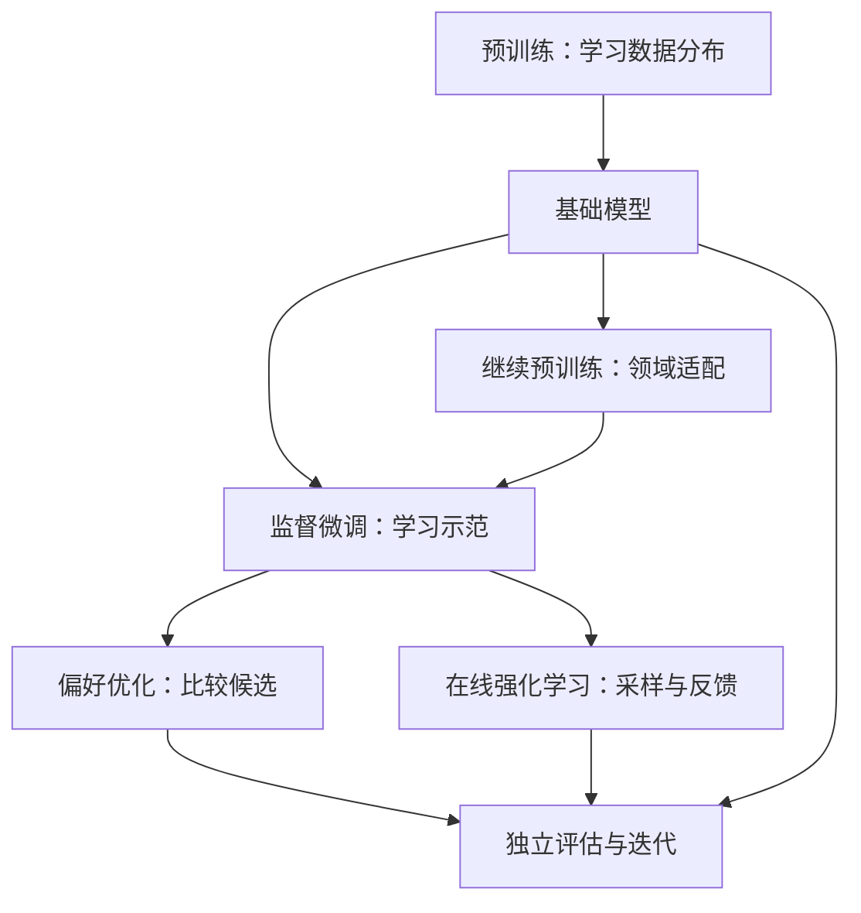
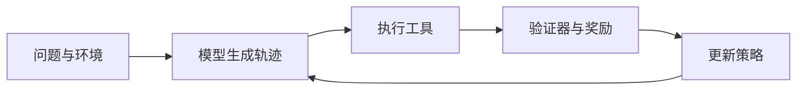

# 08 从预训练到后训练：目标、数据与反馈

训练阶段的名称常常造成一种错觉：只需把几段算法按顺序连接，就能得到高质量模型。实际每一阶段解决不同问题，也有不同的输入、质量门槛和成本。先把训练视作对模型行为的一次干预：想改变什么，准备什么信号，用什么方法更新，以及如何证明收益？



图 8-1：常见关系示意。路径可跳过、分支或重复；蒸馏可以在不同阶段介入，详见第 05 章。并非所有模型都依次经过这些步骤。

| 阶段 | 典型输入 | 更新时的信号 | 首要工程问题 |
| --- | --- | --- | --- |
| 预训练 | 大规模文本或多模态序列 | 从数据构造预测目标 | 数据配比、算力、稳定性 |
| 继续预训练 | 领域或新语言语料 | 常仍为下一个 token | 特化收益与通用能力遗忘 |
| SFT | 输入与高质量示范 | 目标回答的 token | 数据真实性、模板及损失掩码 |
| 偏好优化 | 同一输入的优劣候选 | 比较结果 | 偏好标准、负样本与噪声 |
| 在线 RL | 问题、环境和可采样策略 | 采样轨迹的奖励 | 奖励可靠性、吞吐和泛化 |

## 8.1 预训练：先建立语言和任务的基础

以自回归语言模型为例，训练文本经分词得到 token 序列 $x_1,\ldots,x_T$。模型根据前面的 token 预测下一个 token，最常见的目标是最大化序列中各目标 token 的条件概率，等价于最小化负对数似然：

$$L_{\mathrm{NTP}}=-\frac{1}{N}\sum_{t\in M}\log p_\theta(x_t\mid x_{<t})$$

其中 $\theta$ 是参数，$M$ 是参与损失的位置集合，$N=|M|$。这个公式说的是：真实下一个 token 的概率越低，该位置的惩罚越大。分布式训练中要明确归一化方式；不同长度的样本以样本数还是有效 token 数加权，可能改变实际优化目标。它也不是所有架构和模态共同的唯一训练目标。

数据治理先于堆算力。模型看到的数据混合比直接影响它在哪些分布上学习：例如提升代码比例可能改善代码建模，但如果减少自然语言、数学或多语数据，收益和代价必须在保留的独立评测上比较。去重及来源过滤不只节省计算，还影响评测污染；单靠训练 loss 无法证明模型泛化。

大规模训练往往把文本切成固定长度块并分配给 GPU。工程上需明确跨文档拼接时的边界标记、注意力是否跨文档、截断与短样本利用率；不同实现的 packing 语义可能不同。训练日志至少包括有效训练 token、loss、学习率、梯度范数、吞吐、峰值显存以及检查点和数据游标。恢复时需要优化器、调度器、随机数状态及数据进度，而不只是模型权重。

**算力规划并非固定公式。** Chinchilla 研究了固定训练计算量下模型规模和训练 token 之间的经验关系，其假设不等于所有真实部署的最优选择；推理调用量、数据质量及延迟也影响最终决策。[Hoffmann 等，2022](https://arxiv.org/abs/2203.15556)；[推理约束下的缩放](https://arxiv.org/abs/2401.00448)。

## 8.2 继续预训练：改变熟悉的分布

继续预训练从现有基础模型出发，用新的无标注语料继续训练。例如，为代码决策器增加公司允许使用的代码与技术文档，让模型更熟悉项目术语和语言。**熟悉领域文本与会按要求完成任务是两件事**：继续预训练产生的模型可能需要 SFT 才能稳定输出指定格式。

容易遗漏的风险是遗忘：领域指标提升的同时，通用语言或其他已有能力下降。应在训练前准备通用集、领域集和最终应用测试集，固定各自用途。训练时可比较领域数据和通用数据混合比例，但不能假设某种混合必然防止遗忘。若知识变动频繁，还应与检索增强比较：检索可以更新外部资料，继续预训练则涉及重新训练和部署。

## 8.3 监督微调：把示范变成可学习的样本

SFT 的核心样本是一个上下文和期望的回答。对于多轮对话和工具任务，样本还需要区分 system、user、assistant 和 tool。消息边界、工具调用格式和结束 token 必须与实际推理模板相符，否则训练时看见的交互方式与部署时不同。

以下为**数据结构示意**，并非可直接训练的完整脚本。示例展示代码 Agent 的合法工具使用思路，不代表已验证的训练数据：

```json
{
  "messages": [
    {"role": "user", "content": "定位订单总价计算的入口文件。"},
    {"role": "assistant", "content": "先检查订单服务中计算总价的函数，再核对测试覆盖。"}
  ]
}
```

训练时需要决定用户输入是否也参与损失。若目标是学习回答行为，可以只计算 assistant 响应位置的 loss；但 mask 必须与选定的聊天模板及工具消息结构匹配。以 TRL 为例，`assistant_only_loss` 面向对话数据，具体模板能否正确产生 assistant mask 应按版本和模型验证；请抽样打印 token、角色边界和最终 labels。[TRL SFT Trainer](https://huggingface.co/docs/trl/main/sft_trainer)。

数据处理器通常把忽略的位置设置为 `-100`，训练代码示意如下。此例只展示标签构造原则，省略 tokenizer、padding 和真正的模型调用；不同模型的因果语言建模实现可能在内部完成标签移位，避免重复移位。

```python
# 已经按聊天模板编码；mask 为 True 的位置才参与回答损失。
input_ids = [101, 21, 22, 102, 31, 32, 103]  # 仅为示意 ID
assistant_mask = [False, False, False, False, True, True, True]
labels = [token if keep else -100
          for token, keep in zip(input_ids, assistant_mask)]
# labels: [-100, -100, -100, -100, 31, 32, 103]
```

**必须检查结束符。** 若真实模板要求模型学习何时结束回答，但 mask 把结束符排除，可能影响生成终止；结束符如何标注因模板及任务而异。若打包多个样本，检查边界、注意力屏蔽以及是否存在一个样本读取另一条样本的问题；packing 能减少 padding，但其具体行为取决于实现。[TRL packing 文档](https://huggingface.co/docs/trl/main/sft_trainer)。

全参数训练更新整个模型；LoRA 冻结基础参数并训练低秩增量，常能降低优化器状态开销。它不消除长上下文激活占用、基础模型权重和通信开销。将它与全参方案比较时，应固定基础模型、数据、训练 token、评测及硬件；参见 [LoRA 原论文](https://arxiv.org/abs/2106.09685) 和 [QLoRA 原论文](https://arxiv.org/abs/2305.14314)。

## 8.4 从示范到偏好：DPO 与奖励模型

有时两条回答都语法正确，但一条更安全、准确或符合业务流程。偏好数据将同一输入 $x$ 与优选回答 $y_w$、较差回答 $y_l$ 配对。标注规范需要说明评价维度、冲突时优先级、平局或不可判断如何处理。优劣必须共享可比较的输入上下文；若较差回答只是无意义乱码，模型可能只学会识别明显坏答案。

奖励模型方法先由比较数据训练打分器，再用分数作为策略优化的反馈。DPO 则直接使用偏好对和参考模型优化策略，避开单独训练奖励模型与在线 RL 的必经流程；它依赖其建模假设，不能保证自动消除偏见或对所有偏好任务都最好。[DPO 原论文](https://arxiv.org/abs/2305.18290)；[TRL DPO 文档](https://huggingface.co/docs/trl/main/dpo_trainer)。

工程检查包括：候选生成方式、参考模型版本、响应截断、偏好标签质量，以及 SFT 和 DPO 所用数据是否泄漏测试集。评估时不应仅盯住训练对上的偏好准确率：还应测实际任务、输出长度变化、通用能力、拒答行为和误伤率。

## 8.5 在线强化学习：让模型在环境中获得反馈

在线 RL 从当前策略采样回答或多步轨迹，获得奖励后更新策略。对于代码 Agent，环境可能提供文件系统和测试程序；奖励可能基于任务测试、格式或副作用。要注意，一个奖励分数只是评估器观察到的代理信号：通过某个测试并不能证明代码对所有输入正确。



图 8-2：在线训练的一次反馈环。生产系统中还要处理采样与训练之间的模型版本、失败重试、环境隔离和日志。

PPO 是一种常见策略优化方法；GRPO 使用同一问题的多个样本计算组内相对优势，减少对单独价值模型的依赖，但具体变体的归一化、裁剪、KL 与损失计算可能不同，需阅读所用实现。[DeepSeekMath](https://arxiv.org/abs/2402.03300)；[TRL GRPO 文档](https://huggingface.co/docs/trl/grpo_trainer)。同组奖励差异很小、验证器错误、或模型学会取巧时，训练指标都可能误导。

实际流程还必须管理训练与生成的资源分配：生成服务器、环境容器和 GPU 训练器并不总是同一个进程。权重同步、采样版本滞后、tokenizer 和聊天模板一致性、被截断的轨迹、超时和环境重置都影响结果。`vLLM` 可作为 rollout 生成引擎；它与负责优化策略的 RL 框架属于不同层。[vLLM RLHF 文档](https://docs.vllm.ai/en/latest/training/rlhf/)。

## 8.6 如何安排对照实验

以代码任务决策器为例，固定同一基础模型、测试集和目标部署环境，依次建立以下比较。各组资源预算不必完全相同，但必须同时报告数据量、GPU 时间和推理成本，否则“更好”没有明确含义。

| 对照组 | 训练信号 | 主要回答的问题 |
| --- | --- | --- |
| 不训练基线 | 无 | 提示词和检索已能解决多少问题？ |
| SFT | 已验证示范 | 示范是否提高文件召回与任务通过率？ |
| 偏好优化 | 同题优劣对 | 是否改善容易混淆的策略选择？ |
| 在线 RL | 环境奖励 | 与 SFT 相比，多步反馈是否带来增益？ |

建议按仓库分离训练、开发和最终测试，并记录相同任务上的成功率、错误编辑、成本、置信区间和失败类型。多次调参使用开发集，最终测试集不应反复用于选择方案。若计算资源不足，可以先做较小的 SFT 实验，明确未开展的对照，不编造数值。

**本章代码和流程用于解释，尚未在本书环境中运行训练；生产配置需固定库版本、模型、数据与硬件并单独验证。**
