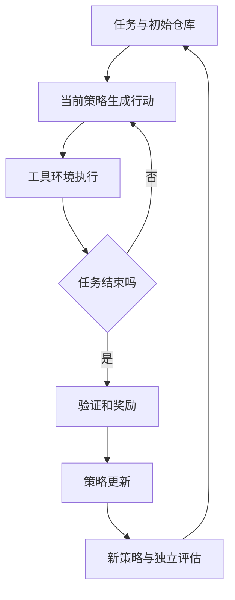

# 08 训练方法：从一条样本理解预训练、SFT、偏好与强化学习

假设我们有一个代码助手。用户报告「日期解析函数把空字符串当作今天」，助手应该先定位相关函数，再决定是否需要编辑，最后运行测试。模型目前会流畅地解释日期，却经常猜测不存在的文件。团队于是提出「再训练一下」。问题在于，训练什么信号？把更多代码交给它、给它正确示范、比较两条修复路线，还是让它实际尝试并根据测试结果学习？这四种选择对应不同目标，不应混为一个笼统的微调按钮。

本章围绕这个案例说明学习目标如何决定数据、损失和工程流程。代码是明确假设下的教学实现；没有在本书环境运行 GPU 训练，不能直接作为某个具体框架版本的生产配置。我们先从同一问题构造不同训练样本，再讨论为什么损失下降有时没有换来正确修复。

## 8.1 先分清：模型看到什么，哪些位置受监督

自回归语言模型对一串 token 依次预测下一个 token。令序列为 $x_1,\ldots,x_T$，模型给出条件概率 $p_\theta(x_t\mid x_{<t})$。训练目标可以写成：

$$L=-\frac{\sum_t m_t\log p_\theta(x_t\mid x_{<t})}{\sum_t m_t}.$$

$m_t$ 是监督掩码，值为 1 表示这个位置计入损失。模型可能看得到某个 token，却不必在这个位置接受训练目标。例如用户问题需要作为上下文输入，但在只监督助手回答的 SFT 中，用户问题位置的 $m_t$ 为 0。这个区别非常关键：attention mask 控制模型能看哪些位置，loss mask 控制哪些预测产生梯度，两者作用不同。通常用标签值 `-100` 表示忽略位置，但具体格式应遵循训练器约定。[Transformers 因果语言模型教程](https://huggingface.co/docs/transformers/tasks/language_modeling)；[TRL SFT 文档](https://huggingface.co/docs/trl/sft_trainer)。

以一个简化序列为例：

| 位置 | 内容 | 是否作为上下文 | 是否监督 |
| --- | --- | --- | --- |
| 1–4 | 系统与用户消息 | 是 | 否 |
| 5–6 | 助手开始标记 | 是 | 按模板定义 |
| 7–12 | `检查 date_parser.py` | 是 | 是 |
| 13 | 助手结束标记 | 是 | 是 |
| 14–16 | padding | 否 | 否 |

不要用字符串搜索「assistant」切标签：这个词可能出现在代码或用户输入中，模板还可能包含工具角色与特殊 token。应使用 tokenizer/模板支持的角色边界，或在构造样本时保留可靠的 token 范围，并打印样本核查。

## 8.2 预训练：学习分布，还不是学习任务完成

如果原始仓库里有许多日期处理实现，预训练样本可能就是：

```python
def parse_date(value):
    if value == "":
        raise ValueError("empty date")
```

模型在这里学习的是给定前文如何继续代码。它可能学到 Python 语法、异常模式、库调用习惯，以及空字符串通常应如何处理。可是这条数据没有告诉它「用户报告 bug 后，应该先搜索文件，不能凭空发明路径」。那是另一层行为。增加领域代码可能改善预测损失，却不一定改善任务执行流程。

预训练时通常监督大量有效文本位置，数据范围和混合比例影响模型学到的分布。从零训练还要承担架构、tokenizer、初始化和稳定性等成本；继续预训练从已有参数开始，通常用于领域或语言分布适应。DAPT/TAPT 研究给出了领域与任务相关无标签数据的适应思路，但具体收益取决于基座、数据和评测，并非普遍保证。[Gururangan 等，2020](https://arxiv.org/abs/2004.10964)。

一个容易忽略的问题是长度与边界。如果把两个文档拼在一起而允许后文关注前文，训练器实际上引入了跨文档上下文。某些训练流程接受这种做法，另一些需要隔离样本注意力。Packing 提升有效计算比例，但不能只检查「padding 变少」，还要检查位置编码、边界和 loss 的语义是否符合预期。

## 8.3 SFT：把正确行为示范给模型

对于日期 bug，SFT 样本可以是一个完整交互：用户提供报告和文件列表，助手先调用搜索工具，工具返回函数位置，助手检查代码并形成编辑方案。若我们只想训练文件定位器，也可以将输出收窄为 JSON：

```json
{
  "messages": [
    {"role": "user", "content": "空日期输入不应变成今天。候选文件：src/date_parser.py、src/logger.py。"},
    {"role": "assistant", "content": "{\"files\":[\"src/date_parser.py\"],\"action\":\"inspect\"}"}
  ]
}
```

这里正确行为不是「直接声称修复完成」，而是根据可见证据定位并检查。训练目标仍是预测 token，但数据分布把这些 token 组织成了期望行为。若训练样本普遍跳过检查、直接给答案，模型就有理由学会相同捷径。

### 看懂交叉熵的梯度

假设模型面对三个可选文件，给出的概率分别为 0.2、0.5、0.3，正确答案是第一个，那么损失为 $-\log0.2\approx1.609$。若训练后概率变为 0.6、0.25、0.15，损失下降到约 0.511。对于 softmax 输出，目标 logit 的梯度为「预测概率减去目标指示值」：正确项为 $0.2-1=-0.8$，梯度下降会提高其分数；错误项梯度为正，会降低其分数。这给出了直觉：模型被推向训练数据中的答案，而不是被直接赋予一个文件搜索算法。

下面用 PyTorch 展示 causal LM 损失。假设 `logits` 的形状是 `[batch, sequence, vocabulary]`，`labels` 是原序列的 token ID，忽略位置设为 `-100`。具体模型类常已内部完成位移，使用其 `.loss` 时不要再手动位移一次。

```python
import torch
import torch.nn.functional as F

def causal_lm_loss(logits, labels):
    # 位置 t 的输出用于预测位置 t+1；最后一个位置无后继目标。
    prediction = logits[:, :-1, :].contiguous()
    target = labels[:, 1:].contiguous()
    valid = target.ne(-100)
    if not bool(valid.any()):
        raise ValueError("当前批次没有任何有效监督 token")
    # reduction=sum 后除以有效目标 token 数，明确归一化口径。
    total = F.cross_entropy(
        prediction.view(-1, prediction.size(-1)),
        target.view(-1),
        ignore_index=-100,
        reduction="sum",
    )
    return total / valid.sum()
```

这段代码解释了 loss 的计算，却还没有覆盖分布式全局归一化。多个 rank 的有效 token 数不同时，简单平均各 rank 的平均损失，未必等于全局所有有效 token 的平均。需要依据框架如何归约梯度来实现正确缩放，并用小样本与单设备结果对照。[PyTorch CrossEntropyLoss](https://docs.pytorch.org/docs/stable/generated/torch.nn.CrossEntropyLoss.html)。

### 为什么训练准确率高，实际仍会猜文件

可能原因包括：训练仓库与测试仓库重叠，模型记住路径；输入始终含有准确文件名，部署时却只含模糊报告；负例太少，模型不会选择「证据不足，继续搜索」；标签总是只有一个文件，实际任务需要多个模块。处理这些问题需要改样本覆盖和评估协议，而不是继续降低 loss。

应做可解释的对照：保持基座、token 预算和训练配置不变，比较只包含成功答案的数据、包含定位过程的数据、包含失败后纠正的数据。使用未见仓库评测，并统计错误文件、漏文件、无证据猜测和修复通过率。训练过程的选择应由这些差异支持。

## 8.4 全参、LoRA 与量化训练：改变更新方式，不替代目标设计

全参数训练允许所有可训练权重更新。LoRA 则给某些线性层增加低秩更新 $\Delta W=BA$，冻结基础权重，只学习较小矩阵。它减少可训练参数、梯度和优化器状态，但基础模型权重和激活仍占显存。QLoRA 将冻结基础模型以低比特表示并训练适配器，需要相应量化内核与硬件支持。[LoRA](https://arxiv.org/abs/2106.09685)；[QLoRA](https://arxiv.org/abs/2305.14314)。

如果数据本身把错误文件标为正确，LoRA 会学习错误标签，全参也一样。若学生模型基础能力不足，增加 rank 也不一定弥补。应先检查是否真的只有预期参数可训练，再检查梯度与权重是否变化，随后比较独立任务效果。

`rank` 决定低秩更新容量，`alpha` 和具体实现的缩放规则影响更新幅度，目标模块决定更新哪些层。这些不是孤立的好坏旋钮：同样 rank 在不同架构、模块与训练预算下意义不同。优先使用模型适配器支持的配置，在小规模验证后改变一项变量，并保留对照。不要仅凭能装进显存就宣布配方成功。

## 8.5 偏好优化：当我们知道哪个答案更好

对于同一报告，我们得到两个候选：A 先搜索日期解析实现，再检查空输入分支；B 直接修改日志模块。标注者能指出 A 更好，但未必能写出完美修复。偏好数据将它表达为同一 prompt 下的 `chosen` 与 `rejected`。两条回答必须拥有相同的条件信息，否则比较可能只是奖励额外信息。

DPO 用当前策略与参考策略的序列对数概率构造相对优势。令 $y^+$ 为优选回答、$y^-$ 为较差回答：

$$z=\beta[(\log\pi_\theta(y^+|x)-\log\pi_{ref}(y^+|x))-(\log\pi_\theta(y^-|x)-\log\pi_{ref}(y^-|x))],$$

$$L_{DPO}=-\log\sigma(z).$$

直觉上，模型应比参考策略更偏向被选中的回答，而不是无约束地增加所有长回答的概率。参考策略通常固定；序列对数概率如何求和、mask 与长度处理需要与实现一致。$\beta$ 参与偏好目标的尺度，不能脱离实现与数据直接套用。[DPO 原论文](https://arxiv.org/abs/2305.18290)；[TRL DPO 文档](https://huggingface.co/docs/trl/dpo_trainer)。

```python
import torch.nn.functional as F

def dpo_loss(policy_chosen, policy_rejected,
             reference_chosen, reference_rejected, beta=0.1):
    # 输入为每条回答的 log probability，而不是原始 token logits。
    # 参考模型固定；调用方必须保证相同 prompt 和正确回答 mask。
    policy_gap = policy_chosen - policy_rejected
    reference_gap = reference_chosen - reference_rejected
    margin = beta * (policy_gap - reference_gap)
    return -F.logsigmoid(margin).mean()
```

这个小函数不是完整 DPO trainer：它没有分词、序列打包、参考模型计算或分布式处理。它的价值在于揭示优化对象。如果标注者总选更长、更礼貌的回答，即使其路径错误，训练会学会这些偏好捷径。应将定位正确性、证据、编辑范围和格式分开评价，抽检标注分歧；在不含风格暗示的样本上评测。

## 8.6 在线强化学习：让当前模型承担自己的轨迹

离线数据通常由旧模型或教师生成。在线 RL 的重要区别是由当前策略采样，然后对这些轨迹给反馈。对于代码助手，一次 rollout 可能包含搜索、读文件、编辑和执行测试。奖励可来自测试、静态检查或人工评价，但它只衡量你定义的那部分目标。



如果奖励只看公开测试通过，模型可能删除测试或硬编码答案。如果奖励只看文件名命中，模型可以输出所有文件获得高召回。如果奖励包含格式，模型可能学会完美 JSON 却没有正确判断。应限制不当副作用、使用独立隐藏任务、记录轨迹并人工审查；奖励本身还应有测试。

PPO 等方法通过策略梯度更新生成策略，常使用概率比与裁剪限制单次更新幅度。GRPO 类方法为同一问题采样一组回答，利用组内奖励形成相对反馈，减少对某些价值估计组件的依赖；具体变体在标准化、损失归一化、长度处理和 KL 项上可能不同。[PPO](https://arxiv.org/abs/1707.06347)；[DeepSeekMath](https://arxiv.org/abs/2402.03300)；[TRL GRPO](https://huggingface.co/docs/trl/grpo_trainer)。

假设同一问题四条轨迹的奖励为 `[0, 0, 1, 1]`，它们有区分信号；若为 `[0, 0, 0, 0]`，组内相对奖励无法告诉模型哪条更有希望。此时不能只盲目增加训练步数，应检查任务难度、采样多样性、初始能力和奖励覆盖。若所有回答都成功，也可能已经饱和或测试过于宽松。组内方差不是最终能力指标。

### RL 工程中多出来的成本

SFT 通常读已有样本；在线 RL 还要生成、调用工具、等待环境和验证。长轨迹使生成成本上升，环境超时会拉长尾部，训练和采样模型权重还需要同步。记录训练 token/s 与 rollout token/s、环境执行时长、每任务采样数量、通过率和总成本。单看 GPU 训练吞吐不能判断整个流水线效率。[verl Agentic RL](https://verl.readthedocs.io/en/latest/start/agentic_rl.html)。

## 8.7 如何选择下一步实验

假设基线定位正确率低，先抽查失败。如果模型缺少仓库信息，增加检索比训练可能更直接；如果证据足够却输出不稳定，SFT 是可检查的起点；如果多条合理路线难以排序，偏好优化可利用比较信号；如果任务可执行、结果可验证，而且已有策略能产生一定比例的有效轨迹，在线 RL 才可能获得有用反馈。蒸馏则能够为这些阶段提供教师示范或概率信号，并不只能放在最后。

每次实验至少保留基座基线、同预算训练对照和独立测试。将数据修改、算法修改与工程加速分开：否则效果提升后无法知道究竟来自更好数据、更多训练 token，还是新方法。评测同时报告错误类型与成本，不能只用一条总分掩盖退化。

本章的核心不是让读者记住方法缩写，而是学会沿着「数据给了什么证据—损失奖励什么行为—系统实际更新了什么—独立任务是否改善」逐层检查。把这条链路打通，才能在面对新的训练算法时判断其解决了哪个问题，以及是否值得引入自己的工程。

## 8.8 把一次失败实验拆开检查

现在设想团队已经做完一轮 SFT。训练损失下降了，输出 JSON 的比例从较低水平提高，但端到端修复率没有变化。这里不引用虚构成绩，而是说明诊断过程。第一步不是换算法，而是把端到端任务拆开：输入是否包含正确文件？模型是否选中正确位置？是否生成合理编辑？编辑后是否真的运行测试？测试是否足以覆盖报告的问题？每一环都有可能吞掉前一环的收益。

如果文件定位准确率提高，而修复率没提高，说明训练目标可能只解决了前半段。应保留定位器改进，单独分析编辑失败，而不是宣布整个 SFT 无效。如果格式正确率提高，但定位仍然随机，说明模型主要学到输出形式；可能标签本身不可靠、输入缺少判别信息，或简单模板在训练中占据太多有效 token。可以按回答内容切片计算损失，但切片损失也只是诊断指标，最终还要回到真实任务。

再设想 DPO 后模型更少提出检查步骤，更常直接给出一份自信修复。可能偏好标注倾向选择简洁完整的回答，间接惩罚了合理的不确定性。抽取相同问题下的优劣对，遮住长度与语气后重新比较事实正确性。若标注者意见变化，问题就在偏好定义，而不一定在优化器。调整数据时保留旧版数据和模型，以确认行为变化确实来自新的评价标准。

在线 RL 的失败则可能更加隐蔽。训练奖励持续上涨，隐藏任务成绩却下降，意味着策略可能利用训练环境特征。检查奖励最高的轨迹，而不仅检查失败轨迹：它们是否使用异常路径、读取不该读取的缓存、修改测试或对输出格式作投机处理？奖励验证器与最终验收器应尽可能分离；发现漏洞时，先修正环境和数据，再决定是否继续该策略，而不是把已经学到的漏洞当作正常能力保存。

## 8.9 数据量、训练量与难度如何相互影响

更多数据不一定意味着更多独立信息。同一模板换几个变量名可以产生大量样本，却没有扩大任务结构的覆盖。代码定位器若只见过「报错函数名直接出现在文件名」的题目，即使训练样本很多，也可能无法处理间接依赖。应按失败机制构建分类：缺少符号名、跨文件调用、配置错误、测试误导、重复实现、报告与根因距离较远等。每类样本都要有可核查标签，并在不同仓库上检查迁移。

训练量同样不能只用 epoch 比较。两个数据集的平均回答长度不同，相同 epoch 会产生不同数量的监督 token；长轨迹还包含更多工具输出，其中一些位置可能不参与损失。比较方案时记录输入 token、有效目标 token、优化步数和实际运行时间。对于只监督助手回答的配置，许多用户和工具 token 占用了计算，却没有直接成为预测目标，这种成本应该在预算中体现。

难度影响信号的有效性。过于容易的 SFT 样本可能主要重复模型已有行为，过于困难且答案质量差的样本又会引入错误。RL 中所有采样都失败的题目不一定完全无用，但当前奖励形式可能没有提供足够区分。可以先使用可验证的子任务或教师示范提高初始成功率，再逐步扩大任务长度；这种课程安排需要通过独立难度分层测试，防止只是把训练题变容易而误以为能力增强。

## 8.10 做一次能被别人审查的方法比较

设计一个最小比较，不必同时训练所有算法。选择固定基座、相同 tokenizer 与模板，以及一组未见仓库任务。第一条路线不训练，只使用固定提示和检索；第二条路线使用经过审查的示范做 SFT；第三条路线在第二条模型上增加偏好优化。若要比较 RL，另外明确采样预算、环境调用预算和奖励计算成本，不要只给训练 GPU 小时。

在实验开始前写下验收：每个任务允许多少次尝试，是否可以联网，工具版本是什么，测试执行环境如何重置，超时算失败还是基础设施错误。基础设施失败应单独记录，但不能任意剔除不利样本。对相同任务保存各模型的成败结果，就能够看到哪些任务从失败变成功，哪些从成功退化；只比较两个总通过率会丢掉这层信息。

当预算允许时重复训练或至少重复采样，以区分优化随机性和生成随机性。对小测试集，几个任务就可能显著改变总分，因此报告样本量、配对结果和不确定性比给出很多小数位更诚实。最终模型选择还要考虑显存、延迟、维护复杂度和失败成本；质量相近时，较简单的流程可能更适合长期维护。

保留一份实验卡：问题、假设、基线、数据版本、训练目标、可训练参数、学习率、批量和归一化方式、训练 token、检查点、评测协议、成本、结果与失败分析。这份记录使后续工具升级有参照，也能避免几周后只剩下一个名为 final 的模型目录。方法名称只是实验卡中的一项，完整的证据链才是工程结论。

阅读本章之后，可以拿任意一条自己的训练样本逐项检查：可见上下文是否足够，目标是否唯一或合理，标签是否错误奖励了捷径，测试是否真正对应产品需求。这个检查通常比马上更换一个新算法更能发现实际问题，也为后续蒸馏和单卡实验建立了共同语言。
