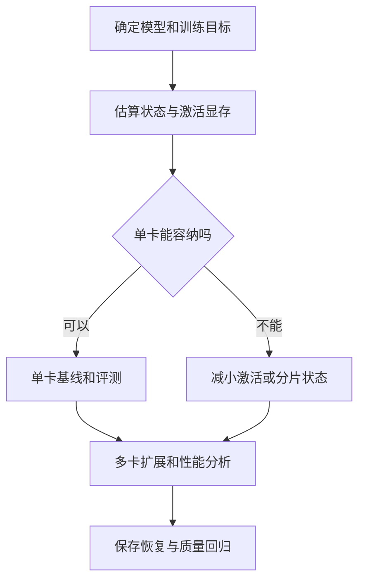

# 09 训练系统：从一张卡到多机集群

一套训练配置首先要回答三个问题：模型和训练状态能否放下？每次更新是否符合预期？算力花在哪里？只有回答完这些问题，才有意义比较吞吐或增加 GPU。一个能启动的作业也不等于一个正确的作业：梯度同步、数据分片、恢复位置和评测都可能悄悄出错。

本章先给出估算和排障方法，再介绍数据、张量、流水线、上下文及专家并行。图中的箭头说明依赖，不代表每次训练都需要所有步骤。官方文档随版本更新，运行前应固定框架版本、镜像、驱动和模型实现。以下示例用于说明，未在本书环境实测。



## 1. 显存花在哪里

训练显存不只是模型权重。一个简化账本是：

| 项目 | 作用 | 主要影响因素 |
| --- | --- | --- |
| 参数 | 保存模型权重 | 参数量、精度、量化和是否分片 |
| 梯度 | 保存反向传播结果 | 可训练参数量、精度、分片策略 |
| 优化器状态 | 保存例如 Adam 的一阶与二阶矩 | 优化器、状态精度、可训练参数和分片 |
| 激活值 | 保存前向计算中反向所需的中间结果 | batch、序列长度、层数、网络结构与检查点 |
| 临时空间 | 算子工作区、通信缓冲、allocator 预留等 | 框架、算子、形状、并行策略和执行时机 |

**一个估算练习。** 假设 7B 个参数均需训练，参数、梯度各为 2 字节，Adam 两个矩均为 4 字节，则静态合计为每参数约 12 字节，即约 84 GB（约 78 GiB），还未计激活、临时空间和可能额外保留的 FP32 主权重。这里的精度组合只为说明，实际实现可能把参数、梯度、主权重或优化器状态配置成其他精度，不能把 12 字节当通用公式。LoRA 只训练适配器时，梯度和优化器状态针对可训练参数计算，但冻结的基础模型权重及激活仍然占空间。

同一张卡上，短上下文可以训练、长上下文突然 OOM，通常与激活和工作区有关，而非参数量突然变大。一次优化应先记录发生 OOM 的阶段（加载、前向、反向、优化器更新或保存），再改变有针对性的变量。例如前向/反向 OOM 可先试缩短序列、降低 micro-batch、激活重计算；保存时 OOM 则应检查是否把分片状态聚合成完整模型。[PyTorch 分布式检查点](https://docs.pytorch.org/docs/stable/distributed.checkpoint.html)

### 激活重计算

激活检查点在前向时少保存部分中间值，反向时重新执行对应计算，换取较低峰值显存；代价是更多计算。随机数状态、重计算函数的副作用和前后执行一致性都可能影响结果，具体选项见 [PyTorch checkpoint 文档](https://docs.pytorch.org/docs/stable/checkpoint.html)。它与训练检查点不是同一件事：前者是显存优化，后者是保存恢复训练状态。

## 2. 批量、梯度累积与 token

在常见的均匀数据并行设置下：

**有效全局样本批量 = 每个数据并行副本的 micro-batch × 数据并行副本数 × 梯度累积次数。**

例如每副本 2 条、4 个数据并行副本、累积 8 次，是每次参数更新 64 条。这里使用的是 **数据并行副本数**，不是总 GPU 数：如果另有张量并行，每个副本本身可能占多张卡。样本长度不同时，64 条不意味着每步 token 数固定；padding、packing、截断、损失 mask 和归一化规则都会影响梯度。实践中应同时记录每次更新的有效目标 token 数、学习率和优化步数。[PyTorch AMP 梯度累积示例](https://docs.pytorch.org/docs/stable/notes/amp_examples.html)

下面展示最简洁的单卡累积思想；假设恰好有四个 micro-batch、每批包含相同数量的有效目标 token，`loss` 是每批均值。真实训练中如果有效 token 数不同，需按有效 token 数加权；最后不足四批也需按实际数量归一化，不能机械照抄。

```python
# 示意：model、optimizer 和四个 batch 已由调用者准备。
optimizer.zero_grad(set_to_none=True)
for batch in four_micro_batches:
    # 除以累积次数，使四个等权 micro-batch 的梯度取平均。
    loss = model(**batch).loss / 4
    loss.backward()
# 累积完毕后才更新参数；多卡时还要遵循框架的梯度同步规则。
optimizer.step()
```

增大累积次数降低单次前向的显存，但通常不会减少模型参数的常驻开销；还可能增加一次优化更新之间的等待。有效批量变化后学习率和收敛也可能变化，应该比较相同数据、token 和评测预算，而不是只看吞吐。

## 3. 混合精度：速度、范围与数值稳定

FP32、FP16 和 BF16 在精度与数值范围上不同。混合精度不是把所有计算永久改成一种类型：例如部分矩阵乘使用低精度，损失、归约或优化器状态可能使用更高精度。PyTorch 的 `autocast` 按算子选择执行精度；FP16 训练常使用梯度缩放减轻下溢，BF16 是否使用缩放以及哪些操作保留 FP32 应按模型和框架配置确定。[PyTorch AMP](https://docs.pytorch.org/docs/stable/amp.html)

遇到 loss 变成 NaN 或梯度溢出，先确认输入和标签没有异常，定位首次出现异常的 step、层和数值，再检查学习率、mask、精度、归一化及梯度缩放。将同一小批次切回更稳健的精度是定位手段，不应直接假定「精度有问题」就是根因。FP8 等低精度方案还依赖硬件、内核、缩放策略及模型支持，必须验证训练稳定性与最终质量。

## 4. 多卡：拆什么，通信什么

| 策略 | 如何拆分 | 主要通信与代价 | 典型用途 |
| --- | --- | --- | --- |
| 数据并行 DP | 每个副本处理不同样本 | 同步梯度；复制模型状态 | 模型能放下时提高数据吞吐 |
| FSDP / ZeRO | 对数据并行组分片模型状态 | 按需收集参数、归约并分片梯度；换显存为通信 | 单卡放不下全部训练状态 |
| 张量并行 TP | 拆分单层矩阵等计算 | 层内频繁通信，对互联敏感 | 单层过大或需要提高层内并行 |
| 流水线并行 PP | 把不同层放到不同阶段 | 阶段间传递激活及梯度；存在流水线空泡 | 模型层数多、跨节点扩展 |
| 上下文并行 CP | 沿序列长度分配工作 | 注意力所需信息跨设备交换 | 长上下文 |
| 专家并行 EP | 将 MoE 的专家分布到不同设备 | token 路由与跨设备交换；负载不均 | 混合专家模型 |

并行的具体通信和分片细节取决于框架实现及配置；不同技术也可以组合。[Megatron Core 并行指南](https://docs.nvidia.com/megatron-core/developer-guide/latest/user-guide/parallelism-guide.html) 对这些策略给出实现与配置。以常见的 TP × PP × CP × DP 布局为例，GPU 数可以表示为这些维度的乘积；但 EP 的组织和并行折叠依实现而异，不要把所有名字盲目相乘。[Megatron 上下文并行](https://docs.nvidia.com/megatron-core/developer-guide/latest/user-guide/features/context_parallel.html)


**DDP 与 FSDP 的区别。** DDP 的各数据并行副本通常各有一份完整模型，并在反向期间同步梯度。FSDP 将参数等训练状态分片，在需要计算时收集，之后可再分片；单卡常驻状态减少，但可能增加通信和临时峰值。FSDP2 使用 `fully_shard`，具体行为由模块划分和 `reshard_after_forward` 等配置决定。[PyTorch FSDP2](https://docs.pytorch.org/docs/stable/distributed.fsdp.fully_shard.html) 选择包裹粒度时要测显存与通信：聚合单位过大可能导致峰值上升，过小则可能产生过多通信。

**流水线的空泡。** 如果第一阶段刚开始处理一个 micro-batch，后续阶段仍在等待；在尾部反向结束时也可能有设备空闲。增加 micro-batch 数和使用交错调度可能改善利用率，但也增加调度与内存约束。不要把 GPU 利用率当成唯一指标，还要确认同样精度和数据下最终质量未退化。

## 5. 从估算到可测量的扩展

首先在小数据、短运行上验证：单卡损失能否下降、标签 mask 是否正确、权重是否实际更新、样本是否正确分片、评估脚本能否复现基线。再扩到多卡，控制数据和有效批量，比较短期 loss 与梯度数值的合理性。多卡浮点归约顺序可能不同，不能要求所有情况下逐 bit 相同；但明显偏离需要调查。[PyTorch 随机性说明](https://docs.pytorch.org/docs/stable/notes/randomness.html)

记录性能时区分：

- **有效训练 token/s**：计入口径、是否排除 padding、时间是否包含数据加载、评测和保存。
- **峰值显存**：记录各 rank 的峰值，以及参数聚合或检查点时的峰值。
- **数据与通信等待**：数据读取、tokenization、网络集合通信和 GPU 核函数的时间。
- **最终目标**：固定预算下的独立评测、训练总成本及稳定性。

吞吐上升但损失归一化变了，不能认定训练等价。数据加载慢时增加 GPU 常常只会增加等待；网络慢时进一步增加跨节点张量并行也可能适得其反。用 profiler 和时间线识别瓶颈，针对一项变更做前后对比。

## 6. 训练中断后怎么恢复

完整恢复通常需要模型权重、优化器和学习率调度器状态、梯度缩放器（如使用）、步数、随机数状态、数据读取位置及与之对应的配置和数据版本。只保存模型权重适合推理或另起微调，通常不足以精确续训。分布式检查点能分别保存各 rank 的分片，但格式、重分片和恢复兼容性需按框架与版本验证。[PyTorch Distributed Checkpoint](https://docs.pytorch.org/docs/stable/distributed.checkpoint.html)

**恢复演练**比「已经保存」更可靠：在测试任务中主动终止，确认最新检查点完整可读、数据位置与步数正确，恢复后损失连续且优化器确实恢复。`torchrun` 可在故障时重启 worker，但丢失的进度取决于应用的检查点和恢复逻辑，不是启动器自动替你保存。[PyTorch 容错教程](https://docs.pytorch.org/tutorials/beginner/ddp_series_fault_tolerance.html)

## 7. 故障定位速查

| 症状 | 先确认 | 再尝试 |
| --- | --- | --- |
| 加载模型时 OOM | 权重加载精度、是否重复加载、设备映射 | 分片加载或选择较小模型 |
| 前向/反向 OOM | 序列长度、micro-batch、激活、峰值 rank | 减小 batch 或序列、重计算、分片；检查质量影响 |
| 第一次优化器更新 OOM | 优化器状态是否延迟创建、精度及是否分片 | 检查可训练参数和状态分片 |
| loss 为 NaN | 首次异常 step、输入/标签、学习率、精度 | 定位异常张量，缩小案例，比较 FP32 和缩放设置 |
| 多卡挂起 | 首个失败 rank、通信组、各 rank 控制流和网络 | 从单节点小测试开始；确保集合通信调用顺序一致 |
| 吞吐不随 GPU 数增长 | 数据加载、通信、流水线空泡、有效 token 口径 | 分析 profiler 和网络拓扑，再决定并行布局 |
| 恢复后结果突变 | 优化器、调度器、RNG、数据位置和版本 | 重做受控中断恢复测试 |

以上为排查顺序而非唯一原因。所有性能和正确性结论最终都应由目标机器上的测量、可追踪配置与独立任务评测支撑。
