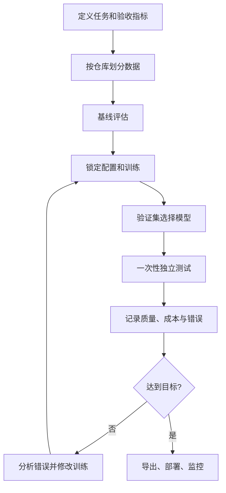

# 10 从实验到可信结论：数据、评估与复现

训练不是「启动任务，等 loss 下降」这么简单。有效的实验要回答：**相比已有方案，新的训练是否在未见数据上改善了真实任务，改善的代价又是多少？**本章以代码 Agent 的文件定位任务为例，从数据切分、评价到实验记录，建立可以反复使用的工程流程。这里给出的训练配置是示意，尚未在特定 GPU 上运行；示例中的统计脚本只依赖 Python 标准库。



图中测试集不是调参工具。每次根据同一测试集的具体错误改数据，都会让测试集逐步变成另一套验证集；应预留从未用于这些决策的新测试集合。评估、采样和部署配置需要与模型版本一同固定。

## 10.1 把任务写成可测试协议

假设输入是 bug 描述和允许检索的仓库内容，输出是一个有序文件列表。一次样本至少记录以下信息：

- **输入边界：**仓库和提交版本、用户问题、模型可以查看哪些文件、是否可以使用搜索工具。
- **参考答案：**哪些文件确实需要修改，以及标签如何产生；真实修复提交可作为线索，但其修改文件不一定是唯一正确答案。
- **预算：**上下文长度、文件读取次数、工具调用次数、采样温度、最大生成 token、时间限制。
- **终点：**只评价文件定位，还是实际允许 Agent 修改代码并在干净环境执行测试。两者必须分别报告。

例如 `repo_id=example/library`、`commit=abc123`、`task_id=42` 是标识信息；示例提交 ID 并非真实来源。提示模板、检索器和评估器会影响结果，因而应与模型权重同样被记录。比较 A 与 B 时，尽量固定任务、工具、上下文、采样及预算，只改变需要研究的因素。

## 10.2 按独立单位切分，而不是随机切行

代码样本存在相同仓库的不同提交、文件重命名、fork、复制函数和相似 issue。随机将单行分到训练集和测试集可能产生过高的分数。应先确定泛化目标：对未见任务的同仓库泛化，还是对未见仓库泛化；两者回答的是不同问题。

下例按**仓库组**稳定分配集合，用哈希保证同一仓库始终进入同一集合。输入为 JSONL，每行至少包含 `repo_group` 和 `task_id`；`repo_group` 应在划分前人工或自动归并已知 fork 与镜像。必须先冻结该映射，否则同一份代码的不同副本仍可能跨集合。代码不自动识别近似重复。分组数少时哈希比例也不保证实际样本比例正好是 80/10/10。

```python
# split_by_repo.py — Python 3；标准库，不依赖训练框架
import hashlib
import json
import sys
from pathlib import Path


def split_for(repo_group: str) -> str:
    # 使用固定盐保证不同运行中同一 group 的分配稳定；不要用 Python 内建 hash()。
    digest = hashlib.sha256(("split-v1:" + repo_group).encode("utf-8")).digest()
    bucket = int.from_bytes(digest[:8], "big") % 100
    return "train" if bucket < 80 else "validation" if bucket < 90 else "test"


def main(source: Path, output: Path) -> None:
    output.mkdir(parents=True, exist_ok=True)
    # 为避免误覆盖，以独占创建方式写文件；重复执行前显式选择新目录。
    files = {name: (output / f"{name}.jsonl").open("x", encoding="utf-8")
             for name in ("train", "validation", "test")}
    try:
        with source.open(encoding="utf-8") as src:
            for line_no, line in enumerate(src, 1):
                if not line.strip():
                    continue
                row = json.loads(line)
                group = row.get("repo_group")
                if not isinstance(group, str) or not group.strip():
                    raise ValueError(f"line {line_no}: missing repo_group")
                target = files[split_for(group)]
                target.write(json.dumps(row, ensure_ascii=False) + "\n")
    finally:
        for file in files.values():
            file.close()


if __name__ == "__main__":
    if len(sys.argv) != 3:
        raise SystemExit("usage: python split_by_repo.py INPUT.jsonl NEW_OUTPUT_DIR")
    main(Path(sys.argv[1]), Path(sys.argv[2]))
```

**检查：**统计每个集合的仓库、样本、语言和难度分布；确认组无交集；抽查跨组相似代码和重复问题；将输入文件、仓库归组表和脚本的 SHA-256 值一起保存。脚本中途遇错可能留下部分输出，应删除这次失败的输出目录后重新运行。Hugging Face Datasets 的 `train_test_split` 提供随机样本切分，但它不会自动解决按仓库分组或近似重复问题。[^datasets]

## 10.3 一个样本从数据到训练

SFT 对话数据通常包含多条有角色的消息。一个示意记录：

```json
{"messages":[{"role":"user","content":"任务：修复解析错误。给出需要检查的文件。"},{"role":"assistant","content":"[\"src/parser.py\", \"tests/test_parser.py\"]"}]}
```

实际训练需要固定 tokenizer、chat template、截断长度和损失掩码。若只希望学习 assistant 输出，就要确认框架在对应模板下正确识别并屏蔽其他角色。**不要只检查配置名**：抽取预处理后的 `input_ids` 和 `labels`，解码非忽略位置，核对目标文本、结束标记及多轮边界。TRL 的 `assistant_only_loss` 依赖对话数据和支持相应掩码的模板；接口与行为按固定版本文档核查。[^trl]

数据短样本可完整显示，长样本需抽查：关键信息是否被截断？文件路径是否被模板或预处理改写？如果打包多个样本，必须了解框架的注意力边界、标签掩码和有效 token 计算，不能假定实现全部相同。训练前先在极小样本上检查 loss 是否有限、梯度是否更新了预期参数；小样本过拟合只是排查管线的手段，不是最终效果证明。

## 10.4 评价：同一任务的多个维度

| 指标 | 定义和用途 | 不能证明什么 |
| --- | --- | --- |
| 文件召回率 Recall@k | 取前 k 个候选，命中参考目标文件的比例；明确多目标样本的计算方式 | 不保证最终修改正确 |
| 精确率 Precision@k | 前 k 个候选中有多少属于参考目标 | 参考标签不完整时可能低估合理候选 |
| 端到端通过率 | 完成编辑并通过独立验证的任务占比 | 验证器未覆盖的错误与副作用 |
| 成本 | 每任务 token、GPU 时间、工具调用、墙钟时间 | 单次便宜不代表每个成功任务便宜 |
| 回归 | 通用任务及安全相关任务相对基线的变化 | 无法覆盖所有未知场景 |

例如一个任务有两个目标文件，前 3 个候选命中其中 1 个，则该任务 Recall@3 为 1/2；如果 3 个候选中只有该文件属于参考集合，Precision@3 为 1/3。若任务数不同、每个任务目标数不同，要说明是先逐任务求平均（宏平均）还是汇总命中数（微平均）。

端到端测试应重置到指定提交，隔离依赖和外部状态，保留 Agent 产生的补丁、测试日志以及失败原因；隐藏测试应由评测端掌控。测试通过不保证没有绕过验证、修改无关文件或引入隐藏问题。不要让模型在训练环境直接读取隐藏答案。

## 10.5 比较两个方案：不仅看一个平均数

用同一批任务比较 A 与 B，先报告每个方案的成功数、总任务数和任务切分；再看同一任务上「A 成功 B 失败」与「B 成功 A 失败」各有多少。配对比较比拿两批不同任务的平均数比较更能控制任务难度差异。对生成有随机性的模型，分别记录采样次数与随机种子；一次通过率、best-of-N 和 pass@k 不是同一指标，不能互换。

模型训练也有随机性。条件允许时重复训练并报告不同 seed 的差异，同时给出任务层面的置信区间；如果样本少，应把不确定性展示出来，而不是将微小差异写成确定的领先。调参固定后才使用保留测试集；之后发布结果时记录所有关键失败，而不是只挑成功案例。

## 10.6 记录什么，才能复现和恢复

一份 run 记录应包括：

1. **代码与数据：**Git commit、未提交改动、数据版本与哈希、切分规则、数据许可和预处理参数。
2. **模型与训练：**基础权重与 tokenizer 修订、chat template、可训练参数、损失掩码、优化器、学习率、batch、累积、总有效 token、精度与随机种子。
3. **环境：**GPU 型号、数量、驱动、CUDA 或 ROCm、框架及各依赖的固定版本、容器镜像摘要、并行与网络配置。
4. **运行：**配置文件、日志、耗时、峰值显存、吞吐、检查点、失败和恢复事件；区分训练成本与评测/生成成本。
5. **评价与交付：**评测代码和数据版本、生成参数、原始逐题结果、汇总方法、导出方式、推理引擎版本及已知限制。

检查点若要继续训练，通常除了模型权重还需优化器、学习率调度器、随机状态及数据进度；具体恢复能力依赖训练器。只保存适配器能否恢复完整训练，也取决于相关状态是否另存。恢复测试应实际中断并重新启动，核对步数、损失、学习率和数据游标；仅看到权重文件存在不足以证明恢复有效。

设置随机种子有助于复现实验，但 PyTorch 明确指出，不同版本、平台、设备或某些算子之间未必完全一致；启用确定性算法可能降低性能或在缺少确定性实现时报错。[^pytorch] MLflow 等工具可以管理参数、指标、数据和模型，但工具本身不会自动保证实验配置正确或数据无泄漏。[^mlflow]

## 10.7 交付前的小型验收清单

- 固定一个基线和一个候选，使用相同任务与推理预算；逐题输出能追溯到模型与数据版本。
- 核验训练/验证/测试的分组、近重复和权限；检查聊天模板及 loss 掩码。
- 完成小数据管线检查、检查点恢复测试和导出后推理一致性检查。
- 报告任务质量、失败类型、成本和不确定性；对验证器漏洞或评估覆盖不足写明限制。
- 为发布的模型附上数据、许可、预期用途、限制和已知风险说明。

## 本章资料

[^datasets]: Hugging Face, [Process a Dataset](https://huggingface.co/docs/datasets/process)，样本处理与切分文档；分组切分与去重需额外设计。
[^trl]: Hugging Face, [TRL SFT Trainer](https://huggingface.co/docs/trl/main/sft_trainer)，对话数据、损失掩码与训练配置；示例使用前核对所锁定版本。
[^pytorch]: PyTorch, [Reproducibility](https://docs.pytorch.org/docs/stable/notes/randomness.html) 与 [deterministic algorithms](https://docs.pytorch.org/docs/stable/generated/torch.use_deterministic_algorithms.html)。
[^mlflow]: MLflow, [Experiment Tracking](https://mlflow.org/docs/latest/ml/tracking/)，记录 run、数据、参数和指标。
