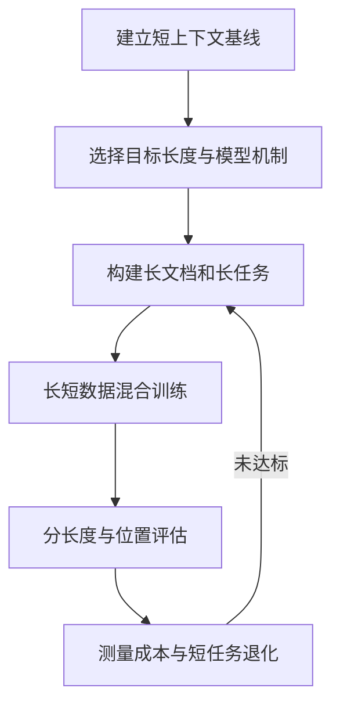
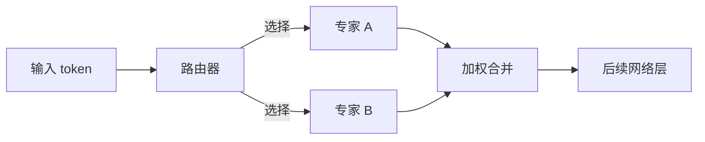
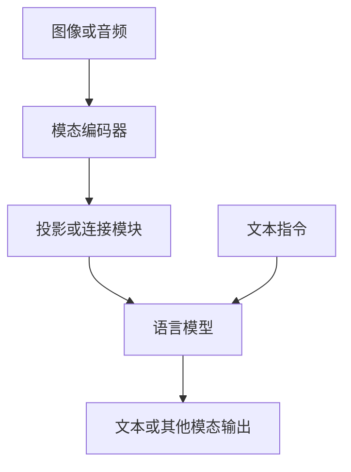

# 长上下文、MoE 与多模态：从需求到训练方案

把输入窗口变长、把模型改成混合专家、为模型增加图像或语音能力，都会改变训练的成本和数据组织。三者解决不同问题：长上下文扩大单次处理的信息量；混合专家提高参数容量与每个 token 计算量之间的灵活性；多模态让模型处理不同类型的信号。它们可以组合，但组合后训练能否收敛、系统能否稳定运行，都要分别验证。

本章从已有模型继续训练的角度讨论实践。引用的论文和项目文档提供方法与实现入口，具体模型、框架版本和硬件组合的兼容性需要实验验证；本文不声称已运行这些实验。

## 一、长上下文：能够输入，不等于能够使用

假设一个代码 Agent 需要阅读整个仓库：把窗口从 8K 扩到 128K，只说明系统允许更长输入，并不证明模型能从中找出影响修改的文件，也不说明它能利用分散在不同位置的证据推理。要分别检验**容量、远距离定位、跨位置推理、输出质量和成本**。长上下文模型也可能保留检索能力，因为筛掉无关内容可以降低延迟和干扰。

### 1. 为什么不能只修改最大长度

部分模型使用旋转位置编码（RoPE）。在长于原训练范围的位置上，位置表示进入模型较少见的区域，输出可能退化。位置插值将新位置映射到较小范围，是一类配合训练使用的扩展方法；YaRN 等方法采用不同的缩放设计。[Position Interpolation 原论文](https://arxiv.org/abs/2306.15595)；[Transformers RoPE 配置说明](https://huggingface.co/docs/transformers/main/internal/rope_utils)。这些方法的效果依赖架构、原训练长度、数据和训练设置；简单调大配置值不等于获得经过验证的长上下文能力。

全注意力对于序列长度增加很敏感。朴素注意力计算中的 token 对数量随序列长度平方增长；例如长度扩大 4 倍时，注意力矩阵的元素数变为 16 倍。FlashAttention 等实现通过分块减少显存读写与中间矩阵占用，但不会自动把全注意力的计算复杂度变成线性。[FlashAttention 原论文](https://arxiv.org/abs/2205.14135)。上下文并行（CP）可以把序列分到多个 GPU，但需要跨设备通信；它是系统并行方法，不直接改变模型已经学到的上下文能力。[Megatron Core CP 文档](https://docs.nvidia.com/megatron-core/developer-guide/latest/user-guide/features/context_parallel.html)。

### 2. 一条可复现的扩展路径

1. 固定基础模型、tokenizer、原始最大长度、位置编码与训练代码版本，先记录短上下文质量和资源占用。
2. 明确目标任务与长度分布。例如，对代码定位同时保留短 issue、长文件、跨文件依赖与错误堆栈；不要只用将短文本重复拼接产生的长样本。
3. 按模型文档选择位置编码配置，混合不同长度与短上下文数据，逐步尝试目标长度。数据、位置策略、训练 token 数分别记录，避免一次改变多个变量后无法归因。
4. 在未参与训练的仓库上，分别测试证据位于开头、中部、末尾、多处的情形；记录文件召回、跨文件推理和完整修复结果，而不只做单个关键词检索。长文档任务存在位置敏感性，相关现象可参考 [Lost in the Middle](https://arxiv.org/abs/2307.03172)。
5. 记录峰值显存、训练与推理吞吐、首 token 延迟、单次任务成本；同时回归短上下文、代码和一般语言任务。若短任务退化，考虑数据混合、训练方案或模型选择，而不是仅宣布窗口已扩大。

### 3. 辨别训练上下文与推理缓存

训练中主要关注模型权重、优化器、梯度、激活和通信等；推理中生成较长内容时，KV cache 的大小又会随缓存 token 数、层数、KV 头和精度等变化。训练显存预算和推理 KV cache 预算不能直接互换。不同架构的滑动窗口、分组查询和混合注意力设计也会改变实际成本。

## 二、MoE：更多参数，按 token 选择部分计算

混合专家（Mixture of Experts，MoE）通常把模型部分前馈网络替换成多个专家，并由路由器为每个 token 选择少量专家。它不是多个完整模型逐个回答，也不等于每次都只加载所选专家：训练和服务仍需要处理专家权重的放置与分发。

**图示：**以两个被选择的专家为例，实际模型可能有更多专家，选择数、共享专家和路由粒度依架构不同。

### 1. 看懂两个参数量

总参数量包含全部专家与共享部分；激活参数量通常指处理单个 token 时参与计算的参数近似规模。前者影响权重存储与放置，后者有助于理解每 token 计算量，但不能单凭它推断吞吐、显存或部署成本。路由、跨 GPU 通信、批量大小、专家负载和硬件拓扑都会影响实际表现。DeepSeek-V3 是公开的 MoE 工程案例，具体架构和训练结果见其[技术报告](https://arxiv.org/abs/2412.19437)。

### 2. 训练时需要额外监控什么

- **专家负载：**每个专家接收的 token 数及其分布。如果少数专家过热，其他专家闲置，可能产生训练瓶颈或专家利用不均。
- **路由稳定性：**路由概率分布、负载变化和训练损失是否同时异常。负载均衡的辅助目标或偏置机制因架构而异，不能不经验证就替换。
- **容量与溢出：**部分实现对专家处理的 token 数设容量限制；超过容量时如何处理，必须核查实现，不能假设都会丢弃或都不会丢弃。
- **通信：**专家并行（EP）将专家放到不同 GPU，token 需要按路由分发并收回；GPU 间和跨节点网络都可能成为瓶颈。[Megatron Core MoE 文档](https://docs.nvidia.com/megatron-core/developer-guide/latest/user-guide/features/moe.html)

例如，在固定总 batch 与硬件的情况下，增加专家数可能降低单个专家每次获得的 token 数，使矩阵计算变小并放大调度和通信开销；最终速度仍应实测。观察平均吞吐之外，还应看最忙专家、设备空闲及步骤耗时分位数，识别尾部拖慢。

### 3. 选 dense 还是 MoE

先比较目标指标、总成本、维护难度与部署硬件。单卡小模型实验往往优先选择易于调试的 dense 基线；多机训练且有合适网络时，可比较 MoE 的质量和吞吐。实验需固定数据、训练计算预算或部署预算，并明确哪一种预算被固定：只按相同参数量对比可能掩盖不同的激活计算和存储成本。

## 三、多模态：先统一数据关系，再训练模型

图像、音频和视频并不是“把文件名放进文本”就能训练。通常需要对应模态的编码器或 tokenizer，将输入变成模型能处理的表示，再通过投影层或其他融合机制与语言模型连接。不同架构也可能采用原生统一建模或其他融合方式，因此下图只是常见的一类设计。

早期 LLaVA 使用视觉编码器与语言模型连接，并通过视觉指令数据训练助手；这是理解此类系统的具体实例，不代表所有现代多模态模型都采用同一结构。[LLaVA 原论文](https://arxiv.org/abs/2304.08485)。

### 1. 数据和标签比文件格式更重要

图文数据要明确图片与文字是否描述同一内容，样本是否有使用许可，是否存在重复或个人信息；语音数据还要核查语言、噪声、说话人、转写和音画时间对齐。视频任务必须定义帧采样策略和时间顺序。高分辨率、帧数和音频时长可能大幅增加 token 或特征长度，改变 batch 中不同样本的计算成本。

### 2. 阶段化训练

一种常见路线先用成对数据训练连接或对齐模块，再进行指令微调；也可以在不同阶段解冻视觉编码器或语言模型。冻结哪些模块需要以任务和资源决定：只训练连接层便于控制成本，但可能无法适配新视觉域；解冻更多层需要更多显存、数据与回归测试。以上是设计选项，而非所有模型必须遵循的固定流程。

从工程上先用少量人工可核查样本检查图像方向、颜色空间、文本模板、遮挡、图文对应和损失掩码，再扩大数据规模。验证图像输入确实被模型使用，例如对同一问题替换图片并观察回答是否相应变化；只比较文本答案并不能排除模型忽略视觉输入。

### 3. 评估与常见失效

分别测图像理解、OCR、跨图推理、视频时间顺序或语音能力，并在实际任务上测试；还要保留纯文本回归以发现能力退化。模型可能编造图中不存在的内容，也可能依赖训练集偏差或图片内文本，故需要设计反事实样本与人工抽检。对医疗等高风险领域，训练或基准得分本身不足以支持真实部署。

## 四、三种能力组合时如何规划

长视频问答可能同时需要多模态、长上下文和 MoE。先测单个样本在目标硬件上的长度、内存和质量，再逐步加入多个样本与并行训练；不要同时修改模型架构、数据、位置编码、优化器和并行策略，否则失败难以定位。记录每个阶段的模型、数据、配置、代码、评测与成本，并保留能恢复训练的检查点。

实践中优先阅读目标模型的官方训练 recipe：Megatron Core 文档分别说明[上下文并行](https://docs.nvidia.com/megatron-core/developer-guide/latest/user-guide/features/context_parallel.html)与[专家并行](https://docs.nvidia.com/megatron-core/developer-guide/latest/user-guide/features/moe.html)；两种方式是否能与目标模型、精度、硬件和检查点组合使用，仍须针对指定版本核对并运行小规模验证。
