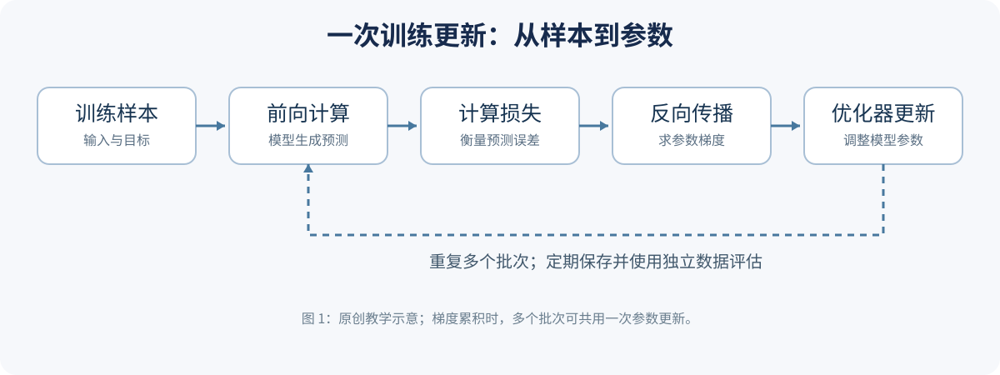

# 12 从一轮训练看懂模型如何学习

当你修改训练框架的配置时，底层反复发生的事可以拆成五步：取样本、计算预测、衡量误差、计算梯度、更新参数。下图只表示一次更新；真实系统还会有数据加载、混合精度、分布式通信、梯度累积、检查点和评测。



*图 12-1：原创教学示意。虚线表示参数更新后，模型使用新参数进入下一轮。*

## 先用最小程序观察

项目里的 [`scripts/tiny_bigram.py`](../scripts/tiny_bigram.py) 不依赖 GPU 或机器学习框架。它用当前字符预测下一个字符，只为解释训练循环，并非语言大模型或 Transformer。运行：

```bash
python scripts/tiny_bigram.py
```

程序对 `abcabc...` 中相邻字符构造样本。每个输入字符对应一行可学习的分数（logits）；softmax 把分数转成概率，交叉熵惩罚正确答案的低概率。所有样本的梯度求平均后，优化器按学习率更新分数。这里训练集和演示样本相同，损失下降只能证明模型拟合了这组样本，不能证明泛化。

程序中的数值稳定处理 `exp(x - max(x))` 不改变 softmax 的概率，因为分子与分母都乘以同一常数。每行梯度为 `预测概率 - 目标指示值`：如果正确答案的概率小于 1，该项为负，梯度下降将提高它的分数。

## 将玩具例子映射到大模型

| 项目 | 玩具模型 | 大语言模型的常见做法 |
| --- | --- | --- |
| 输入单位 | 字符 | tokenizer 产生的 token |
| 前文 | 只看一个字符 | 使用上下文中的多个 token |
| 参数 | 每个字符的一行分数 | 多层神经网络的权重 |
| 优化器 | 简单梯度下降 | 常用 AdamW 等，含状态和学习率调度 |
| 验收 | 仅显示训练损失 | 独立数据损失、任务、质量与成本 |

训练时通常会把序列右移，使用每个位置的前文预测下一 token。监督微调还需要区分哪些位置参与损失，例如只训练助手回答或包含工具轨迹；具体语义由数据模板与训练器配置决定。[Hugging Face 语言模型教程](https://huggingface.co/docs/transformers/tasks/language_modeling)；[TRL SFT 文档](https://huggingface.co/docs/trl/sft_trainer)。

## 向下探索：批量和累积

一次更新可以由一个或多个 micro-batch 组成。梯度累积允许分别计算小批次的梯度，累积后再更新参数，但要正确归一化损失，并在更新后清空梯度。变长序列下，每个 micro-batch 的有效 token 数不同，简单平均批次损失可能与按 token 全局平均不同；比较实验时要明确统计口径。[PyTorch 自动微分](https://docs.pytorch.org/tutorials/beginner/basics/autogradqs_tutorial.html)。
