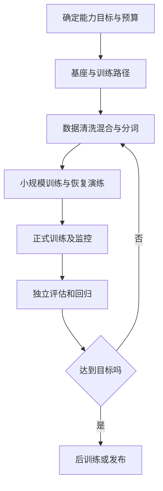

# 13 预训练与继续预训练：从数据到稳定运行

当现有基础模型对目标语言、领域或任务的原始分布覆盖不足时，继续预训练可能有价值；当需要完全自定义模型、词表和训练来源时，可以考虑从零预训练。前者以已有检查点为起点，后者从随机初始化开始，工程成本和可控性完全不同。本章沿着「目标—数据—小规模验证—训练—检查点—评估」讲解流程；命令和伪配置用于说明，**未在本书环境完成大模型或 GPU 训练实测**。

## 13.1 三种起点，三种问题

| 路径 | 输入 | 希望得到什么 | 代价与风险 |
| --- | --- | --- | --- |
| 从零预训练 | 架构、初始化参数、tokenizer 和大规模语料 | 通用或专用基础模型 | 数据、训练和验证成本最高；中途异常需要恢复 |
| 领域继续预训练（DAPT） | 已有基础模型与领域文本 | 更好地建模领域语言和知识 | 领域增益不保证转化为任务增益；可能遗忘通用能力 |
| 任务继续预训练（TAPT） | 基座及更贴近任务分布的无标签文本 | 缩小输入分布差距 | 不能让评估数据的答案或近重复样本进入训练 |

DAPT 和 TAPT 不是 SFT：它们通常仍采用原来的无监督语言模型目标；SFT 的示例则明确给出期望行为。Gururangan 等人在多个领域和分类任务上研究了 DAPT/TAPT，但论文中的效果不能直接外推到所有现代模型、语言和任务。[Don’t Stop Pretraining, 2020](https://arxiv.org/abs/2004.10964)

例如，团队需要一个理解内部工程文档的代码模型。先比较基座、提示、检索；若问题是最新文档无法进入上下文，检索可能更易更新。若模型对代码和术语的基础分布确实不适应，则设计继续预训练实验，再用独立项目测端到端收益。领域文本能改善预测损失，不自动证明 Agent 的文件定位或修复率也提高。

## 13.2 原始语料到训练 token

数据准备不是「把文本拼起来」。至少应保留来源、许可证、采集日期、文档 ID、处理版本和删除策略；处理后记录内容 hash 和清洗指标，建立从训练 shard 回溯原始来源的能力。公开的 [Dolma 数据集论文](https://arxiv.org/abs/2402.00159) 对网页、代码、论文等混合数据的构建和处理提供了可研究的参考，不能把其数据配比直接当作其他项目的最佳配方。

1. **抽取与清洗。** 检查乱码、空文本、机器生成垃圾、重复导航，以及敏感信息与许可证限制。代码的换行和缩进本身有意义，清洗规则不能只按自然语言设计。
2. **去重。** 精确 hash 可发现相同文档，近似去重可发现少量编辑或模板变体；两者阈值不同，均可能误删正常内容。保留去重算法、阈值和抽样审查报告。
3. **隔离评测。** 依据时间、仓库或其他来源分组切分，检查跨组副本和近重复。基准题、参考解答、网页镜像及其改写版本都可能形成污染。对没有把握清理的评测题报告限制。
4. **配比与重采样。** 先定义领域、语言、代码和通用数据的预算；记录每类数据的实际采样 token，而不只是原始文件字节。重复使用小领域语料增加有效曝光，也可能过拟合。
5. **分词与打包。** 固定 tokenizer 版本、特殊 token 和文档边界规则；按训练器语义检查 padding、截断、目标 mask 和跨样本 attention。Packing 能减少 padding，但不同实现对样本间注意力隔离的支持不同。[Transformers padding-free 文档](https://huggingface.co/docs/transformers/v5.12.0/padding_free)

如果继续预训练直接更换 tokenizer，就可能改变 token 到 embedding 行的对应关系。必须检查输入与输出 embedding 的词表大小、特殊 token 和原始映射；扩词还需要明确新增参数的初始化与后续训练。仅把一个新 tokenizer 指向旧模型并不能保证权重与 token 语义一致。[Megatron Bridge tokenizer 配置](https://docs.nvidia.com/nemo/megatron-bridge/latest/apidocs/bridge/bridge.training.tokenizers.config.html)

### 数据配比示例

假设训练预算为 100 亿 token，计划通用数据占 60%、代码占 25%、领域文档占 15%，则目标分别为 60、25 和 15 亿 token。**这是算术示例，不是推荐配比。**还需记录抽样是否放回、每个来源被重复多少次，以及去重后可用数据是否足够。训练日志中的有效 token 定义要明确：输入 token、目标 token、padding、文档边界和重复采样不一定采用相同计数方式。

## 13.3 训练配方与真实运行

训练配方需要完整描述模型结构、tokenizer、数据采样、全局批量、序列长度、优化器、学习率、精度、并行布局、保存与评测间隔。代码版本、镜像、驱动、训练数据快照、硬件和种子应与配方一起保存。用同一模型和数据先做短跑：验证 batch 形状、模型输出、目标 mask、有限 loss、梯度、权重是否变化，再演练保存和恢复。

常见的下一 token 损失可写为：

\[
L = -\frac{1}{N}\sum_{t \in \mathrm{valid}} \log p_\theta(x_t \mid x_{<t})
\]

这里 `valid` 表示参与训练目标的位置，`N` 是其数量。若使用多个数据并行进程和梯度累积，确保有效 token 数不同时的损失归一化语义符合预期；不能仅比较样本数。学习率调度、权重衰减、梯度裁剪和精度设置都影响轨迹，不应只复制某个模型的参数而忽略全局批量、数据质量和目标。

Megatron Bridge 的官方文档提供从零预训练、SFT 和 PEFT 的不同数据配置与入口；相应 recipe、模型支持、检查点行为必须以选定版本核对。[训练入口](https://docs.nvidia.com/nemo/megatron-bridge/latest/training/entry-points.html)；[配方说明](https://docs.nvidia.com/nemo/megatron-bridge/latest/recipe-usage.html)。不要把官方提供某个 recipe 解释为在所有 GPU、网络与模型上的性能保证。

## 13.4 继续预训练：验证领域收益与遗忘

先锁定用于比较的基座版本、tokenizer、模型模板、目标测试集及通用回归集。至少保留三个实验：未训练基线、使用目标领域数据继续预训练、在同等预算下混合部分通用数据的继续预训练。固定训练 token、上下文长度及其他关键设置；对多个任务和来源报告结果，而不是只挑提升最大的一个。

关注三个层面的差异：

- **领域语言建模**：独立文档的目标 token loss 或 perplexity；不同 tokenizer 下的 perplexity 不能直接当作公平比较。
- **任务能力**：如代码仓库文件召回、修复测试通过率；测试项目和近复制内容不能进入训练。
- **通用与部署回归**：一般指令遵循、短上下文、工具调用格式、延迟与显存；如果只优化领域 loss，可能掩盖其他能力退化。

在同一测试集上反复挑选数据配比也会造成间接过拟合：把开发集用于调参，把最终测试集留给确定配方后的评估；重要结果报告样本数、配对结果、波动与失败类型。

## 13.5 长上下文：长度配置不是能力证明

扩大配置中的上下文上限，并不意味着模型已经学会在所有位置利用长文本。位置编码、训练时长度分布、注意力算子、内存和推理服务设置都必须协同。对于 RoPE 模型，位置插值和渐进扩展是可研究的路径；[LongRoPE](https://arxiv.org/abs/2402.13753) 给出了特定模型上的方法和实验，并不保证所有模型在任意长度都能获得相同效果。

工程上先测短序列基线，再逐步提高长度；记录有效 token、峰值显存和吞吐，检查训练数据是否真的含有需要跨较长距离联系的信息。如果只是把互不相关的短文拼接成大块，样本变长不一定等价于长距离能力训练。确保模型、kernel、位置编码与部署服务对最大长度及缩放参数理解一致。

测量至少包括：目标信息在开头、中间、结尾的检索与利用；多处证据整合；真实文档与代码任务；不同长度的质量曲线；以及原短上下文能力回归。[Lost in the Middle](https://arxiv.org/abs/2307.03172) 表明部分模型会受关键信息位置影响，因此单一位置的 needle 测试不能代表完整能力。

## 13.6 看懂故障，保护长期训练

| 症状 | 先观察 | 常见排查方向 |
| --- | --- | --- |
| 第一步 loss 非常大 | token IDs、词表、标签位移、mask、初始化 | tokenizer 或模板不匹配；目标 token 被错误构造 |
| 稳定运行后出现 NaN | 首次异常 step、输入 shard、梯度范数、学习率 | 损坏样本、数值范围、优化器或精度；回放同一批次 |
| 长序列突然 OOM | 各 rank 峰值、激活、通信和临时空间 | 长度分布、batch、重计算、并行与 kernel 选择 |
| 吞吐下降但 GPU 繁忙 | 有效 token/s、padding、同步、检查点 | 输入形状或口径变化、通信与数据管线；比较 profiler |
| 恢复后 loss 跳变 | 优化器、调度器、RNG、数据位置及参数 | 缺失状态或恢复了错误 checkpoint；小规模中断重演 |
| 领域指标上涨、通用指标下降 | 数据混合、训练步数、分任务差异 | 缩小领域比例、减少训练量或调整配方后做对照 |

保存检查点不等于具备恢复能力。除权重外，通常还需优化器、学习率调度、精度缩放状态、训练步数、随机数和数据迭代位置，以及配置和 tokenizer 版本。分布式检查点可能由多个文件构成；要验证全部 shard 写入完成后再标记其可恢复。PyTorch DCP 支持多 rank 保存和加载时重分片，但具体模型、优化器和版本仍需实际恢复测试。[PyTorch DCP](https://docs.pytorch.org/docs/stable/distributed.checkpoint.html)；[Megatron Bridge 检查点](https://docs.nvidia.com/nemo/megatron-bridge/latest/training/checkpointing.html)。

## 可执行检查清单

正式投入前，确认：目标与独立评估已固定；数据权限、去重、污染和真实配比有记录；模型和 tokenizer 对齐；小规模训练能正确更新并恢复；日志同时记录 loss、有效 token、吞吐、各 rank 内存和训练状态；模型完成后对比领域收益与通用回归。任何未运行的 recipe 和标称速度都只作为待验证的候选，而不是实验结果。
