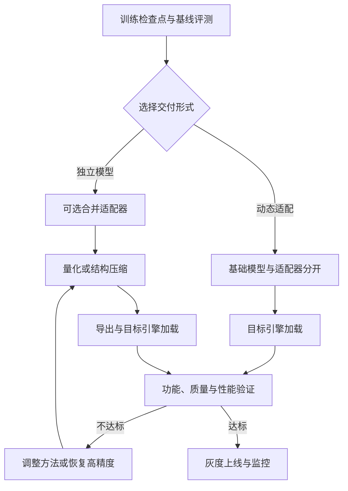

# 14 训练完成之后：压缩、导出与部署验证

模型训练成功，不意味着它能以可接受的质量、延迟和成本提供服务。本章从训练产物出发，解释为什么、何时以及如何做量化、剪枝、导出与验证。示例是工程方案，**没有在本书环境中运行模型量化或部署**；真实支持范围以固定版本、模型、硬件和运行时为准。

图 14-1：交付的一个常见流程；量化、适配器合并和压缩均为可选。部署格式、目标引擎以及量化工具可能要求不同的先后顺序。每次操作保留原始检查点与准确版本，便于复现和回退。

## 1. 首先确定约束，而不是先选最低位数

模型交付常见约束包括：设备可用显存、单次请求峰值显存、预填充与生成速度、并发、质量、架构支持和部署许可。先建立高精度或当前稳定版本的基线，固定 tokenizer、对话模板、系统提示、生成参数、测试任务和服务环境；否则比较结果会混入模板、采样和运行时差异。

例如，一个 7B 参数模型的理想纯权重体积按参数个数乘位数估算，16 位约 14 GB，4 位约 3.5 GB。**这不是实际显存需求**：量化还需尺度等元数据，并非所有权重一定是同一精度；推理还要占用运行时内存、计算缓冲与 KV 缓存。GB 与 GiB 也应分别记录。

一个格式更小并不必然更快。如果目标 GPU 缺少高效低位数内核，反量化开销或数据搬运可能抵消收益。批量、上下文长度、硬件和算子都会改变结果；应在目标机器测量，而不是从位数推断吞吐。[vLLM 量化及硬件支持表](https://docs.vllm.ai/en/stable/features/quantization/index.html)

## 2. 量化：改变数值表示

量化使用低位数表示一部分权重或激活，通常通过尺度等参数把高精度值映射到有限数值集合。格式不只由位数决定，还包括整数或浮点格式、分组方式、尺度、校准算法和具体内核。[NVIDIA ModelOpt 量化基础](https://nvidia.github.io/Model-Optimizer/guides/_basic_quantization.html)

| 选项 | 做什么 | 首要问题 |
| --- | --- | --- |
| 权重量化 | 压缩模型权重，计算和激活精度依实现而定 | 目标引擎是否支持格式及高效内核？ |
| 权重与激活量化 | 同时降低权重和部分计算的精度 | 激活分布与异常值对质量有何影响？ |
| KV 缓存量化 | 压缩生成时的注意力缓存 | 长上下文和多轮质量是否仍达标？ |
| 混合精度 | 对不同层或张量保留不同精度 | 哪些层敏感，额外元数据和复杂度是否值得？ |

**训练后量化（PTQ）**从已训练权重出发进行量化。有些方法只需权重，有些需要代表性输入作为校准数据，估计激活或寻找量化尺度。校准样本应覆盖任务、语言、长度和工具格式等实际分布，记录来源与处理方式；校准集与最终独立测试集分开。ModelOpt 的相关接口展示了使用前向循环采集校准数据的方式，但具体算法与资源需求不同。[ModelOpt 校准文档](https://nvidia.github.io/Model-Optimizer/reference/generated/modelopt.torch.quantization.model_calib.html)

**量化感知训练（QAT）**在训练或微调中模拟量化误差，使模型有机会适应部署精度；它需要额外训练与验证，最终仍要转换成目标格式。它可能改善特定配置下的精度，但不保证对所有任务优于 PTQ。PyTorch 的 torchao 文档介绍了通过 fake quantization 执行 QAT 的方式。[torchao QAT](https://docs.pytorch.org/ao/stable/workflows/qat.html)

不要混淆量化微调和最终部署：QLoRA 中低位基础权重与可训练 LoRA 的组合是训练策略；部署时可以继续以引擎支持的方式使用基础模型加适配器，也可以依支持情况在合并后重新量化。两者输出及兼容性需逐一验证。

## 3. 剪枝、稀疏与蒸馏的区别

剪枝减少权重、神经元、注意力头或层；蒸馏是用教师信号训练学生；量化改变表示精度。它们可以组合，但最终速度取决于导出格式和运行时是否真正利用该结构。把权重置零、获得较高稀疏率，并不自动减少文件大小或缩短推理时间；稀疏模式、存储格式、硬件和专用内核都需要匹配。结构化剪枝可能改变模型结构，必须检查配置、加载和质量回归。蒸馏的训练设计见[第 5 章](05-distillation.md)。

## 4. 检查点、适配器与目标格式

训练检查点可能包含模型、优化器、学习率调度、随机数和数据进度，用于继续训练；推理产物通常只需要模型及其配置、tokenizer、模板和必要的量化元数据。不要用只含模型权重的推理导出物假定能完整恢复训练。

LoRA 可作为独立适配器加载，也可以在兼容条件下与基础权重合并。分开保存便于复用基础模型、切换适配器；合并后可得到不依赖 PEFT 运行时的普通模型，但会失去同一实例上的部分适配器切换能力，且某些量化或配置不支持合并。保存基础模型版本与适配器版本，合并前后进行等价性评测。[PEFT 检查点格式](https://huggingface.co/docs/peft/developer_guides/checkpoint)

推理引擎能否加载，并不只看文件扩展名。需要核对架构定义、权重名称与精度、tokenizer、词表、特殊 token、chat template、上下文配置和量化元数据。一个引擎的格式不能推断另一个引擎兼容；转换后的生成结果应与转换前对比。尤其是 GGUF、Hugging Face 检查点或某引擎专用格式之间，应使用该模型架构与版本明确支持的转换器，并保存转换命令与日志。

## 5. 按三层检查质量

1. **可加载与接口**：在目标环境启动，确认模型、tokenizer、模板、上下文及特殊 token；检查基本生成、结构化输出、工具调用、流式终止和错误处理。
2. **模型质量**：用相同独立测试集和生成参数比较任务成功率、格式合规、长上下文表现、安全及通用能力退化；对代码 Agent 要执行独立测试，并检查误修改和副作用。
3. **服务性能**：按真实输入/输出长度和并发分布测首 token 延迟、后续生成速度、吞吐、尾延迟、峰值显存、失败率和每成功任务成本。报告计时口径、预热、缓存状态、硬件、引擎版本及重复次数。

不应只比较困惑度或单个基准：它们能发现部分退化，却不能代替真实任务质量。基线和候选采用配对任务，按任务类型报告差异与失败样本；如果接受标准无法事先确定，至少把质量、成本和不确定性一起报告，避免仅凭吞吐宣布更优。

## 6. 发布记录与回退

发布单至少记录：基础模型与许可证、训练和适配器版本、数据与评测版本、合并与量化配置、校准样本来源、转换工具和命令、产物哈希、硬件和依赖版本、功能与质量报告、已知限制以及回退版本。灰度发布先用小比例真实请求观察质量、时延、显存和错误率；正式环境不应在未知数据授权的情况下保存用户输入。发现质量退化时，保留原始高精度产物与可恢复的服务配置，按既定流程回滚。

这一章提供的是可执行的检查框架，不声称本书已对任意具体 GPU、量化格式或模型测得性能；每个生产组合都需独立验收。
