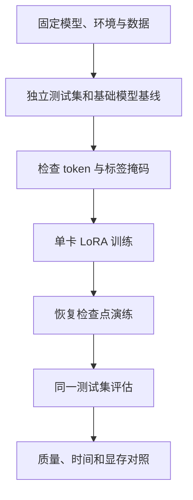

# 15 单卡实战：从基线到 LoRA 与回归评测

本章用一个小模型、少量人工构造数据演示整个实验闭环：记录环境、检查训练数据、生成基线、运行 LoRA、评估并保存可恢复的产物。例子只学习简单的任务分类；它的目的在于验证管线，不足以训练可靠的代码 Agent。**本章的模型训练与 GPU 性能尚未在本书环境实测**，以下配置是实验配方，运行前应根据固定版本进行兼容检查。若需要无依赖且已运行的数学演示，先看第 12 章。



## 1. 定义可回答的问题

任务：给一条描述，输出 `READ`（阅读理解）或 `EDIT`（需要修改）。以独立的文本作为测试集；训练与测试不能包含模板化重复或同一真实仓库/问题的变体。工业场景中建议按仓库、项目或时间分组，记录分割方案、去重方法和来源。分类准确率适合做首个检查，但真实 Agent 还需看文件召回、无关编辑和任务级通过率。

基础模型可选 [Qwen2.5-0.5B-Instruct](https://huggingface.co/Qwen/Qwen2.5-0.5B-Instruct)；仅因体量小、适合学习而选用，不代表其是任务最佳选择或建议替代你自己的模型。仓库模型卡标注 Apache-2.0，部署前仍需核查所用模型、训练数据与依赖许可证。训练、评测与导出必须使用相同 tokenizer、模型修订版和聊天格式。

## 2. 环境与记录

准备一张可用的 NVIDIA GPU、支持该 GPU 的驱动及匹配 CUDA 的 PyTorch 安装；CUDA 工具链、显存和模型大小共同决定能否运行。不要按照参数量直接断定占用。推荐隔离 Python 环境，按 [PyTorch 安装指南](https://pytorch.org/get-started/locally/)选对应版本，再参考 [TRL v0.22.1 文档](https://huggingface.co/docs/trl/v0.22.1/sft_trainer)与 [PEFT 指南](https://huggingface.co/docs/peft/quicktour)安装兼容的依赖。以下是要执行的操作，不假设所有平台都适用：

```bash
python -m venv .venv
source .venv/bin/activate
# 首先安装与本机驱动和 GPU 兼容的 PyTorch；命令由官方安装页面生成。
python -m pip install 'trl==0.22.1' 'transformers' 'peft' 'datasets' 'accelerate'
python -m pip freeze > requirements.lock.txt
python -c 'import torch; print("torch:", torch.__version__, "cuda:", torch.version.cuda, "available:", torch.cuda.is_available())'
nvidia-smi
```

`pip freeze` 记录解析结果，不等于跨平台锁定二进制、驱动和系统依赖；应同时记录 Python、操作系统、GPU、驱动、CUDA、实际包版本、模型和 tokenizer 的 revision。建议实验后重新使用记录的版本在干净环境验证。上面的依赖组合还未在本书环境验证；如果版本冲突，请依据固定版本文档选择相容组合，再记录完整解析结果。

## 3. 可检查的最小数据

在工作目录建立 `train.jsonl`，每行是标准的 prompt/completion 样本：

```jsonl
{"prompt":"判断类型：解释这段函数的作用。\n类别：", "completion":"READ"}
{"prompt":"判断类型：修正解析器的异常处理。\n类别：", "completion":"EDIT"}
{"prompt":"判断类型：查看该文件中的导入关系。\n类别：", "completion":"READ"}
{"prompt":"判断类型：给入口增加参数校验。\n类别：", "completion":"EDIT"}
```

创建 `test.jsonl`，使用不同的输入内容，避免复制训练条目：

```jsonl
{"prompt":"判断类型：说明缓存是如何失效的。\n类别：", "completion":"READ"}
{"prompt":"判断类型：调整日志输出的格式。\n类别：", "completion":"EDIT"}
```

四条训练数据只是为了检查流程，很容易过拟合；两条测试数据也不足以估计真实效果。实际评测应使用足够数量且来源独立的任务，固定切分并报告按任务类别分组的结果。TRL 文档说明 prompt-completion 数据可将损失限定在 completion；聊天数据及 assistant-only mask 则依赖支持标记的模板，不能假设所有 tokenizer 均正确生成助手掩码。[数据格式](https://huggingface.co/docs/trl/v0.22.1/dataset_formats)；[SFTTrainer](https://huggingface.co/docs/trl/v0.22.1/sft_trainer)。

训练前检查：记录数据文件的哈希；打印前几条渲染后的输入、token 和监督标签；确认 prompt 被屏蔽、completion 未被截断；同类任务按项目拆分而非随机拆分单条。例如 Linux/macOS 可使用 `shasum -a 256 train.jsonl test.jsonl`，或用 Python `hashlib.sha256` 计算。

## 4. LoRA 训练配方

保存为 `train_lora.py`；该示例使用 prompt/completion 格式，无需依赖特定 chat template 的 assistant mask。请先按固定版本文档核对接口并检查实际数据 collator 生成的标签；这是示意配方，尚未实测。

```python
from datasets import load_dataset
from peft import LoraConfig
from transformers import AutoTokenizer, set_seed
from trl import SFTConfig, SFTTrainer

MODEL = "Qwen/Qwen2.5-0.5B-Instruct"
REVISION = "c89bee90d9f811437d9735454613c35b4a3c4dc8"
set_seed(42)

data = load_dataset("json", data_files={"train": "train.jsonl", "test": "test.jsonl"})
tokenizer = AutoTokenizer.from_pretrained(MODEL, revision=REVISION)
# 固定具体模型提交，避免 main 分支变化导致实验不可复现。
args = SFTConfig(
    output_dir="runs/lora-example",
    model_init_kwargs={"revision": REVISION},
    max_length=256,
    per_device_train_batch_size=1,
    gradient_accumulation_steps=4,
    learning_rate=2e-4,
    max_steps=20,  # 小数据仅用于验证管线；不是推荐训练预算。
    logging_steps=1,
    save_strategy="steps",
    save_steps=10,
    save_total_limit=2,
    completion_only_loss=True,
    report_to="none",
    seed=42,
)
# q_proj/v_proj 是本例目标模型的投影层命名；换架构时先检查模块名。
lora = LoraConfig(r=8, lora_alpha=16, lora_dropout=0.05,
                  target_modules=["q_proj", "v_proj"], task_type="CAUSAL_LM")
trainer = SFTTrainer(model=MODEL, args=args, train_dataset=data["train"],
                     processing_class=tokenizer, peft_config=lora)
trainer.model.print_trainable_parameters()
trainer.train()
trainer.save_model("runs/lora-example/adapter")
tokenizer.save_pretrained("runs/lora-example/adapter")
```

```bash
python train_lora.py 2>&1 | tee train.log
```

训练前应确认输出的 trainable 参数非零，抽样检查 loss mask 和至少一个可训练参数是否真正更新。`max_steps=20` 不意味着训练已充分；训练日志应记录 loss、step、学习率、耗时及有效目标 token 口径。默认未打开量化或混合精度，显存不足时可先缩短序列、降低 micro-batch，再按目标硬件和模型支持核查量化、BF16 或激活重计算。更改配置后记录新实验，不覆盖旧结果。

## 5. 对比基础模型与适配器

分别加载同一 revision 的基础模型，以及基础模型加 PEFT 适配器；对 `test.jsonl` 的每条 prompt 使用相同生成设置（如贪心解码、相同最大新 token）得到结果。只解码新增 token，做明确的标签解析，无法解析的结果标为错误而非静默丢弃。汇总 `正确数 / 全部测试数`，并保存每条输入、预测、参考、解析结果和配置。推理时也需要沿用训练的 prompt 格式；不要一边使用聊天模板、一边训练纯文本格式。适配器加载与合并需遵循 [PEFT 文档](https://huggingface.co/docs/peft/quicktour)。

报告至少包含：测试集规模与切分、基础模型及适配器的准确率、逐样本差异、训练时间、硬件、峰值显存、tokens/s 的统计口径，以及多次实验的不确定性。两条样本的 50% 或 100% 没有统计说服力，也不能用于宣称训练有效。对于代码 Agent，额外使用未见仓库的任务及隐藏验证器，测文件召回、任务通过率、无关编辑及每个成功任务的总成本。

## 6. 训练恢复与成本

`trainer.save_model` 保存的是模型或适配器产物；续训应使用包含优化器、调度器及训练状态的完整 checkpoint，具体文件与恢复语义按版本检查。训练从中断点恢复可参考 [Transformers Trainer 文档](https://huggingface.co/docs/transformers/main_classes/trainer)，并在小作业中主动中断、恢复，验证步数、学习率、数据位置和损失是否连续。仅靠一份模型权重无法保证完整续训。

训练费用包括 GPU 时间、数据制作和验证、实验失败、存储、持续推理与评估。把资源限制和结果一起记录：GPU 型号、数量、训练时长、实际运行时间、训练 tokens、有效 token/s、显存峰值、评测数及版本。用系统级成本评估收益：如果训练出的模型必须多次重试，单次推理便宜也不代表每次成功任务更便宜。

| 症状 | 首先检查 | 可尝试的措施 |
| --- | --- | --- |
| 加载或首次更新 OOM | 其他进程、模型加载精度、优化器状态、峰值发生阶段 | 缩短序列、减小 micro-batch；按支持情况使用 LoRA/量化/分片 |
| loss 不降或没有可训练参数 | 标签是否全被屏蔽、目标模块名称、数据与学习率 | 查看标签和 trainable 参数，先在少量样本上验证梯度 |
| 评测输出格式错误 | prompt、tokenizer、停止条件及解析方式 | 固定模板和解码，保留无法解析样本 |
| 恢复后 loss 跳变 | 是否只恢复权重，优化器与调度器是否恢复 | 做中断恢复演练并固定环境及数据位置 |

实验代码和工具 API 会随版本变动。运行失败时先记录报错与环境，再查固定版本文档；不要根据一份未验证的配置声称获得了性能提升。
