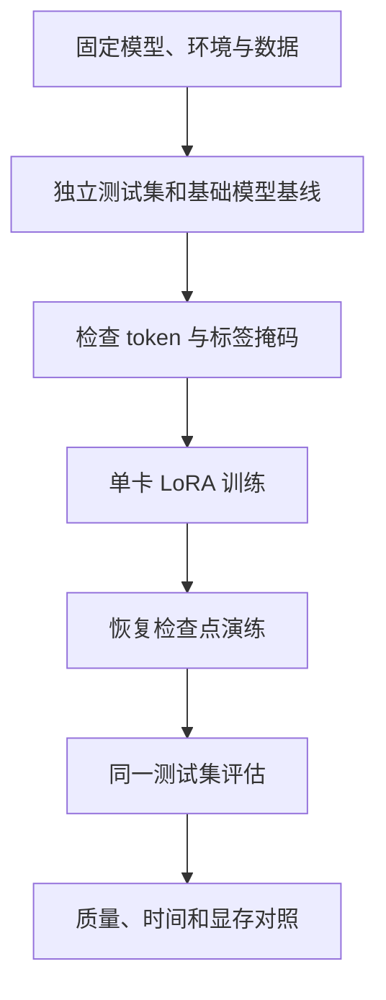

# 15 单卡实战：从基线到 LoRA 与回归评测

本章用一个小模型、少量人工构造数据演示整个实验闭环：记录环境、检查训练数据、生成基线、运行 LoRA、评估并保存可恢复的产物。例子只学习简单的任务分类；它的目的在于验证管线，不足以训练可靠的代码 Agent。**本章的模型训练与 GPU 性能尚未在本书环境实测**，以下配置是实验配方，运行前应根据固定版本进行兼容检查。若需要无依赖且已运行的数学演示，先看第 12 章。



## 1. 定义可回答的问题

任务：给一条描述，输出 `READ`（阅读理解）或 `EDIT`（需要修改）。以独立的文本作为测试集；训练与测试不能包含模板化重复或同一真实仓库/问题的变体。工业场景中建议按仓库、项目或时间分组，记录分割方案、去重方法和来源。分类准确率适合做首个检查，但真实 Agent 还需看文件召回、无关编辑和任务级通过率。

基础模型可选 [Qwen2.5-0.5B-Instruct](https://huggingface.co/Qwen/Qwen2.5-0.5B-Instruct)；仅因体量小、适合学习而选用，不代表其是任务最佳选择或建议替代你自己的模型。仓库模型卡标注 Apache-2.0，部署前仍需核查所用模型、训练数据与依赖许可证。训练、评测与导出必须使用相同 tokenizer、模型修订版和聊天格式。

## 2. 环境与记录

准备一张可用的 NVIDIA GPU、支持该 GPU 的驱动及匹配 CUDA 的 PyTorch 安装；CUDA 工具链、显存和模型大小共同决定能否运行。不要按照参数量直接断定占用。推荐隔离 Python 环境，按 [PyTorch 安装指南](https://pytorch.org/get-started/locally/)选对应版本，再参考 [TRL v0.22.1 文档](https://huggingface.co/docs/trl/v0.22.1/sft_trainer)与 [PEFT 指南](https://huggingface.co/docs/peft/quicktour)安装兼容的依赖。以下是要执行的操作，不假设所有平台都适用：

```bash
python -m venv .venv
source .venv/bin/activate
# 首先安装与本机驱动和 GPU 兼容的 PyTorch；命令由官方安装页面生成。
python -m pip install 'trl==0.22.1' 'transformers' 'peft' 'datasets' 'accelerate'
python -m pip freeze > requirements.lock.txt
python -c 'import torch; print("torch:", torch.__version__, "cuda:", torch.version.cuda, "available:", torch.cuda.is_available())'
nvidia-smi
```

`pip freeze` 记录解析结果，不等于跨平台锁定二进制、驱动和系统依赖；应同时记录 Python、操作系统、GPU、驱动、CUDA、实际包版本、模型和 tokenizer 的 revision。建议实验后重新使用记录的版本在干净环境验证。上面的依赖组合还未在本书环境验证；如果版本冲突，请依据固定版本文档选择相容组合，再记录完整解析结果。

## 3. 可检查的最小数据

在工作目录建立 `train.jsonl`，每行是标准的 prompt/completion 样本：

```jsonl
{"prompt":"判断类型：解释这段函数的作用。\n类别：", "completion":"READ"}
{"prompt":"判断类型：修正解析器的异常处理。\n类别：", "completion":"EDIT"}
{"prompt":"判断类型：查看该文件中的导入关系。\n类别：", "completion":"READ"}
{"prompt":"判断类型：给入口增加参数校验。\n类别：", "completion":"EDIT"}
```

创建 `test.jsonl`，使用不同的输入内容，避免复制训练条目：

```jsonl
{"prompt":"判断类型：说明缓存是如何失效的。\n类别：", "completion":"READ"}
{"prompt":"判断类型：调整日志输出的格式。\n类别：", "completion":"EDIT"}
```

四条训练数据只是为了检查流程，很容易过拟合；两条测试数据也不足以估计真实效果。实际评测应使用足够数量且来源独立的任务，固定切分并报告按任务类别分组的结果。TRL 文档说明 prompt-completion 数据可将损失限定在 completion；聊天数据及 assistant-only mask 则依赖支持标记的模板，不能假设所有 tokenizer 均正确生成助手掩码。[数据格式](https://huggingface.co/docs/trl/v0.22.1/dataset_formats)；[SFTTrainer](https://huggingface.co/docs/trl/v0.22.1/sft_trainer)。

训练前检查：记录数据文件的哈希；打印前几条渲染后的输入、token 和监督标签；确认 prompt 被屏蔽、completion 未被截断；同类任务按项目拆分而非随机拆分单条。例如 Linux/macOS 可使用 `shasum -a 256 train.jsonl test.jsonl`，或用 Python `hashlib.sha256` 计算。

## 4. LoRA 训练配方

保存为 `train_lora.py`；该示例使用 prompt/completion 格式，无需依赖特定 chat template 的 assistant mask。请先按固定版本文档核对接口并检查实际数据 collator 生成的标签；这是示意配方，尚未实测。

```python
from datasets import load_dataset
from peft import LoraConfig
from transformers import AutoTokenizer, set_seed
from trl import SFTConfig, SFTTrainer

MODEL = "Qwen/Qwen2.5-0.5B-Instruct"
REVISION = "c89bee90d9f811437d9735454613c35b4a3c4dc8"
set_seed(42)

data = load_dataset("json", data_files={"train": "train.jsonl", "test": "test.jsonl"})
tokenizer = AutoTokenizer.from_pretrained(MODEL, revision=REVISION)
# 固定具体模型提交，避免 main 分支变化导致实验不可复现。
args = SFTConfig(
    output_dir="runs/lora-example",
    model_init_kwargs={"revision": REVISION},
    max_length=256,
    per_device_train_batch_size=1,
    gradient_accumulation_steps=4,
    learning_rate=2e-4,
    max_steps=20,  # 小数据仅用于验证管线；不是推荐训练预算。
    logging_steps=1,
    save_strategy="steps",
    save_steps=10,
    save_total_limit=2,
    completion_only_loss=True,
    report_to="none",
    seed=42,
)
# q_proj/v_proj 是本例目标模型的投影层命名；换架构时先检查模块名。
lora = LoraConfig(r=8, lora_alpha=16, lora_dropout=0.05,
                  target_modules=["q_proj", "v_proj"], task_type="CAUSAL_LM")
trainer = SFTTrainer(model=MODEL, args=args, train_dataset=data["train"],
                     processing_class=tokenizer, peft_config=lora)
trainer.model.print_trainable_parameters()
trainer.train()
trainer.save_model("runs/lora-example/adapter")
tokenizer.save_pretrained("runs/lora-example/adapter")
```

```bash
python train_lora.py 2>&1 | tee train.log
```

训练前应确认输出的 trainable 参数非零，抽样检查 loss mask 和至少一个可训练参数是否真正更新。`max_steps=20` 不意味着训练已充分；训练日志应记录 loss、step、学习率、耗时及有效目标 token 口径。默认未打开量化或混合精度，显存不足时可先缩短序列、降低 micro-batch，再按目标硬件和模型支持核查量化、BF16 或激活重计算。更改配置后记录新实验，不覆盖旧结果。

## 5. 对比基础模型与适配器

分别加载同一 revision 的基础模型，以及基础模型加 PEFT 适配器；对 `test.jsonl` 的每条 prompt 使用相同生成设置（如贪心解码、相同最大新 token）得到结果。只解码新增 token，做明确的标签解析，无法解析的结果标为错误而非静默丢弃。汇总 `正确数 / 全部测试数`，并保存每条输入、预测、参考、解析结果和配置。推理时也需要沿用训练的 prompt 格式；不要一边使用聊天模板、一边训练纯文本格式。适配器加载与合并需遵循 [PEFT 文档](https://huggingface.co/docs/peft/quicktour)。

报告至少包含：测试集规模与切分、基础模型及适配器的准确率、逐样本差异、训练时间、硬件、峰值显存、tokens/s 的统计口径，以及多次实验的不确定性。两条样本的 50% 或 100% 没有统计说服力，也不能用于宣称训练有效。对于代码 Agent，额外使用未见仓库的任务及隐藏验证器，测文件召回、任务通过率、无关编辑及每个成功任务的总成本。

## 6. 训练恢复与成本

`trainer.save_model` 保存的是模型或适配器产物；续训应使用包含优化器、调度器及训练状态的完整 checkpoint，具体文件与恢复语义按版本检查。训练从中断点恢复可参考 [Transformers Trainer 文档](https://huggingface.co/docs/transformers/main_classes/trainer)，并在小作业中主动中断、恢复，验证步数、学习率、数据位置和损失是否连续。仅靠一份模型权重无法保证完整续训。

训练费用包括 GPU 时间、数据制作和验证、实验失败、存储、持续推理与评估。把资源限制和结果一起记录：GPU 型号、数量、训练时长、实际运行时间、训练 tokens、有效 token/s、显存峰值、评测数及版本。用系统级成本评估收益：如果训练出的模型必须多次重试，单次推理便宜也不代表每次成功任务更便宜。

| 症状 | 首先检查 | 可尝试的措施 |
| --- | --- | --- |
| 加载或首次更新 OOM | 其他进程、模型加载精度、优化器状态、峰值发生阶段 | 缩短序列、减小 micro-batch；按支持情况使用 LoRA/量化/分片 |
| loss 不降或没有可训练参数 | 标签是否全被屏蔽、目标模块名称、数据与学习率 | 查看标签和 trainable 参数，先在少量样本上验证梯度 |
| 评测输出格式错误 | prompt、tokenizer、停止条件及解析方式 | 固定模板和解码，保留无法解析样本 |
| 恢复后 loss 跳变 | 是否只恢复权重，优化器与调度器是否恢复 | 做中断恢复演练并固定环境及数据位置 |

实验代码和工具 API 会随版本变动。运行失败时先记录报错与环境，再查固定版本文档；不要根据一份未验证的配置声称获得了性能提升。

## 7. 把实验从“能跑”变成“可判断”

前面的四条数据和二十步训练，只适合做冒烟测试：它回答“依赖、数据格式、梯度和产物能否连起来”，不能回答“训练是否值得”。要进入有意义的实验，必须先把任务边界说清。`READ` 和 `EDIT` 看似简单，实际包含不少歧义。例如“检查并修复异常处理”包含检查和修改，按最终交付物应标记 `EDIT`；“指出需要改哪里”要求提出建议但没有授权修改，可以标记 `READ`。如果标注人员对这种边界没有一致解释，模型学到的首先是标注者之间的冲突。

可将标注规则写成一小段可执行契约：只要请求明确要求改变仓库中的文件、配置或生成新文件，就归 `EDIT`；只要求解释、定位、审查和建议则归 `READ`；无法仅凭文本确定的任务归入人工复核池，暂不进入这次二分类训练。复核池不是垃圾桶：统计它包含哪些请求，决定未来是否需要增加 `CLARIFY` 类别。若真实流量中歧义请求很多，强迫二分类会导致错误自信，此时任务定义本身需要修改。

### 7.1 为什么先评估基座

假设基础模型已经在独立测试集上达到很高准确率，LoRA 可能没有足够提升空间。如果修改提示模板、减少输出格式歧义就能达到要求，训练所引入的数据维护、模型版本和回归成本未必合理。反过来，如果基座经常把“分析为什么失败”误判为修改，先查看它是否理解了任务规则，再判断是示例不足、输入截断还是确实需要参数学习。

因此，基线不是一个百分比，而是一组可回看的输出记录。给每条测试任务分配稳定的 `id`，保留文本、来源、参考标签、基座原始输出、解析状态和推理设置。训练后仍使用同一批 ID 进行配对比较：哪些任务从错变对，哪些从对变错，错误是否集中在某个项目或某种语言。相同的总准确率可能掩盖完全不同的错误结构。

## 8. 数据准备脚本：保留来源，先切分再训练

实际工作中的一条记录可以具有 `id`、`project`、`text`、`label` 字段。`project` 用于按来源分组；同一项目中的重复请求和改写应尽量留在同一集合。下面的脚本是完整的标准库示例，可保存为 `prepare.py`。输入是 `raw.jsonl`；输出目录包含训练、开发、测试和一份数据清单。这里按项目名称的稳定哈希切分，目的是让相同输入得到相同结果，并非声称哈希切分对所有任务都最公平。

```python
import hashlib
import json
from pathlib import Path

source = Path("raw.jsonl")
out = Path("data-v1")
out.mkdir(exist_ok=False)  # 避免静默覆盖此前实验的数据版本。
rows = []
seen_ids = set()
seen_text = {}
for line_no, line in enumerate(source.read_text(encoding="utf-8").splitlines(), 1):
    if not line.strip():
        continue
    row = json.loads(line)
    for key in ("id", "project", "text", "label"):
        if not isinstance(row.get(key), str) or not row[key].strip():
            raise ValueError(f"line {line_no}: invalid {key}")
    if row["id"] in seen_ids:
        raise ValueError(f"duplicate id: {row['id']}")
    seen_ids.add(row["id"])
    if row["label"] not in {"READ", "EDIT"}:
        raise ValueError(f"line {line_no}: unexpected label")
    normalized = " ".join(row["text"].split())
    fingerprint = hashlib.sha256(normalized.encode()).hexdigest()
    # 相同文本标签冲突是数据问题，不应随机保留其中一条。
    if fingerprint in seen_text:
        old = seen_text[fingerprint]
        if old["label"] != row["label"]:
            raise ValueError(f"conflicting labels: {old['id']}, {row['id']}")
        continue
    seen_text[fingerprint] = row
    rows.append(row)

splits = {"train": [], "dev": [], "test": []}
for row in rows:
    value = int(hashlib.sha256(row["project"].encode()).hexdigest()[:8], 16) % 100
    name = "train" if value < 80 else "dev" if value < 90 else "test"
    splits[name].append(row)

manifest = {"source_sha256": hashlib.sha256(source.read_bytes()).hexdigest(),
            "split_rule": "project-sha256-mod100:80/10/10", "splits": {}}
for name, items in splits.items():
    path = out / f"{name}.jsonl"
    path.write_text("".join(json.dumps(r, ensure_ascii=False) + "\n" for r in items),
                    encoding="utf-8")
    manifest["splits"][name] = {
        "count": len(items),
        "projects": len({r["project"] for r in items}),
        "labels": {label: sum(r["label"] == label for r in items)
                   for label in ("READ", "EDIT")},
        "sha256": hashlib.sha256(path.read_bytes()).hexdigest(),
    }
(out / "manifest.json").write_text(json.dumps(manifest, ensure_ascii=False, indent=2),
                                    encoding="utf-8")
print(json.dumps(manifest, ensure_ascii=False, indent=2))
```

这个脚本仍有明确边界。空白规范化后的精确去重不能发现同义改写；同一项目换一个名字也会跨集合；项目数量少时，80/10/10 的桶并不保证实际样本比例接近目标，甚至可能有空集合。运行后先检查清单，不要为了得到漂亮比例反复改哈希规则并查看测试结果。若需要分层且分组的切分，先在不知道模型测试表现的条件下确定方案，并记录所有人工移动。

开发集用于选择学习率、训练步数和模板；最终测试集只在配方确定后用于报告。如果你对测试集观察后不断修正训练数据，该集合已经逐渐变成开发集，需要新的独立测试。数据划分与交叉验证的边界可参考 [scikit-learn 模型选择说明](https://scikit-learn.org/stable/modules/cross_validation.html)。

## 9. 标签检查不是看原始 JSON

原始记录看起来正确，进入模型后仍可能错误。最常见的情况是 completion 被长度限制截掉，或者 collator 把所有标签都变成 `-100`。`-100` 是常见的损失忽略索引，表示该位置不贡献交叉熵；它不是一个“特殊词”。如果只打印输入 token，你无法发现训练目标已经消失。

在 `trainer.train()` 前加入下面的检查。它针对前面使用的 `SFTTrainer`，通过训练器实际的数据加载器观察最终 batch，而不是自行模拟一份可能不同的标签。

```python
batch = next(iter(trainer.get_train_dataloader()))
input_ids = batch["input_ids"]
labels = batch["labels"]
for row in range(min(2, input_ids.shape[0])):
    active = labels[row] != -100
    print("INPUT:", tokenizer.decode(input_ids[row].tolist()))
    print("SUPERVISED:", tokenizer.decode(labels[row][active].tolist()))
    print("target_tokens:", int(active.sum()))
    assert active.any(), "所有标签被忽略：检查截断、模板和 loss mask"
    # READ/EDIT 可能被 tokenizer 拆成多个 token，不应硬编码 token 数。
```

输出的 `SUPERVISED` 应与期望类别及结束标记一致。如果里面包含整条用户请求，而你的实验目标是只监督 completion，就要检查配置或数据格式。反过来，若想学习完整对话分布，却只监督最后一个短标签，训练信号也和目标不一致。观察多条样本、长样本和边界样本；只打印第一条通常不足以发现长度问题。

短标签训练还有一个不易察觉的问题：模型可能只需要记住高频词，例如见到“修复”就输出 `EDIT`。这不一定是错误，但不能据此声称具有代码理解能力。测试应加入“解释修复为什么有效”“不要修改，只分析修复方案”等对照，检验它是否理解否定与最终动作要求。若下游要做函数分类或文件定位，需要加入真正的代码上下文和相应标签，不能把自然语言请求分类当作其替代证明。

## 10. LoRA 参数如何影响实验

LoRA 的 `r` 决定低秩更新的维度。增加它通常增加可训练参数、优化器状态与适配器文件大小，但不保证效果单调提升。`lora_alpha` 与 `r` 一起影响更新缩放；在更改 rank 后不加说明地复用其他参数，会让比较不再只改变一个因素。`lora_dropout` 在训练时对适配器路径施加随机丢弃，可能影响过拟合和稳定性；极小数据上的结果尤其容易波动。

`target_modules` 决定哪些线性层带适配器。前例只选择 `q_proj` 和 `v_proj`，便于理解而非宣称最优。不同模型可能采用融合 QKV、不同投影名称或 MoE 专家模块，必须先打印 `model.named_modules()`。名称匹配成功也不代表你覆盖了想训练的所有位置。PEFT 可以报告可训练参数量，另应保存适配器配置，确保评估加载的是同一目标结构。[PEFT LoRA 开发者指南](https://huggingface.co/docs/peft/developer_guides/lora)

学习率 `2e-4` 只是适配器训练的一种试验起点，不是所有模型与数据的默认答案。较大的学习率可能很快降低训练损失，却使独立任务退化；较小的学习率也可能在预算内无法学会标签。先建立一个短跑，确认非零梯度、有限损失、权重变化和输出变化，再在预先规定的小范围里使用开发集选择设置。每次只改一个核心因素更容易诊断，最终效果仍可能需要多种参数联调。

有效批量由 micro-batch、数据并行副本和梯度累积共同决定。单卡例子的每批一条、累积四次，在样本等权的前提下相当于每次更新四条；变长样本的有效 token 数不同，需核对训练器的归一化方式。将累积从四改到十六不只是“降低显存”，它也改变每次更新看到的数据和更新频率，因此应重新记录学习率调度与训练 token。

## 11. 一份不会把错误吞掉的评估脚本

下面的 `evaluate.py` 在基础模型和适配器之间切换，保留全部预测。这里使用与训练一致的纯文本 prompt；没有悄悄加聊天模板。模型 ID、revision 和适配器目录通过命令行输入，方便保存实际运行命令。推理采用 FP32 与单卡映射以减少示例分支，实际资源不足时要明确改变精度并重新测量。

```python
import argparse
import json
from pathlib import Path
import torch
from peft import PeftModel
from transformers import AutoModelForCausalLM, AutoTokenizer

p = argparse.ArgumentParser()
p.add_argument("--model", required=True)
p.add_argument("--revision", required=True)
p.add_argument("--adapter")
p.add_argument("--test", default="data-v1/test.jsonl")
p.add_argument("--output", required=True)
a = p.parse_args()

tok = AutoTokenizer.from_pretrained(a.model, revision=a.revision)
model = AutoModelForCausalLM.from_pretrained(
    a.model, revision=a.revision, torch_dtype=torch.float32)
if a.adapter:
    model = PeftModel.from_pretrained(model, a.adapter)
device = "cuda" if torch.cuda.is_available() else "cpu"
model.to(device).eval()
results = []
with torch.inference_mode():
    for line in Path(a.test).read_text(encoding="utf-8").splitlines():
        item = json.loads(line)
        prompt = f"判断类型：{item['text']}\n类别："
        batch = tok(prompt, return_tensors="pt").to(device)
        # 先检查长度。静默截断可能恰好丢掉决定标签的末尾要求。
        if batch.input_ids.shape[1] > 240:
            raise ValueError(f"输入过长，需要明确截断策略: {item['id']}")
        generated = model.generate(
            **batch, do_sample=False, max_new_tokens=8,
            pad_token_id=tok.eos_token_id)
        suffix = generated[0, batch.input_ids.shape[1]:]
        raw = tok.decode(suffix, skip_special_tokens=True).strip()
        # 严格解析。输出“EDIT，因为……”算格式失败，不取第一个词蒙混过关。
        prediction = raw if raw in {"READ", "EDIT"} else None
        results.append({"id": item["id"], "reference": item["label"],
                        "raw": raw, "prediction": prediction,
                        "correct": prediction == item["label"]})
Path(a.output).write_text(
    "".join(json.dumps(r, ensure_ascii=False) + "\n" for r in results), encoding="utf-8")
print({"n": len(results), "correct": sum(r["correct"] for r in results),
       "invalid": sum(r["prediction"] is None for r in results)})
```

脚本只做确定性生成下的分类评测。它没有实现批量吞吐测量，也没有在推理开始前预热 GPU，因此不能直接用其运行时间声称服务延迟。若真实应用允许解释文本，应该提前定义不同解析规则；不能看到哪个规则更有利于训练模型后才选择。相同规则必须用于基座与适配器。生成和输出处理的接口见 [Transformers 生成指南](https://huggingface.co/docs/transformers/main_classes/text_generation)。

## 12. 恢复实验：故意中断一次

长训练最昂贵的错误之一，是直到机器故障后才发现 checkpoint 只能用于推理。先在短跑中设置保存间隔，保存后终止进程，再从明确路径恢复：

```python
# 将前面的 trainer.train() 替换为此调用；路径要对应完整 checkpoint。
trainer.train(resume_from_checkpoint="runs/lora-example/checkpoint-10")
```

恢复时检查日志中的 step、学习率和读取位置，确认优化器与调度器状态存在；不要仅因为输出目录包含 `adapter_model.safetensors` 就断定足以续训。若数据顺序、worker 数、分布式规模或依赖改变，精确复现可能受到影响，需记录这些变化。训练恢复与仅加载适配器做新一轮微调是两种不同操作，书中的实验记录必须区分。[Trainer 检查点恢复](https://huggingface.co/docs/transformers/main_classes/trainer)

如果恢复后的第一步损失与中断前不同，不应立即认定失败：读取的 batch 可能不同，dropout 也有随机性。更有力的测试是在固定小数据与环境中比较连续运行和中断恢复的步数、学习率、样本顺序及多步轨迹；若差异异常大，再定位状态缺失。把恢复检查设计成预算内的实验，比把它当部署后的补救措施可靠。

## 13. 何时可以宣布这次训练有价值

实验结束时，应能用一句有边界的话描述结果，例如：“在固定版本的模型与提示下，按项目隔离的某份测试集上，适配器相比基座减少了哪些错误，增加了哪些错误，训练花费多少资源，仍在哪些条件下失败。”如果没有真实数据，就只报告管线检查结果；如果只跑了一次，就不声称结论具有稳定性；如果基线不同，就不要将所有差异归因于 LoRA。

一个有用的交付包至少包含数据清单和哈希、标注规则、固定环境、模型及 tokenizer revision、训练与评估命令、适配器、完整检查点或其保存策略、逐样本预测、错误分析和资源记录。它不一定很大，但应允许同事知道“训练了什么、为什么认为它更好、哪些结论还没有证据”。本章提供的是完整实验设计和代码说明，仍需在目标 GPU 与固定依赖环境实测后，才可填入任何性能或质量结果。
