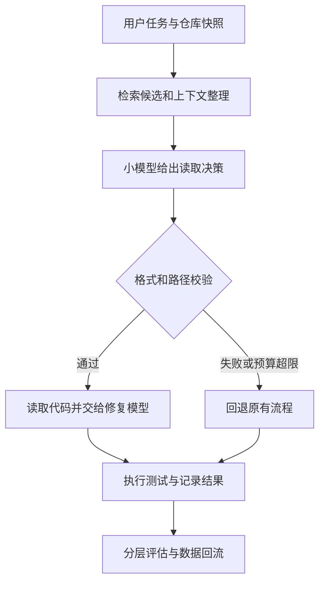

# 16 从业务目标到训练系统：设计一个代码决策模型

假设团队维护一个代码助手。它收到问题描述后，需要决定先读哪些文件、调用什么工具、是否有足够证据开始修改。团队希望用一个较小的模型承担这些高频决策，把昂贵的大模型留给复杂推理与最终修复。本章从这个需求出发，设计完整训练工程：先确定系统边界和验收，再计算数据、训练与推理预算，最后决定如何上线。**本章的业务量、成本、吞吐和成功率均为明确假设的算例，不是实测或任何产品的报价。**

工程设计不是先选择框架，再给框架寻找任务。正确顺序是确定系统必须交付什么、错误造成什么后果、可以花多少资源，然后选择能达到这些约束的实现。模型只是整个系统的一个组件。相同权重放进不同检索、工具和重试流程，实际效果可能完全不同。

## 16.1 定义模型的职责，才能谈训练收益

收到「登录后刷新页面会回到未登录状态」这个问题，一个代码助手可能经历四步：搜索仓库中的会话和持久化逻辑；读取相关文件；提出并实施修改；运行测试并解释结果。如果小模型只负责第一步，就不应该直接用端到端修复率作为唯一训练标签，因为修复失败还可能来自后续编辑模型或测试环境。反过来，仅报告文件召回率，也不能证明整个助手更有价值。

我们先定义一个边界明确的服务：输入是任务描述、仓库目录与搜索结果，输出是最多五个待读取文件、每个文件的依据，以及是否需要追加检索。模型不直接提交补丁。服务层验证路径必须来自当前仓库，拒绝不存在的文件，限制输出数量；当模型置信不足、输出非法或超出预算时，回退到原有大模型流程。这不是把安全寄托在模型口头承诺上，而是把错误的影响限制在可观察、可撤销的读取决策中。



*图 16-1：训练对象是决策组件，验收对象是包含回退的完整系统。原创教学示意。*

职责边界同时决定数据格式。若模型输出的是静态文件列表，训练样本不能偷偷包含最终补丁给出的路径；若希望模型学习多轮检索，就需要保存每一步的观察、动作和工具返回。否则它只看到最终答案，看不到取得证据的过程，会学到“直接猜路径”的捷径。这个差异会影响后面的 SFT、蒸馏和强化学习选择。

## 16.2 从业务量推导验收与误差预算

假设系统每天处理 20,000 个任务，平均每个任务调用决策模型 3 次，则日决策请求为 60,000 次。团队规定每个请求最多增加 2 秒的 P95 延迟；整个任务的解决率下降不能超过 0.5 个百分点；错误决策引入的平均额外文件读取不能超过 1 个；非法路径必须由程序拦截。这里有三类约束：用户看到的最终质量、每个阶段的运行预算、无条件执行的系统不变量。它们不能用一个总分互相抵消。

为什么要同时设置阶段指标和端到端指标？假设新模型把五个文件的召回率从 80% 提高到 90%，但它在每一步都要求重新检索，平均多调用三次工具。修复成功率可能没有变化，延迟却增加；如果只优化召回，团队会奖励这种行为。应把一个决策的结果拆成“必要文件是否进入候选”“读取开销多少”“后续是否因此成功”，再决定什么可以进入训练奖励。

误差预算需要基于可执行判定，而不是一句“允许少量下降”。假设旧系统在固定的 2,000 道测试任务中解决 1,200 道，成功率为 60%。新系统解决 1,194 道，点估计下降 0.3 个百分点，看起来满足 0.5 个百分点约束；但单次点估计不足以说明变化可信。两系统必须对同一任务配对比较：旧成功新失败多少题、旧失败新成功多少题、哪些语言和仓库受影响。报告配对差值的区间，并保留样本数，才能区别随机波动和真实退化。不要因为平均值过线，就忽略关键任务类别集中失败。

一个实用的发布门槛应写成独立条件：端到端解决率不出现可接受范围之外的退化；路径校验全部生效；成本下降达到业务目标；P95 延迟符合预算；高影响类别没有新增严重问题。若测试规模不足以区分 0.5 个百分点变化，就应扩大测试或降低结论强度，而不是把“没有显著差异”解释为“已经证明等价”。

## 16.3 先建立能够定位瓶颈的基线

直接训练会跳过一个重要问题：我们究竟需要改变模型，还是改变它能看到的信息？先构建四个基线。第一组是原有大模型完整流程；第二组是小模型直接读目录；第三组是小模型接收检索候选；第四组是固定规则，例如按文本匹配给候选排序。所有系统使用相同仓库快照、任务描述、工具预算和判定规则。

假设小模型直接读目录的必要文件召回率为 45%，接收检索结果后变为 72%，而强模型是 78%。这组假设结果说明检索贡献远大于模型间差距；下一步不应立即用强化学习追逐最后几个百分点，而应检查检索遗漏、候选摘要质量以及目标标签是否一致。如果规则系统已经达到 70%，小模型相对规则只有少量增益，也要考虑维护模型的成本是否合理。

把失败任务人工分桶比反复调学习率更有价值。可以区分：候选集合里根本没有正确文件；候选有正确文件但模型漏选；选对文件但解释引用了不存在的证据；输出不可解析；后续模型没有利用正确文件。只有第二类直接支持“训练决策能力”这个假设。第一类需要检索或信息获取，第三类需要证据约束，第四类可能由格式控制解决，第五类属于下游系统。

基线日志因此不能只有最终分数。每题至少要保存任务 ID、仓库版本、候选集合、模型输出、解析结果、工具调用、有效 token、延迟、回退原因和最终任务结果。敏感代码不必无条件复制到集中日志，可以保存经过授权的快照引用、内容哈希和受控访问路径；但缺少可回放输入，就无法解释一次质量回归。

## 16.4 数据工程是学习问题的定义

假设团队能获得 40,000 条历史任务轨迹。先别把 40,000 当作训练规模。过滤没有仓库快照、工具日志不完整、修复未被验证的记录之后，可能只剩 24,000 条；再去除同一问题的多次重试和复制仓库，可能只有 15,000 个相对独立任务。训练预算和数据质量必须按这个真实分布计算。

我们为每条决策定义一个“当时可见状态”：用户描述、已经观察到的代码片段、搜索结果和当前预算。目标动作只能依赖该状态。若人工标注使用最终补丁辅助判断，需要把它当作离线质量证据，而不能将补丁内容注入模型输入。对于存在多个合理读取顺序的任务，不应把一种顺序标为唯一正确。可以保留多个可接受文件集合，或者评估必要信息是否在预算内被覆盖。

按仓库分组切分训练、开发和最终测试，防止同一代码库的相邻提交出现在不同集合；再检查 fork、模板项目和复制函数。时间切分也有意义，但“旧任务”和“新任务”仍可能引用同一项目，不能替代重复检查。开发集用于选择配方，最终测试集只用于确定方案后的评估。团队每次看到测试失败就改规则，实际上也在对测试集训练。

### 一个样本合同

```json
{
  "task_id": "example-001",
  "repo_snapshot": "immutable-revision",
  "observation": {
    "issue": "刷新后登录状态丢失",
    "candidates": [
      {"path": "src/session.ts", "evidence": "包含会话持久化函数"},
      {"path": "src/theme.ts", "evidence": "只管理界面主题"}
    ]
  },
  "target": {
    "read_paths": ["src/session.ts"],
    "need_more_search": false
  },
  "provenance": {"label_type": "human-reviewed", "schema_version": 1}
}
```

这段数据是虚构示例。重要的不是字段名，而是让状态、动作、来源和版本分开。程序应验证目标路径确实在仓库中、目标没有包含输入未出现的秘密线索、样本有明确 split 和来源。输出解释可以帮助审查，但不要把长篇推理文字当作正确性的替代证据。对于真正的执行决策，机器可检查的动作和结果更可靠。

## 16.5 训练路径：为什么先选 SFT，而不是一次上齐所有算法

这个任务首先有一批可审查的状态—动作示范，因此最小训练是监督微调。使用已有基座，训练它在给定候选和证据时输出合法决策。LoRA 可减少可训练参数与优化器状态，适合快速比较数据和模型；它不能保证质量等同全参训练，也不能消除基础权重和激活的内存。先在小数据集验证权重确实更新、目标 mask 正确，再扩大数据量。[LoRA 原论文](https://arxiv.org/abs/2106.09685)

如果示范主要来自强教师，这同时也是序列蒸馏：训练形式仍可为 SFT，但数据生产管线必须增加教师质量与许可检查。教师在目标任务上必须先通过基线评估，不能仅因参数多就当真值。我们还应保留失败与低置信样本，抽样检查过滤是否只保留简单任务，导致学生在真实难题上没有训练信号。

偏好优化适用于同一状态有多个候选动作，并能可靠判断优劣的场景。例如两种文件选择都合法，但一种多读了十个无关文件。偏好标准应包含必要文件覆盖和读取成本，不能只偏好更短答案。如果奖励模型只根据解释文字判断，学生可能学会写更像“正确答案”的理由，而不是更好的决策。[DPO 原论文](https://arxiv.org/abs/2305.18290)

在线强化学习放在更后面。它要求当前策略产生动作，环境执行并反馈结果；这可能帮助模型学习超出静态示范的搜索策略，但奖励设计、工具环境、并行采样和轨迹对齐显著增加成本。对本例，文件召回容易验证，端到端修复却耗时且包含下游模型噪声。可以先在受控任务上验证阶段奖励与最终成功是否相关，再扩大；如果阶段奖励提高、最终成功反降，应停止扩展并分析奖励漏洞，而不是继续增加采样。

## 16.6 从参数账本估算资源，而不是猜显存

假设候选学生为一个 3B 参数的 dense 模型。这里用简化数字演示账本，实际模型参数结构和实现可能不同。BF16 基础权重需要约 `3×10^9×2 = 6×10^9` 字节，即 6 GB，约 5.59 GiB。全参数训练如果权重和梯度各 2 字节、Adam 两个矩各 4 字节，则静态状态是每参数 12 字节，共 36 GB，约 33.53 GiB；若实现额外保留 FP32 主权重，再加 12 GB，约 11.18 GiB。它还没有算激活、通信和临时工作区，所以不能放进 24 GiB 卡并不意外。

LoRA 假设有 30M 可训练参数，并采用同样的梯度和 Adam 状态账本。冻结基础权重约 6 GB；适配器权重、梯度和两个矩共约 `30×10^6×12 = 0.36 GB`。若另保留适配器主权重约 0.12 GB，则静态合计约 6.48 GB。这个算例解释为什么参数高效微调能显著减少状态，却没有给出“单卡一定可训”的承诺：激活随序列长度、batch 和模型结构变化，长上下文可能成为主要开销。

显存测试应记录加载后、前向峰值、反向峰值、首次优化器更新、保存时的各阶段峰值。第一次优化器更新才 OOM，可能是状态延迟初始化；保存时 OOM，可能是把分片权重聚合到一张卡。盲目减小 batch 不一定解决这些问题。FSDP 和 ZeRO 的价值是把部分状态分散到数据并行设备上，代价是通信和临时聚合；不能简单把总显存除以卡数作为每卡峰值。[PyTorch FSDP2](https://docs.pytorch.org/docs/stable/distributed.fsdp.fully_shard.html)；[Megatron 分布式优化器](https://docs.nvidia.com/megatron-core/developer-guide/latest/user-guide/features/dist_optimizer.html)

## 16.7 从 token 预算到训练时间

假设经过处理的训练集有 30,000 条样本，每条平均输入 1,500 token、目标输出 100 token，总序列 token 约为 `30,000×1,600 = 48M`。训练三轮需要处理约 144M 序列 token；如果只对助手输出计算损失，目标 token 数约为 `30,000×100×3 = 9M`。两者都应记录：GPU 前向仍处理输入，只有 9M 目标并不意味着只花 9M token 的计算。[TRL SFT 目标掩码说明](https://huggingface.co/docs/trl/sft_trainer)

假设在固定机器上短跑测得有效吞吐为 2,000 序列 token/s，那么纯训练时间约为 `144M / 2,000 = 72,000 秒 = 20 小时`。若评测、保存、数据等待和启动额外占 25%，计划时间约为 25 小时。这里的 2,000 是假设的测量输入，不是对 3B 模型或任何显卡的性能声明。真正预算要从自己的短跑中读取，且区分是否计 padding、是否启用 packing、是否包含保存与评估。

按平均长度估时仍会失真。若少量样本特别长，动态 padding 会使实际计算接近每批最长序列；packing 能减少部分 padding，但必须检查样本间 attention 和 loss 边界。若训练器把较长样本截断，吞吐看似提高，正确目标却可能被切掉。应记录长度分布、被截断比例、每步有效输入和目标 token，而不是只打印每秒样本数。

一次完整实验往往不止一次训练。假设先做 4 个候选基座的小规模筛选，各 2 小时；2 个数据配方各 10 小时；最终配方 3 个种子各 25 小时，总计划为 `4×2 + 2×10 + 3×25 = 103 GPU 小时`，未计教师生成与评估。这里按单卡运行计 GPU 小时；四卡运行 25 小时就是 100 GPU 小时，不能把墙钟时间当算力用量。团队应为失败和重跑保留预算，同时规定什么证据才允许进入下一阶段。

## 16.8 训练省下的钱，可能在推理时花回去

训练成本常被高估为唯一成本。若模型长期服务高频请求，推理费用、回退、重试和维护可能主导总拥有成本。我们用统一的假设单价演示。假设旧系统每次决策使用外部服务：平均输入 2,000 token、输出 100 token，输入每百万 token 1 元，输出每百万 token 4 元，则每请求成本为 `2,000/1,000,000×1 + 100/1,000,000×4 = 0.0024 元`。每天 60,000 次，30 天是 1.8M 次，月成本为 4,320 元。

现在假设学生服务每月固定 GPU、运维和监控支出合计 3,000 元，且有 10% 请求需要回退旧服务，回退成本为 `1.8M×10%×0.0024 = 432 元`，合计 3,432 元，月节省 888 元。若训练、教师生成、标注与集成一次性成本合计 12,000 元，静态回收期约为 `12,000/888 = 13.5 个月`，没有计后续维护和再训练。如果模型每三个月需要重训，这个项目可能根本不以省钱成立。

但业务量增到每月 10M 请求时，原成本为 24,000 元。假设学生仍能由相同容量承载——这个假设必须压测证明——回退为 2,400 元，学生总支出 5,400 元，月节省 18,600 元，一次性成本不到一个月可回收。相同模型在不同流量下会得到完全不同的工程决策。固定 GPU 容量是否足够、峰值如何分布、是否需要冗余，会改变这个结论。

还要计重试。若学生单次推理便宜一半，但平均需要三次尝试才能得到可用输出，单题成本可能反而增加。对于完整 Agent，可以写出一个简化式：

\[
C_{\text{每成功任务}} = \frac{C_{\text{所有尝试}}+C_{\text{工具执行}}+C_{\text{回退}}+C_{\text{摊销}}}{N_{\text{成功任务}}}
\]

分母很重要。一个系统通过拒绝难题降低总 token，用“每请求成本”看可能很优秀，但成功任务更少。应该同时报告覆盖率、成功率与每成功任务成本，并明确拒绝与回退由哪个系统承担。

延迟也不能只看平均生成速度。短决策输出通常更受排队和 prefill 影响；高并发可能增加首 token 等待。应按真实输入长度、输出上限、并发与突发模式测试 P50/P95/P99，分别记录排队、首 token、完整响应与工具耗时。vLLM 的官方指标区分首 token、输出 token 时间和请求统计，提醒我们不要用一个 token/s 代替整个服务体验。[vLLM 生产指标](https://docs.vllm.ai/en/latest/usage/metrics/)

## 16.9 实验矩阵：一次只解决一个决策

把所有参数同时改变，可能得到一个更好的模型，却不知道原因，也无法复现收益。实验矩阵不是机械遍历超参数，而是按依赖关系消除不确定性。先确认任务与数据有效，再确认模型和方法，最后优化系统性能。否则后面每个结论都建立在错误输入上。

| 实验阶段 | 固定什么 | 只改变什么 | 得到什么决策 |
| --- | --- | --- | --- |
| 数据检查 | 同一小模型、同一预算 | 原数据与审查后数据 | 标签质量是否比数量重要 |
| 基座筛选 | 同一输入、模板和评测 | 候选学生基座 | 哪个具备足够初始能力 |
| SFT 增益 | 基座、数据、评测 | 不训练与同预算 SFT | 是否存在可学习行为 |
| 蒸馏比较 | 学生、目标 token 和测试 | 人工示范与教师示范 | 教师数据是否真实增益 |
| 在线训练 | 同一初始化和预算 | 离线训练与在线反馈 | 交互带来的收益是否抵成本 |
| 系统优化 | 权重、数据和质量门槛 | 精度、batch、并行布局 | 在质量约束下如何省资源 |

例如 SFT 后文件召回上涨，但最终修复率没变。不要立即宣布“训练无效”，也不要只报告召回上涨。先回放旧失败新成功和旧成功新失败任务：若新模型选对文件但下游没有读取到，问题可能在接口；若选对文件却大量读取无关代码，长上下文噪声可能抵消收益；若真正影响修复的任务只占很小比例，最终测试集可能没有足够统计功效。这些不同解释对应不同下一步。

每次实验记录一个明确问题、预期证据和停止条件。例如“审查教师标签能否降低误选”：固定模型和训练 token，使用相同大小但质量不同的数据，若误选下降而必要文件召回不降，才说明过滤有价值。若只减少训练集规模而不控制训练量，可能混入训练步数差异；若质量过滤同时删除难题，整体分数上涨还可能来自分布变简单。实验设计需要主动寻找这些替代解释。

## 16.10 由单卡扩大到集群，工程责任怎样变化

单卡实验首先验证学习语义：输入、目标、mask、梯度和评测。扩到多卡后，新增的主要风险是数据和通信语义。数据并行需要确保不同 rank 没有重复处理所有样本；梯度累积需要正确同步；变长目标的损失归一化需要按实际 token 数理解。有效全局批量是每个数据并行副本的 micro-batch、数据并行副本数和累积次数的乘积，不能把张量并行卡数也当作独立样本副本。

如果单卡装不下，先分清是静态状态还是激活。如果是优化器状态过大，分片可能有效；如果是长序列激活，重计算、序列策略或上下文并行更相关；如果单层本身过大，需要张量并行或改变模型。系统方案从瓶颈推导，而不是认为 GPU 越多越应该同时启用所有并行技术。Megatron Core 官方并行指南强调多维并行的组合与取舍，具体配置取决于模型和硬件互联。[并行策略指南](https://docs.nvidia.com/megatron-core/developer-guide/latest/user-guide/parallelism-guide.html)

集群预算还有存储与调度。假设完整检查点为 40 GB，每小时保存一次，保留最近 3 个及每天一个归档，一周最简单的保留策略可能需要数百 GB；写入期间还要留临时空间，不能只按最终大小申请磁盘。若每次保存耗时 4 分钟，每小时一次意味着约 6.7% 时间用于保存；如果平均故障每两天一次，保存更频繁是否划算，需要比较保存开销与丢失进度。这里的数值只是演示，实际检查点大小、写入吞吐和故障分布需测量。

作业不能在“文件出现”时就认定保存成功。多个 rank 的分片应全部写完并有一致元数据，再标记可恢复；上传对象存储时还要检查完整性。恢复演练要验证模型、优化器、调度器、随机数和数据位置，而不是只确认模型能加载。PyTorch Distributed Checkpoint 提供分布式保存与加载的机制，但训练应用仍需正确保存状态与处理版本兼容。[DCP 教程](https://docs.pytorch.org/tutorials/recipes/distributed_checkpoint_recipe.html)

## 16.11 一次看似成功、实际失败的训练复盘

下面是虚构的工程事故，用于说明证据链。团队报告新模型训练 loss 从 1.8 降到 0.4，文件选择准确率提高 12 个百分点，于是扩大到全部流量。上线后工具读取次数增加，修复成功率下降，客服发现模型经常选择不存在的文件。根因不是单一的“模型太小”。

首先，训练数据从最终补丁提取文件路径，但输入没有保证包含这些路径。模型学到了根据问题风格猜路径；同一仓库在训练和测试中都有相邻任务，让离线指标看起来很好。其次，评测只比较列表中是否包含一个参考文件，没有惩罚多选，也没有验证路径存在，模型通过输出更多路径提高召回。第三，训练和部署使用了不同聊天模板，部署提示里候选摘要被截断；最终模型面对的输入分布与训练不同。

恢复过程也要按因果顺序。先在服务层回滚并保留故障轨迹；修复路径校验与输出数量限制，阻止相同错误继续影响系统；重建按仓库隔离的测试集并回放；再修订训练样本合同，使目标只依赖可见状态。重新训练之前，先验证原基座在修复后的管线中是否已经恢复。否则管线修复和参数变化同时发生，无法判断哪个因素解决问题。

一个好的复盘不只写“加强数据质量”。它应说明哪条验收本应拦截事故、为什么没有触发、如何形成可自动检查的证据。例如“目标路径必须存在于仓库快照”是可执行断言；“不要泄漏”需要具体到 split 规则和重复检测；“模型表现更稳定”需要定义哪些任务、多少样本、何种差异和运行条件。

## 16.12 发布决策：发布的是版本化系统

最终交付物应包括模型或适配器、基座版本、tokenizer、聊天模板、训练和推理配置、数据版本、评测结果、已知限制与回滚目标。只上传一个权重文件，无法重现系统行为。适配器依赖正确基座；合并、量化或导出都可能改变数值及格式，需要在目标推理栈重新评估。训练环境里成功生成一条答案，不代表生产服务已达到质量与容量要求。

灰度发布先在低比例请求上观察质量代理指标、回退率、非法输出、超时和成本。真实任务结果可能延迟出现，因此需要保留旧系统回放或影子比较；影子模式也有费用和数据访问约束。发布门槛、观察窗口和回滚条件在上线前确定，避免看到不利结果后临时改变标准。遇到质量下降，应能快速切回已知版本，而不是在服务高峰现场重新训练。

这个项目是否值得继续，最终取决于目标而非算法数量。如果固定规则加检索已满足质量和预算，就没有必要为展示技术栈加入 RL。如果学生通过蒸馏满足需求，且训练与维护总成本可接受，SFT 路线就是合理终点。如果瓶颈仍是候选信息不足，再大的训练也未必比改进检索更有效。顶层工程的深度，正是把每一次参数更新与可验证的业务收益连接起来，并为没有收益的方向设置停止条件。
