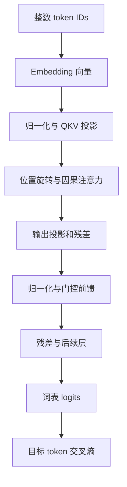

# 17 一次参数更新的内部：从 token 到梯度与通信

前面的工程章节把模型当作一个可以训练、评估、发布的组件。本章打开这个组件：对一个具体序列，追踪它如何成为张量，如何通过注意力和前馈网络产生预测，以及一个错误预测如何反向改变参数。这里的数字都是为便于手算设计的教学数据，不是某个真实大模型的权重；代码用于揭示计算关系，不以吞吐或模型效果为目标。

我们采用 decoder-only 自回归模型的常见结构，但不会把一种结构当作全部模型的标准。归一化位置、激活函数、位置编码、注意力头组织和参数共享均可能不同。读者应学会从模型配置和实现确认差异，而不是只凭模型名称猜测。本章的注意力关系参照原始 Transformer 论文，RoPE、优化器和精度部分分别引用原论文与官方文档。[^attention]

## 17.1 先确定模型究竟在预测什么

考虑输入文本：`检查会话缓存。`。真实 tokenizer 可能把它拆为词、字或字节片段；为便于观察，我们暂设一个只有八个 token 的词表，并令这段文本对应 `[1, 3, 5, 2]`。这里的整数只是索引，不表示大小关系。token 5 不比 token 3 更有语义，也不意味着两者的距离等于 2。

自回归训练要求每个位置利用前文预测后一个 token。因此四个 token 可以构造三个预测位置：

| 位置 | 当前可见 token | 本位置的预测目标 |
| --- | --- | --- |
| 0 | `[1]` | `3` |
| 1 | `[1, 3]` | `5` |
| 2 | `[1, 3, 5]` | `2` |

这不是把同一个目标重复三次，而是同一序列中的三个条件预测问题。训练时可把整段并行送入网络，但必须用因果掩码确保位置 0 的计算无法读取位置 1、2、3 的内容。并行的是计算，不是向模型泄露未来。

如果输入是指令和回答，例如「选择应读取的文件」加上助手输出，SFT 可以只在助手回答的位置计算损失。**不计算某位置的损失，不等于不让后续位置读取这个输入。** 输入中的系统提示、问题和文件摘要仍参与前向计算，并可能通过后续回答的损失接收到梯度；只有目标位置的直接交叉熵被忽略。冻结参数、屏蔽注意力和忽略标签是三个不同操作。

## 17.2 embedding：查表之后才开始计算

设 batch 大小为 `B=2`，每条样本长度为 `T=4`，隐藏维度 `D=4`，词表大小 `V=8`。输入 ID 的形状为 `[2,4]`，embedding 权重 `E` 的形状为 `[8,4]`。查表之后，隐藏张量 `X` 的形状为 `[2,4,4]`。

例如某个教学 embedding 表的三行是：

\[
E_1=[1,0,1,0],\quad E_3=[0,1,0,1],\quad E_5=[1,1,0,0].
\]

于是输入 `[1,3,5]` 变成三行向量。查表不是根据 token ID 做连续插值；它从一个可训练矩阵中取出对应行。若只看这一层，没出现在当前批次中的行没有来自输入查表路径的梯度；如果输入 embedding 与输出词表投影共享权重，同一矩阵还可能从输出路径收到梯度。理解参数共享，才能正确解释某个参数为什么被更新。

embedding 的梯度也不是「把某个词改成另一个词」。优化器改变的是连续向量；它如何影响输出取决于后续各层。一个方向上的变化，可能同时影响许多上下文，因此训练某一类数据也可能改变别的任务表现。

## 17.3 Q、K、V 是可学习投影，不是数据库字段

用单个注意力头说明。设头维度为 `d=2`，投影矩阵 `W_Q,W_K,W_V` 的形状均为 `[4,2]`。对某个样本：

\[
Q=XW_Q,\quad K=XW_K,\quad V=XW_V.
\]

三者形状都是 `[T,2]`。名字可以帮助直觉：Q 表示当前位置用于匹配的查询，K 表示各位置可被匹配的特征，V 表示在匹配后被聚合的信息。但它们并没有由人预先指定「实体」或「语法」等字段；这些特征由训练形成。每一层和每一头都可能采用不同的表示。

假设前两个位置经投影后得到：

\[
q_0=[1,0],\quad q_1=[0,1],\quad
k_0=[1,0],\quad k_1=[1,1],\quad
v_0=[2,0],\quad v_1=[0,4].
\]

位置 1 可以读取位置 0 和位置 1。点积为 `q1·k0=0`、`q1·k1=1`。除以 `sqrt(d)=sqrt(2)` 后，分数约为 `[0,0.7071]`，softmax 得到约 `[0.3302,0.6698]`。因此该头在位置 1 的输出为：

\[
o_1=0.3302[2,0]+0.6698[0,4]
\approx[0.6604,2.6792].
\]

这个结果不是选择一个 token 的硬索引，而是两个 value 向量的加权和。注意力权重高说明该层该头在这一次计算中对相应 value 的权重较大；它本身不能证明因果解释，更不能直接当作模型推理过程。

除以 `sqrt(d)` 的作用是控制点积随维度增加的尺度。若各维独立且具有相近方差，点积方差会随维度增长；分数过大容易使 softmax 饱和。真实网络还包含归一化、初始化与数值策略，因此这个解释是设计直觉，不是所有运行状态的精确统计定律。

## 17.4 因果 mask 与 padding mask 为什么不能混用

完整注意力分数是：

\[
S=QK^\top/\sqrt d+M,\qquad A=\operatorname{softmax}(S),\qquad O=AV.
\]

`S` 的形状为 `[T,T]`；行是查询位置，列是被读取的位置。因果掩码允许读对角线及其左边，禁止读取未来。可把被禁止位置的分数视为负无穷，使其 softmax 概率为零。实际实现可能使用布尔掩码、有限的极小值或专门的 causal kernel，必须按对应 API 语义检查。

padding mask 解决的不是时间方向，而是哪些位置根本不是有效内容。右侧 padding、左侧 padding和多样本 packing 会改变掩码的构造。如果把多条互不相关的样本拼为一段而没有正确隔离，后一条样本可能读取前一条样本；这是否符合训练目标必须明确，不能因为张量长度正确就认为语义正确。

某一行如果所有 key 都被屏蔽，softmax 在概念上面对的是全负无穷，可能产生 NaN 或触发实现特定处理。因此测试掩码时要检查边界行、空样本、全部被忽略的标签和 padding 对齐。`attention_mask` 的 1/0 含义与某些底层算子布尔 mask 的 True/False 含义也可能不同；名字相同不等于约定相同。[^sdpa]

## 17.5 多头如何改变形状

设隐藏维度为 4096，查询头数 32，则常见每头维度为 128。`Q` 可从 `[B,T,4096]` 重排为 `[B,32,T,128]`，每头独立计算注意力，再拼回 `[B,T,4096]`，通过输出投影映射回残差通道。

GQA 让多个查询头共享较少的 key/value 头；例如 32 个查询头与 8 个 KV 头。它改变 KV 参数与缓存组织，不能把 Q、K、V 的头数都假定相同。实现可能用广播或 kernel 内分组处理，不一定真的复制 K/V。阅读模型权重形状时，若发现 K/V 投影比 Q 小，不应立刻判断权重损坏。[^gqa]

## 17.6 RoPE：旋转向量而非增加一个位置标签

在采用旋转位置编码的模型里，Q 和 K 的部分或全部维度按二维配对旋转。对一对维度，位置 `m` 的旋转为：

\[
R(m\omega)\begin{bmatrix}x_1\\x_2\end{bmatrix}
=\begin{bmatrix}
\cos(m\omega)&-\sin(m\omega)\\
\sin(m\omega)&\cos(m\omega)
\end{bmatrix}
\begin{bmatrix}x_1\\x_2\end{bmatrix}.
\]

若向量是 `[1,0]`、角度为 90 度，旋转后为 `[0,1]`。这只是一个便于手算的例子；真实模型在不同维度使用不同频率，并按实现安排配对方式。Q 与 K 的旋转使两者点积可依赖相对位置：`(R_m q)^T(R_n k)=q^T R_(n-m) k`。因此位置信息进入了匹配关系，而不是简单在向量末尾附一个整数。

这也解释了为什么改上下文上限不是纯粹的配置开关：新的位置范围会改变角度分布，模型在训练中是否见过相应关系、频率是否缩放、推理端是否使用同一策略，都影响表现。RoPE 提供位置表示机制，不能单独保证模型在任意长序列中正确利用信息。[^rope]

## 17.7 一个 block 不只有 attention

注意力负责跨位置交换信息；逐位置前馈网络负责对每个位置的通道做非线性变换。常见 pre-norm block 可以概念化为：

\[
H=X+\operatorname{Attention}(\operatorname{Norm}(X)),
\qquad Y=H+\operatorname{MLP}(\operatorname{Norm}(H)).
\]

残差加法要求输出与输入形状相同。它同时提供信息和梯度可经过的路径，但不是说梯度永不消失或训练永远稳定。归一化会改变每一层输入的尺度；LayerNorm 和 RMSNorm 的公式不同，不能将其参数和统计行为混为一谈。

一种常见门控前馈形式是 `down(SiLU(gate(X)) * up(X))`。例如 `D=4096`、中间维度 `F=11008` 时，gate 和 up 将 `[B,T,D]` 分别投影为 `[B,T,F]`，逐元素相乘后再由 down 投影为 `[B,T,D]`。这里每个位置使用相同参数，未直接跨位置混合；跨位置依赖已经通过注意力进入隐藏表示。门控激活是具体架构选择，不能从原始 Transformer 的 ReLU 前馈公式直接推断所有现代模型。[^swiglu]



*图 17-1：一段序列的前向计算。为突出主线，省略 dropout、偏置、不同架构分支和算子融合；实际实现需逐项核对。*

## 17.8 logits、概率与交叉熵：算出一个错误的代价

最后的隐藏向量通过词表投影得到 logits。若某位置的隐藏维度为 `D`、词表为 `V`，投影把 `[D]` 变成 `[V]`。logits 是未归一化分数，不是概率，也不要求为正。

设只有三个候选 token，logits 为 `[2,1,0]`，真实目标是下标 1。减去最大值后，指数为 `[1, exp(-1), exp(-2)]≈[1,0.3679,0.1353]`，总和约 1.5032。于是：

\[
p\approx[0.6652,0.2447,0.0900],\qquad
L=-\log p_1\approx1.4076.
\]

模型把最大概率给了错误候选，真实目标只有约 24.47% 概率。若真实目标改为下标 0，同样的预测对应损失约 0.4076。损失依赖真实目标，不是只看预测分布是否集中。

交叉熵对 logits 的梯度非常简洁：

\[
\frac{\partial L}{\partial z_j}=p_j-\mathbb{1}[j=y].
\]

所以梯度约为 `[0.6652,-0.7553,0.0900]`。梯度下降减去梯度：错误候选的分数向下，正确候选的分数向上。但真实模型更新的是产生这些分数的权重，而不是把这三个 logit 作为永久参数单独保存。下一次上下文不同，输出也不同。[^ce]

## 17.9 为什么这个梯度成立

把交叉熵写开：

\[
L=-z_y+\log\sum_k e^{z_k}.
\]

对 `z_j` 求导，第一项给出 `-1[j=y]`，第二项给出 `exp(z_j)/sum(exp(z_k))`，正是 `p_j`。这个推导还说明实现可以直接从 logits 计算稳定的 log-sum-exp，不必先把概率转出来再取 log。错误地先 softmax 再把概率作为 `CrossEntropyLoss` 的输入，会让框架再执行一次与 logits 对应的变换，目标函数便不同了。

如果有效目标有 `N` 个，平均损失会让每个位置的梯度再除以 `N`。标签平滑、类别权重、辅助损失和不同归一化会改变公式或权重，因此比较 loss 前必须确认定义一致。大模型词表常有数万甚至更多 token；真正训练时是对整个支持集合的分布学习，而不是只比较被采样出来的一个答案。

## 17.10 反向传播不是把正确答案直接写入权重

先看输出层。设隐藏向量 `h=[1,2]`，输出权重矩阵为：

\[
W=\begin{bmatrix}1&0&0\\0.5&0.5&0\end{bmatrix},
\quad z=hW=[2,1,0].
\]

仍用目标下标 1，令 `g_z=[0.6652,-0.7553,0.0900]`。链式法则给出：

\[
\frac{\partial L}{\partial W}=h^\top g_z
=\begin{bmatrix}
0.6652&-0.7553&0.0900\\
1.3304&-1.5106&0.1800
\end{bmatrix}.
\]

隐藏向量的梯度为 `g_h=g_z W^T≈[0.6652,-0.0451]`。这两项扮演不同角色：权重梯度用于更新输出层；隐藏梯度继续向前一层传播。若教学性地直接对 W 做学习率 0.1 的 SGD 更新，h 暂时不变，则新 logits 约为 `[1.6674,1.3777,-0.0450]`。目标概率约从 0.2447 上升到 0.3880，损失约降到 0.9467。这个算例只验证局部更新方向，并不是对真实模型每步损失必降的保证；真实训练里 h 和其他参数也会更新，且下一批数据不同。

对一般矩阵乘法 `Y=XW`，如果已知上游梯度 `G=∂L/∂Y`，则 `∂L/∂W=X^T G`，`∂L/∂X=G W^T`。前向一次乘法，反向通常需要另外两次相关乘法。这是训练比单次前向昂贵的重要原因之一，但实际成本还由激活、归约、重计算、通信和融合实现决定，不能把「三倍」当作任意训练系统的精确比值。

注意力也可沿这条线拆开。`O=AV` 得到 `g_V=A^T g_O` 与 `g_A=g_O V^T`；对每一行 softmax，有 `g_S=a*(g_A-sum(a*g_A))`；`S=QK^T/sqrt(d)` 再产生 `g_Q=g_S K/sqrt(d)` 与 `g_K=g_S^T Q/sqrt(d)`。这里 `*` 是逐元素乘法。没有被 mask 允许的位置不应获得相应注意力分数梯度。最终，Q、K、V 投影各自的权重和输入路径继续收集梯度，残差路径则与分支梯度相加。

这一过程由自动微分系统根据实际计算图执行。它并不理解「这是一个注意力模块」的自然语言含义，而是知道各算子的导数和依赖关系。错误地调用 `.detach()`、在不该使用的地方进入 `no_grad()`、把中间值转成普通 Python 数字后重新构造 tensor，都可能切断计算图。相反，反复把带计算图的 loss 存进列表，也可能让旧图无法释放，使显存持续增长。[^autograd]

## 17.11 一段可审查的计算代码

下面代码用 float64 和极小张量复现前述输出层损失，并核对自动微分与解析梯度。它需要 PyTorch，但不需要 GPU；本章编写环境没有安装 PyTorch，因此代码明确作为待执行验证的教学程序。模型实验章节应在锁定依赖的环境中实际运行后保存输出，不把预期结果写成实测结果。

```python
import torch
import torch.nn.functional as F

torch.set_default_dtype(torch.float64)

# h 可以代表前面所有 Transformer 层在某个位置的输出。
h = torch.tensor([[1.0, 2.0]], requires_grad=True)
W = torch.tensor([[1.0, 0.0, 0.0],
                  [0.5, 0.5, 0.0]], requires_grad=True)
target = torch.tensor([1])
logits = h @ W                    # [1, 2] @ [2, 3] -> [1, 3]
loss = F.cross_entropy(logits, target)
loss.backward()

with torch.no_grad():
    probabilities = logits.softmax(dim=-1)
    dz = probabilities.clone()
    dz[0, target.item()] -= 1.0  # p - one_hot(y)，这里仅一个目标
    expected_dW = h.T @ dz
    expected_dh = dz @ W.T
    torch.testing.assert_close(W.grad, expected_dW)
    torch.testing.assert_close(h.grad, expected_dh)
    print('logits:', logits.tolist())
    print('probabilities:', probabilities.tolist())
    print('loss:', loss.item())

    # 只更新输出层，方便与手算对比；真实训练由 optimizer 管理更新。
    updated_W = W - 0.1 * W.grad
    next_loss = F.cross_entropy(h @ updated_W, target)
    print('loss after one local SGD update:', next_loss.item())
```

用这类局部核对可以发现梯度符号、归一化和形状错误。它不能验证整个大模型、数据管线或分布式运行都正确。下一层验证应测试多个位置、被忽略标签、padding 和变长批次；然后才测试完整训练器。

## 17.12 AdamW：参数之外还要保存什么

SGD 直接按当前梯度更新；Adam 为每个可训练参数维护一阶与二阶矩估计。对某个标量参数，第 t 步可写为：

\[
m_t=\beta_1m_{t-1}+(1-\beta_1)g_t,
\quad v_t=\beta_2v_{t-1}+(1-\beta_2)g_t^2.
\]

初始矩为零时需要偏差修正：`m_hat=m_t/(1-beta1^t)`、`v_hat=v_t/(1-beta2^t)`。AdamW 将权重衰减与梯度自适应更新解耦，简化写成：

\[
\theta_t=(1-\eta\lambda)\theta_{t-1}
-\eta\frac{\hat m_t}{\sqrt{\hat v_t}+\epsilon}.
\]

设 `theta0=1`、`g1=0.2`、`beta1=0.9`、`beta2=0.999`、学习率 `eta=0.01`、衰减 `lambda=0.1`，忽略极小 epsilon。第一步 `m1=0.02`、`v1=0.00004`；修正后为 `m_hat=0.2`、`v_hat=0.04`。梯度项约为 0.01，衰减项为 0.001，因此新参数约为 0.989。

这里自适应更新幅度接近学习率，并不意味着梯度大小不再重要：后续步骤的历史、方向、二阶估计、epsilon、裁剪和调度都会影响轨迹。如果重新加载了权重却没有加载 m、v 和步数，下一次更新通常不会与连续训练相同。只保存模型权重是模型导出；保存可恢复训练状态还需要优化器、调度器、随机数、数据位置等信息。[^adamw]

Adam 的两个矩为什么贵？若有 70 亿个可训练参数，且两个矩都使用 FP32，则仅它们就占 `7e9*2*4=56e9` 字节，约 52.15 GiB。参数、梯度、可能的主权重、激活、通信 buffer 还要另外计入。这就是全参数训练与只训练小适配器在优化器状态上差异巨大的原因。但不同优化器和实现的状态精度不同，必须从实际配置核算，不能把一个字节常数套到全部方案。

权重衰减也有参数分组。实际配方常对某些 bias 或归一化参数采用不同衰减，但这不是模型无关的定律；应沿用经过验证的配方或做受控实验。梯度为 None 与数值为零也可能导致优化器不同行为，因此冻结参数时应确认可训练参数列表，而不只是看到某些梯度很小。

## 17.13 混合精度到底混在哪里

「BF16 训练」不是说从权重到 loss 再到优化器状态全部永久使用 BF16。矩阵乘、归约、softmax、归一化与优化器可能采用不同的存储和计算类型。低精度带来更低内存和更高吞吐的机会，但数值范围、有效位和硬件实现都需要考虑。

FP16 的指数范围较小，小梯度可能下溢，较大中间值可能溢出。损失缩放把 loss 乘以一个尺度 S，使反向得到 `S*g`，更新前再除以 S；这利用了链式法则。如果存在无穷或 NaN，动态缩放器可能跳过该步并调整尺度。**梯度裁剪应在反缩放后进行**，否则裁剪阈值对应的是被放大后的梯度。梯度累积窗口内也需要遵守缩放器的约定，不能在每个 micro-batch 随意改变尺度。[^amp]

BF16 具有与 FP32 相近的指数位数，但尾数更短。它减少某些范围问题，却不意味着没有数值误差，更不保证可以不看任何 NaN。多个很小贡献加到较大累加值时可能被舍入；不同归约顺序也会改变浮点结果。比较单卡和多卡时，逐 bit 一致通常不是通用要求，但质量明显退化需要调查，不能一概归因于随机误差。

FP8 等方案还涉及缩放粒度、动态范围校准、部分算子保留高精度和特定硬件 kernel。只把权重 dtype 改成某个低精度名称，不等于实现了完整低精度训练。工程验证至少同时看吞吐、峰值显存、loss/梯度异常、独立任务质量及恢复行为。

## 17.14 多个 token 的平均：一个很容易训练错的地方

设一批中有六个有效目标，每个位置损失分别为 `l1...l6`，期望目标是 token 平均：`L=sum(li)/6`。如果这些位置被拆到两个 micro-batch，第一批 2 个、第二批 4 个，各自计算均值再平均，得到：

\[
L_{wrong}=\frac12\left(\frac{l_1+l_2}{2}+\frac{l_3+l_4+l_5+l_6}{4}\right).
\]

前两个 token 的权重为 1/4，后四个为 1/8；这不是目标中的统一 1/6。若第一批平均损失为 4、第二批平均为 1，简单批平均为 2.5，而正确 token 平均为 `(2*4+4*1)/6=2`。这不仅影响日志，它改变梯度和优化目标。

SFT 中尤其容易出现这种问题：总序列长度相同，助手回答长度却不同；padding、提示词和工具消息被 mask 后，有效目标数量差异很大。按样本平均也可以是有意设计的目标，但必须说明选择；不能一面声称按 token 平均，一面实际按 micro-batch 平均。

一个单进程、梯度累积窗口的思路是先知道本窗口有效目标总数 N，每个 micro-batch 都计算 `sum` 损失并除以同一个 N，再 backward。最后只更新一次：

```python
# 教学片段：batches 已可在这个累积窗口内重用；并非完整训练脚本。
# logits/labels 的右移必须和模型约定一致，不能在内置 loss 后重复右移。
optimizer.zero_grad(set_to_none=True)
N = sum(int((batch['labels'][:, 1:] != -100).sum()) for batch in batches)
if N == 0:
    raise ValueError('这个累积窗口没有任何有效目标 token')
for batch in batches:
    logits = model(input_ids=batch['input_ids'],
                   attention_mask=batch['attention_mask']).logits
    shift_logits = logits[:, :-1].contiguous()
    shift_labels = batch['labels'][:, 1:].contiguous()
    loss_sum = F.cross_entropy(
        shift_logits.reshape(-1, shift_logits.size(-1)),
        shift_labels.reshape(-1),
        ignore_index=-100, reduction='sum')
    (loss_sum / N).backward()
optimizer.step()
```

这个实现省略了 AMP、分布式、设备迁移和流式数据；为得到 N 而缓存整个窗口也可能占用内存。完整框架可以通过预先统计计数、显式缩放或其自身提供的 token 归一化接口解决。关键是把数学目标和训练器的实际归约约定对齐。

## 17.15 从单卡到 DDP：为什么还要乘 world size

设有 R 个数据并行进程，第 r 个进程的有效目标数为 `N_r`，总损失和为 `S_r`。想优化全局 token 平均：

\[
L=\frac{\sum_r S_r}{\sum_r N_r}.
\]

若每个进程对本地均值 `S_r/N_r` 反向，标准 DDP 再对各进程梯度取平均，结果是「各 rank 均值的平均」。当 `N_r` 不同，它并非全局 token 平均。

在常见、默认 DDP 梯度平均约定下，可以令每个 rank 反向的本地标量为 `R*S_r/N_global`。DDP 平均之后，R 抵消其 1/R，最终梯度正是 `sum_r grad(S_r)/N_global`。因此要先把有效目标数做全局求和；计数必须覆盖同一个累积窗口。若采用自定义通信 hook、不同框架归约或其他并行组合，必须重新推导，不能机械乘 R。[^ddp]

举例：rank 0 有 2 个目标，rank 1 有 4 个。全局总数为 6，R 为 2。rank 0 对 `2*S0/6` 反向，rank 1 对 `2*S1/6` 反向；DDP 平均后是 `(grad(S0)+grad(S1))/6`。对每个 rank 的局部均值平均则会分别给两组不同的 token 权重。

梯度累积若在每个 micro-batch 都同步，会产生多次不必要通信；DDP 的 `no_sync` 可以将同步推迟到窗口末尾，但必须让前向和反向都处于正确上下文，并保证最后一次触发同步。只有减少通信而保持数学目标不变，才可把吞吐改善看成等价训练的系统优化。[^ddp]

FSDP、ZeRO 和张量并行又增加了参数及梯度分片。它们改变状态在哪里、何时收集和归约；如果实现正确，应对应设定的训练目标，但实际 rounding、loss 归一化、辅助损失以及采样分片都需要验证。总 GPU 数不是 token 平均公式里的数据并行副本数：同一张量并行组共同计算一个模型副本，不能把其每张卡当作独立样本副本。

## 17.16 把计算图变成排错路线

当 loss 异常时，沿计算顺序排查比盲目修改学习率有效。先检查 token ID 是否落在词表内、tokenizer 是否匹配、是否重复加入特殊 token；再确认 embedding 与模型权重版本一致。检查 Q/K/V 与 mask 形状、位置 ID 是否连续或按 packing 规则重置、是否存在全 mask 行。接着核查 logits 有限性、标签右移、有效目标数和损失归约；最后检查梯度是否出现、是否被意外累积、是否反缩放与裁剪，以及优化器是否真的更新可训练参数。

若单卡正常而多卡异常，固定一小批样本，明确其在各 rank 的分配和总有效 token 数；在相同全局批量下比较一轮更新前后的参数变化，而不是只比较打印的 loss。分布式日志只打印 rank 0 的局部均值时，即使梯度正确，显示值也可能无法代表全局；反过来，全局 loss 看起来正常，也不能证明梯度加权正确。

验证应逐层增加复杂度：手算或有限差分核对局部梯度；小张量核对实现；单卡小批次验证权重更新；完整数据管线验证 mask 和采样；多卡验证归约与恢复。每一层增加一个明确问题。这样即使最终采用 NeMo、Megatron、TRL 或其他成熟工具，团队也能判断异常发生在哪个环节，而不是只能等待框架维护者解释。

## 注释与原始资料

[^attention]: Vaswani 等，*Attention Is All You Need*，2017。原始 scaled dot-product attention 与多头结构：[论文](https://arxiv.org/abs/1706.03762)。本章的 decoder-only、pre-norm 和门控前馈组合是教学选型，不等同于原论文完整 encoder-decoder 模型。
[^sdpa]: PyTorch，`scaled_dot_product_attention`：[官方接口与 mask 说明](https://docs.pytorch.org/docs/stable/generated/torch.nn.functional.scaled_dot_product_attention.html)。布尔 mask 语义和 kernel 选择按选定版本核对。
[^gqa]: Ainslie 等，*GQA: Training Generalized Multi-Query Transformer Models from Multi-Head Checkpoints*，2023：[论文](https://arxiv.org/abs/2305.13245)。
[^rope]: Su 等，*RoFormer: Enhanced Transformer with Rotary Position Embedding*：[论文](https://arxiv.org/abs/2104.09864)。
[^swiglu]: Shazeer，*GLU Variants Improve Transformer*，2020：[论文](https://arxiv.org/abs/2002.05202)。
[^ce]: PyTorch，`CrossEntropyLoss`：[官方定义、归约和 ignore_index](https://docs.pytorch.org/docs/stable/generated/torch.nn.CrossEntropyLoss.html)。
[^autograd]: PyTorch，[自动微分教程](https://docs.pytorch.org/tutorials/beginner/basics/autogradqs_tutorial.html)。
[^adamw]: Loshchilov 与 Hutter，*Decoupled Weight Decay Regularization*：[论文](https://arxiv.org/abs/1711.05101)；[PyTorch AdamW 算法](https://docs.pytorch.org/docs/stable/generated/torch.optim.AdamW.html)。
[^amp]: PyTorch，[混合精度与梯度累积示例](https://docs.pytorch.org/docs/stable/notes/amp_examples.html)。
[^ddp]: PyTorch，[DistributedDataParallel](https://docs.pytorch.org/docs/stable/generated/torch.nn.parallel.DistributedDataParallel.html)。本章 R 倍缩放推导假设标准梯度平均，不涵盖改变归约约定的自定义实现。
