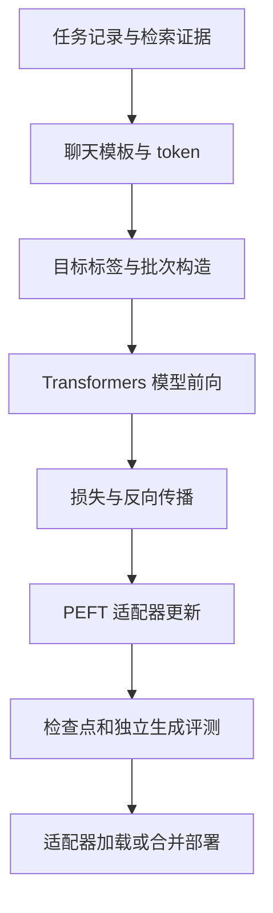

# 18 把 Hugging Face 工具栈接成一次可解释的训练

如果读者只知道 Transformers 加载模型、PEFT 做 LoRA、TRL 提供训练器，那么仍然无法判断一次训练为什么失败。本章把它们放入同一条数据流：我们要训练一个代码助手，根据问题描述和检索结果选择下一步检查的文件。真正的工程对象不是三个库，而是从原始任务到部署输出之间的一组契约。只要其中某个契约变化，模型质量就可能变化，即使程序没有报错。

本章以单机、单张 CUDA GPU、已有自回归指令模型、纯文本单轮监督微调为边界，采用 LoRA，不启用量化、packing、分布式和在线 RL。这样的限制是为了先看清基本路径，再逐项增加复杂度。代码是教学实现，未在本书环境执行 GPU 训练；不能把它当作任何模型或显卡上的已验证配方。文档核查日期为 2026-10-29。

## 18.1 先明确三个库之间的责任

Transformers 提供模型结构、预训练权重加载、tokenizer、生成接口及基础 Trainer。PEFT 改变哪些参数可训练以及适配器如何保存；它不负责判定你的答案是否正确。TRL 在 Transformers 之上组织 SFT、偏好优化和强化学习等流程；SFTTrainer 会处理特定数据格式、损失掩码和训练配置，但不会自动理解业务上的「正确定位」。

把任务交给 SFTTrainer，并不意味着可以跳过 tokenizer 与标签检查。训练器能接受合法 JSONL，也能接受语义完全错误的 JSONL。例如答案中包含真实补丁才知道的文件名，模型可以在训练集学到这种映射，但在新仓库上没有同样证据；这不是训练框架的问题。类似地，LoRA 插入成功只说明参数结构发生变化，不能证明更新落在你以为的位置。[Transformers 模型接口](https://huggingface.co/docs/transformers/main_classes/model)；[PEFT LoRA](https://huggingface.co/docs/peft/package_reference/lora)；[TRL SFTTrainer](https://huggingface.co/docs/trl/sft_trainer)。



图中的检查点不是终点。数据、tokenizer、模板、基础权重和适配器共同定义了最终行为；漏保存任何一项，都可能使训练后的模型在另一台机器上表现不同。

## 18.2 固定环境，而不是写一句「安装最新版」

实践中应区分两种版本文件。一种是依赖声明，告诉安装器大致需要什么；另一种是通过验证的锁定记录，包含确切版本、模型提交 SHA、数据哈希、CUDA 与驱动。项目开始时可以选择团队已经维护的版本组合；通过加载、前向、短训练、保存恢复和生成评测后，再冻结它。不能因为文档里出现某个接口，就假定本机所有版本都支持。

下面的正文使用 `SFTConfig`、`SFTTrainer(processing_class=...)`、`LoraConfig` 等接口形态；这对应 TRL 当前文档中的接口族。若团队使用早期 TRL，可能看到 `tokenizer=`、不同的长度参数或不同的 collator；不要同时复制多个时代的示例。先检查实际签名：

```python
import inspect
import importlib.metadata as metadata
from trl import SFTConfig, SFTTrainer

for package in ("torch", "transformers", "datasets", "peft", "trl", "accelerate"):
    print(package, metadata.version(package))
print(inspect.signature(SFTConfig))
print(inspect.signature(SFTTrainer))
```

这段程序只检查接口存在，不证明训练正确。把输出写入实验目录，再附上 `nvidia-smi`、模型 revision 和代码提交。训练期间不升级库；如果必须升级，把它作为一个新的实验变量。一个「修复兼容性」的依赖变更可能同时改变 attention 实现、损失归一化或模板处理，质量回归不一定只来自模型参数。

为避免隐藏的远程变动，本章的完整低层脚本使用本地 `BASE_DIR`。实际准备时，从已审核的模型仓库下载固定 revision 到该目录，并保留原模型许可证。不能把分支名 `main` 当作不可变版本；同名模型以后可能更新 tokenizer、配置甚至权重。

## 18.3 样本是行为契约，不是任意文本

假设输入记录如下：

```json
{"id":"train-0042","repo":"demo-app","issue":"刷新后登录状态丢失","evidence":"src/session.ts 负责读写会话；src/theme.ts 负责主题。","answer":{"files":["src/session.ts"],"action":"inspect"}}
```

输出只允许 JSON 对象，`files` 必须来自已经提供的候选集合，`action` 暂时只允许 `inspect`。这些约束不是为了让任务显得简单，而是为了让第一轮实验可诊断。若允许模型同时查找文件、编辑、运行测试和解释整个修复，则失败时很难区分是定位、生成、工具协议还是执行环境出了问题。

用户消息可以写成「任务：……；证据：……；请返回规定 JSON」，助手消息则只包含目标 JSON。不要在答案中加入仅训练时存在的私有标识、绝对路径或参考答案注释。对于多文件任务，明确文件顺序是否有意义；如果无意义，评测应按集合比较，避免把同一选择的不同顺序判成错误。

数据切分首先按仓库或来源组进行，而不是在最终 JSONL 上逐行随机。相邻提交和仓库副本容易跨集合泄漏。训练时使用的 evidence 也要来自与部署相同的检索流程；如果训练时人工提供了完美候选，而上线检索经常遗漏正确文件，训练效果会被高估。

## 18.4 模板究竟增加了什么

聊天模型接收的不是 Python 字典。`apply_chat_template` 会把角色、内容、结束标记和助手起始标记转换为一段符合该模型训练约定的序列。两个模型都支持 `messages`，不意味着角色 token 相同。把另一个模型的模板复制过来，有时仍能生成文本，但会破坏原有分布。

```python
messages = [
    {"role": "user", "content": "任务：刷新后登录状态丢失。候选：src/session.ts。返回 JSON。"},
    {"role": "assistant", "content": '{"files":["src/session.ts"],"action":"inspect"}'},
]
print(tokenizer.apply_chat_template(messages, tokenize=False,
                                    add_generation_prompt=False))
```

先看实际字符串，再看 token。训练序列已经包含完整助手回答，因此通常不应在末尾再增加新的助手生成起始标记；推理输入只有用户部分时，则需要按模型模板增加助手起始标记。模型回答后是否生成结束 token，会直接影响停止条件。重复添加特殊 token、遗漏结束标记，可能表现为无限续写、把用户消息也生成出来或过早停止。[聊天模板说明](https://huggingface.co/docs/transformers/chat_templating)；[编写模板](https://huggingface.co/docs/transformers/chat_templating_writing)。

一个常见错误是先渲染出带特殊 token 的字符串，再调用 tokenizer 并让它自动添加另一组特殊 token。官方说明建议在这种分两步处理的情形中注意 `add_special_tokens=False`。更直接的办法是让模板一次完成 tokenization，但仍须核对长度、边界与解码结果。

## 18.5 标签掩码：你究竟在教模型预测什么

因果语言模型常用输入序列自身作为标签，模型内部再把 logits 与下一位置标签对齐。若 `input_ids` 为 `[u1,u2,a1,a2,eos]`，完整语言模型目标会训练用户文本和助手文本；仅回答目标则将前面不参与训练的位置设为 `-100`。这个数不是 token，而是交叉熵里的忽略标记。

注意：mask 不会让模型「看不见」用户内容。attention mask 控制哪些输入位置参与注意力；label mask 控制哪些输出位置计算损失。用户输入可以被模型读取，同时不产生直接的预测损失。混淆两者会导致模型根本无法利用任务描述。

如果每个样本的输入很长、回答很短，错误地对全部 token 算损失，训练会大量优化复述输入的能力。总 loss 可能下降得很好，业务输出却没有改善。相反，如果模板截断使所有回答 token 都消失，batch 可能完全没有有效标签；应在训练前报错，而不是等 NaN 出现。

下面给出一个明确但受限制的编码器。它要求「用户部分加助手生成起始标记」恰好是完整训练序列的前缀；若模型模板不满足，立即拒绝。不要删除断言以让程序跑通，应改用该模板支持的 assistant mask 或其他经验证的边界方法。

```python
def encode_one(row, tokenizer, max_length):
    import json
    prompt = (
        f"任务：{row['issue']}\n证据：{row['evidence']}\n"
        "只返回 JSON，字段为 files 和 action；action 必须为 inspect。"
    )
    user = [{"role": "user", "content": prompt}]
    answer = json.dumps(row["answer"], ensure_ascii=False, separators=(",", ":"))
    prefix = tokenizer.apply_chat_template(
        user, tokenize=True, add_generation_prompt=True
    )
    full = tokenizer.apply_chat_template(
        user + [{"role": "assistant", "content": answer}],
        tokenize=True, add_generation_prompt=False
    )
    # 模板契约检查：不能假定两个独立编码结果天然有前缀关系。
    if full[:len(prefix)] != prefix:
        raise ValueError("模板前缀不一致，需要专用 assistant mask")
    # 第一轮拒绝过长样本；不悄悄截掉参考答案。
    if len(full) > max_length:
        raise ValueError(f"样本过长：{row['id']}，长度 {len(full)}")
    labels = [-100] * len(prefix) + full[len(prefix):]
    if sum(x != -100 for x in labels) == 0:
        raise ValueError("没有可训练的目标 token")
    return {"input_ids": full, "attention_mask": [1] * len(full),
            "labels": labels}
```

为什么不直接按字符串搜索答案的位置？分词可能跨越边界，且相同答案文本可能已出现在提示中。为什么不先编码 prompt 再编码 answer 然后拼接？这不一定等价于对完整模板编码；角色边界、空格与特殊 token 都可能改变结果。前缀检查给出了一个可验证的窄条件，而不是宣称所有模板都适用。

TRL 的 `assistant_only_loss` 和 `completion_only_loss` 能简化常见格式，但两者含义不同。前者围绕对话中的助手段，且要求模板能提供相应 mask；后者围绕 prompt-completion 数据的 completion 部分。配置前先检查实际 batch 的 labels，不要只检查参数是否接受。[SFTTrainer 损失选项](https://huggingface.co/docs/trl/sft_trainer)。

## 18.6 Collator：变长样本如何组成张量

模型需要批量张量，两个样本可能分别有 80 和 120 个 token。collator 将它们补到同一长度。输入 padding 必须在 attention mask 里标为 0；标签 padding 必须为 `-100`。如果模型把 EOS 作为 PAD 使用，不应因此把所有等于 EOS 的真实目标都 mask 掉，必须依赖长度或 attention mask 区分真实结束 token 与补齐位置。

```python
from dataclasses import dataclass
import torch

@dataclass
class AnswerCollator:
    pad_id: int

    def __call__(self, examples):
        width = max(len(x["input_ids"]) for x in examples)
        batch = {"input_ids": [], "attention_mask": [], "labels": []}
        for item in examples:
            pad = width - len(item["input_ids"])
            batch["input_ids"].append(item["input_ids"] + [self.pad_id] * pad)
            batch["attention_mask"].append(item["attention_mask"] + [0] * pad)
            batch["labels"].append(item["labels"] + [-100] * pad)
        return {key: torch.tensor(value, dtype=torch.long)
                for key, value in batch.items()}
```

第一轮使用右 padding，保证调试直观。生成阶段常对 decoder-only 批处理使用左 padding，两者不应随意混用。某些优化内核要求特定长度对齐或 padding-free 数据；只有基础 batch 已经验证后，才值得加入这些优化。

在真正训练前，抽取两个样本打印三行：完整输入解码、有效目标解码、有效目标 token 数。有效目标应包含期望的助手输出与必要的结束标记，而非问题描述。再检查 padded 位置的标签全部为 `-100`。这一步往往比盯着训练曲线更快发现错误。

## 18.7 LoRA 注入之后，哪些权重在变化

对于一个线性层，原计算为 `y = Wx`。LoRA 将更新写成两个低秩矩阵的乘积，常见形式为 `y = Wx + sBAx`。冻结的 `W` 保持原值，训练 `A` 和 `B`；缩放 `s` 与配置和方法有关。PEFT 的 `r` 控制低秩维度，`lora_alpha` 参与缩放，`target_modules` 决定插到哪些模块。[LoRA 原论文](https://arxiv.org/abs/2106.09685)。

例如原矩阵维度为 `4096 × 4096`，全参有约 1678 万权重；`r=16` 的两矩阵共有 `16×4096 + 4096×16 = 131072` 个参数，约为原层的 0.78%。但这只是该层新增参数比例，不是总训练显存下降比例：基础模型仍须加载，反向传播仍需要与激活相关的计算和存储。

```python
from peft import LoraConfig, get_peft_model

config = LoraConfig(
    task_type="CAUSAL_LM",
    r=16,
    lora_alpha=32,
    lora_dropout=0.05,
    bias="none",
    target_modules=["q_proj", "v_proj"],
)
model = get_peft_model(model, config)
model.print_trainable_parameters()
```

这里的模块名只是适用于某些模型结构的示例，不能复制给所有模型。先列出 `model.named_modules()`，确认真正存在且对应目标线性层。模型可能使用融合 QKV、不同命名或 MoE 专家参数；「没有匹配模块」不应通过随意扩大正则来解决。为了查明可训练范围，再遍历 `named_parameters()`，检查 `requires_grad=True` 的名称和数量。若 embedding 或输出头需要训练，要通过相应机制明确保存；否则训练时更新了它们，导出时却只保存 LoRA，就会丢失一部分结果。

`r` 不是质量旋钮。增大它提高更新容量，也增加状态和过拟合机会；学习率、数据质量和训练 token 预算往往同样重要。合理对照是在固定样本、训练量和评测下比较两个秩，而不是让大秩模型多训练一倍后宣称秩越大越好。

## 18.8 一条可读懂的基础训练路径

下面使用 Transformers Trainer 暴露编码和 collator，PEFT 负责适配器。它刻意不同时使用 SFTTrainer 的自动预处理，以免重复应用模板。输入文件为已经按仓库隔离的 `train.jsonl` 与 `dev.jsonl`。小数据只能用于管线验证，不能支撑质量结论。

```python
# train_lora.py：需要 BASE_DIR 指向固定版本的本地模型。
import json
import os
from pathlib import Path
import torch
from datasets import Dataset
from transformers import (AutoModelForCausalLM, AutoTokenizer,
                          Trainer, TrainingArguments)
from peft import LoraConfig, get_peft_model

# encode_one 与 AnswerCollator 使用本章前面给出的完整定义。
base_dir = os.environ["BASE_DIR"]
out_dir = Path(os.environ.get("OUT_DIR", "runs/file-selector"))
max_length = 1024
if not torch.cuda.is_available():
    raise RuntimeError("本示例要求 CUDA GPU；不要把 CPU 时间当训练预算")
if not torch.cuda.is_bf16_supported():
    raise RuntimeError("本配方使用 BF16；请另行验证硬件与 FP16 配方")

tokenizer = AutoTokenizer.from_pretrained(base_dir, local_files_only=True)
if not tokenizer.chat_template:
    raise ValueError("缺少聊天模板；应先选择并验证任务模板")
if tokenizer.pad_token_id is None:
    if tokenizer.eos_token_id is None:
        raise ValueError("缺少 PAD 和 EOS，需要明确特殊 token 策略")
    tokenizer.pad_token = tokenizer.eos_token

def read_dataset(path):
    rows = [json.loads(line) for line in Path(path).read_text().splitlines()
            if line.strip()]
    return Dataset.from_list([encode_one(x, tokenizer, max_length) for x in rows])

train_data = read_dataset("train.jsonl")
dev_data = read_dataset("dev.jsonl")
collator = AnswerCollator(tokenizer.pad_token_id)
probe = collator([train_data[0], train_data[min(1, len(train_data)-1)]])
for ids, labels in zip(probe["input_ids"], probe["labels"]):
    print("INPUT", tokenizer.decode(ids.tolist()))
    print("TARGET", tokenizer.decode(labels[labels != -100].tolist()))

model = AutoModelForCausalLM.from_pretrained(
    base_dir, torch_dtype=torch.bfloat16, local_files_only=True
)
# 不使用 device_map='auto'：它通常服务于推理式设备分配，
# 本章让 Trainer 控制单卡训练设备。
model.config.use_cache = False
model = get_peft_model(model, LoraConfig(
    task_type="CAUSAL_LM", r=16, lora_alpha=32, lora_dropout=0.05,
    bias="none", target_modules=["q_proj", "v_proj"]
))
model.print_trainable_parameters()
args = TrainingArguments(
    output_dir=str(out_dir),
    per_device_train_batch_size=1,
    per_device_eval_batch_size=1,
    gradient_accumulation_steps=8,
    learning_rate=1e-4,
    max_steps=100,
    warmup_steps=10,
    weight_decay=0.01,
    lr_scheduler_type="linear",
    bf16=True,
    gradient_checkpointing=True,
    # 单卡教学路径显式选择非重入实现，避免依赖隐含默认值。
    gradient_checkpointing_kwargs={"use_reentrant": False},
    logging_steps=5,
    eval_strategy="steps", eval_steps=25,
    save_strategy="steps", save_steps=25,
    save_total_limit=3,
    report_to="none",
    seed=42,
)
trainer = Trainer(model=model, args=args, train_dataset=train_data,
                  eval_dataset=dev_data, data_collator=collator)
resume = os.environ.get("RESUME_CHECKPOINT")
trainer.train(resume_from_checkpoint=resume or None)
trainer.save_model(str(out_dir / "adapter-final"))
tokenizer.save_pretrained(str(out_dir / "adapter-final"))
```

这里显式选择非重入激活重计算，是因为它与重入实现对输入梯度和计算图的要求不同；冻结基座的 PEFT 训练尤其要确认梯度确实到达适配器。这不是所有分布式后端都通用的配置，应按目标组合重新验证。[PyTorch checkpoint 两种实现](https://docs.pytorch.org/docs/stable/checkpoint.html)。

这是一套待验证的接口示例，不是承诺 `100` 步就足够。第一轮可以用极少样本验证权重变化和保存恢复，正式预算应由学习曲线、独立评估和资源限制确定。`learning_rate=1e-4` 只是示例值；不同基础模型、目标模块和数据量可能需要不同值。

`gradient_accumulation_steps=8` 表示每次更新累积八个 micro-batch，并不等于每八个样本都有相同 token 数。长度不同时，框架版本的损失归一化与累积实现很重要；记录有效目标 token 与版本，并检查其是否按预期计算。如果要自定义 loss，应阅读 Trainer 的 `compute_loss` 和 `num_items_in_batch` 语义，而不是把每批均值机械除以八。[Trainer 自定义损失说明](https://huggingface.co/docs/transformers/main_classes/trainer)。

## 18.9 用 TRL 改写时，哪些工作交给它

SFTTrainer 适合把标准 SFT 数据直接交给框架，让其组织模板、tokenization、packing 与目标掩码。但迁移时只能有一个组件负责这些转换。如果把本章已编码和带 labels 的数据又转换回字符串，让 SFTTrainer 再套模板，可能产生双重模板或不同标签。

对于标准 conversational 数据，可从如下接口形态开始研究：

```python
from trl import SFTConfig, SFTTrainer
from peft import LoraConfig

# raw_train/raw_dev 的每条记录含 messages，而非前面已经编码的 labels。
# assistant_only_loss 需要聊天模板支持助手区间标记。
config = SFTConfig(
    output_dir="runs/trl-selector",
    max_length=1024,
    packing=False,
    assistant_only_loss=True,
    per_device_train_batch_size=1,
    gradient_accumulation_steps=8,
    max_steps=100,
    learning_rate=1e-4,
    bf16=True,
    report_to="none",
)
trainer = SFTTrainer(
    model=model_without_existing_adapter,
    args=config,
    train_dataset=raw_train,
    eval_dataset=raw_dev,
    processing_class=tokenizer,
    peft_config=LoraConfig(task_type="CAUSAL_LM", r=16, lora_alpha=32,
                           target_modules=["q_proj", "v_proj"]),
)
```

上例是迁移片段，不是第二套可直接运行的完整脚本；`raw_train`、`raw_dev` 与基础模型需按对应版本准备。实践中先取 dataloader 的一个 batch，重复前面的 INPUT/TARGET 检查，再跑单步比较梯度和损失。只有确认语义一致，才比较吞吐。

Packing 减少 padding，但是否允许跨样本 attention、位置 ID 是否重置、结束标记如何处理取决于框架和内核组合。把两个独立任务拼在一起，如果第二个任务可以注意到第一个任务的答案，其训练分布就改变了。不能只看到 token/s 上升就认为是无代价优化。先保留 `packing=False` 的可解释基线，再通过短跑和独立任务检验优化版本。

## 18.10 检查点、适配器和最终模型是三种产物

训练检查点面向续训，通常包含权重、优化器状态、调度器、随机状态和步数等；最终适配器面向加载 LoRA，通常比完整基础模型小得多；合并后的模型把更新写入基础权重，面向不支持适配器的推理路径。三者不能仅用目录名区分，应该检查文件和元数据。

PEFT 保存的适配器依赖确切基础模型。若基础仓库后来更新，把同一适配器加载到新权重上不一定等价。保存模型 ID 不够，应记录 revision 与文件哈希。Tokenizer 和聊天模板同样属于产物；训练时修改过特殊 token 而部署漏带，会改变输入的意义。[PEFT 检查点格式](https://huggingface.co/docs/peft/developer_guides/checkpoint)。

```python
from transformers import AutoModelForCausalLM, AutoTokenizer
from peft import PeftModel
import torch

base = AutoModelForCausalLM.from_pretrained(
    "fixed-base", torch_dtype=torch.bfloat16, local_files_only=True
)
adapted = PeftModel.from_pretrained(base, "adapter-final")
# 合并是新的导出步骤，不能覆盖唯一一份原始基础权重和适配器。
merged = adapted.merge_and_unload()
merged.save_pretrained("merged-export", safe_serialization=True)
tokenizer = AutoTokenizer.from_pretrained("adapter-final")
tokenizer.save_pretrained("merged-export")
```

合并是否支持具体适配器、量化基础权重或变体，需按 PEFT 版本核对。不要默认量化模型可无损原地合并。合并前后先用同一批输入、相同精度和生成参数比较 logits 或输出，再测试部署引擎；如果先合并再量化，分别测每一步的质量变化，才能定位退化来自哪里。

## 18.11 评估不只是一行 eval_loss

`eval_loss` 衡量给定目标序列的预测误差，不能直接告诉你文件选择是否正确。生成评测要从只有用户输入的 prompt 开始，让模型自己生成；如果把标准答案也放进输入，评测会失真。使用固定解码设置，比如 greedy 作为第一轮基线，记录最大新 token 和停止条件。比较基础模型、适配器模型和合并模型，不能只报告训练后分数。

任务指标至少拆成四层：输出能否解析为合法 JSON；字段和路径是否满足协议；目标文件是否被覆盖以及多选了多少文件；这些选择是否提高完整任务成功率。假如模型总是把所有候选文件都返回，召回率很高，但筛选失去了意义。因此同时报告精确率、召回率和读取成本。若只训练定位，不应把定位成功等同完整修复成功。

评测日志应逐题保存原始输出和解析状态，聚合指标之外再检查失败类型。只有十个例子的测试集，提升一题就是十个百分点；不要用小样本曲线证明稳定收益。开发集用于挑学习率与检查点，最终测试集在配方确定后使用；否则看过的测试集会变成隐式训练信号。

## 18.12 真实故障怎样沿数据流定位

**损失正常下降，但生成重复问题。** 先解码有效 labels，看看是否错误地训练了用户输入；再检查部署是否使用了相同模板及助手起始标记。无需先调整学习率。

**每个回答都在很早位置结束。** 检查 EOS 与 PAD 是否混淆，是否把结束标记放在助手内容前面，训练长度是否截断了主体。若训练集答案本来只有几个 token，模型也可能学会过短的行为。

**LoRA 保存很小，但加载后像没训练。** 检查适配器是否真正加载、基础 revision 是否相同、目标模块是否匹配、训练时可训练参数是否包含未保存模块。用同一输入比较适配器开关前后的 logits；仅打印「loaded」不足以判断。

**前向能跑，第一次 optimizer step OOM。** 优化器状态可能延迟到第一次更新才创建；显存账本要包括可训练参数对应的状态。应核查优化器的参数组及实际创建的状态；仅把冻结参数留在参数组中，不代表所有优化器实现都会为无梯度参数分配状态。若反向 OOM，重点看长度与激活；若保存 OOM，检查是否临时聚合完整状态。

**恢复后 loss 跳变。** 区分从适配器重新开始和从完整 checkpoint 续训。后者需要恢复优化器、调度器和数据位置。把 `adapter-final` 目录当作完整 checkpoint，通常不满足续训契约。

**换一个库后吞吐变快、质量下降。** 不要立即归因于内核精度；先对比实际 token 序列、labels、packing、截断和 batch 归一化，再比较优化器和生成模板。优化框架可能默认改变多项设置，必须建立等价条件。

## 18.13 Axolotl、LlamaFactory、Unsloth 应怎样读

Axolotl 与 LlamaFactory 把许多训练选项封装成配置和入口，适合团队复用配方、管理常见模型与数据格式。Unsloth 着重于受支持模型和硬件上的训练实现与资源优化，也提供训练、保存和部署路径。它们可以降低样板代码，但不会消除本章的契约：模板、目标标签、可训练参数、损失计数、保存格式和独立评测仍要确认。[Axolotl 文档](https://docs.axolotl.ai/)；[LlamaFactory 文档](https://llamafactory.readthedocs.io/en/latest/)；[Unsloth 文档](https://unsloth.ai/docs)。

从 Python 脚本迁移到配置式工具，先翻译语义而非参数名：本例的「仅助手回答损失」在工具中由什么字段控制？输入是原始 messages 还是已经渲染的 text？长度超限丢弃还是截断？LoRA target 是否自动扩展？保存的是适配器还是合并权重？同一个 `batch_size=1` 是每卡还是全局？这些答案都写入迁移表后，用同一小批次对比。

反过来，从配置式工具迁回原生栈，也不要把 YAML 文件当作训练的全部定义。工具可能附带模型补丁、默认 collator、特殊 token 修正或加速内核；缺失它们可能改变行为。保存解析后的最终配置、工具版本与源码提交，必要时检查实际构造出的模型和 dataloader。厂商或项目方的加速数字不能直接用于自己的预算，应测同一数据、长度、精度、有效 token 和质量。

## 18.14 本章的交付标准

当团队能够交出固定基础模型与 tokenizer、可回溯的数据、带标签检查的训练程序、完整恢复记录、逐题评测、适配器及其加载说明、合并导出的回归结果时，才完成了一个训练工程闭环。某一条命令打印 `Training completed` 只说明控制流结束。

本章选择显式编码与普通 Trainer，是为了让读者能看见责任边界。掌握之后可以用 SFTTrainer、配置式工具和加速实现减少工作；但任何优化都应保留可解释的基线。工具成熟度真正有意义的地方，不只是支持多少模型，还包括出现差异时能否定位、检查点能否恢复、产物能否在目标环境重现，以及团队能否长期维护这些契约。
