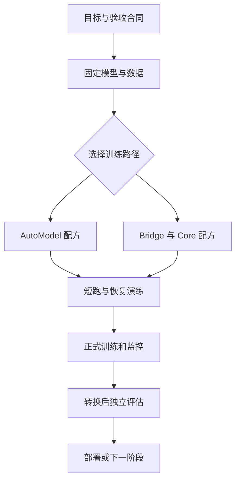

# 19 NeMo 与 Megatron：把一次训练变成可运行、可恢复的集群工程

本章不再逐个介绍组件名称，而是跟随一个明确项目：团队已经用 Hugging Face 基座验证了代码定位任务，现在希望对领域代码继续预训练，再做结构化输出的监督微调。单卡原型可以运行，但完整训练的状态放不下，需要多卡；数据、模型、tokenizer 和独立测试集已经固定。我们要决定如何在 NeMo AutoModel 与 Megatron Bridge 两条路径中选型，怎样组织进程和数据，怎样证明一次中断后真的恢复了训练，以及怎样把结果交回推理与评测系统。

阅读前先区分三个名字。**Megatron Core** 提供模型、并行和分布式训练的底层能力；**Megatron Bridge** 在它之上组织模型提供器、训练入口、配方与受支持模型的 Hugging Face 权重转换；**AutoModel** 则以 PyTorch 和 Hugging Face 模型生态为入口组织训练组件及配方。它们不是按「初级、中级、高级」排列的产品，也不能仅按参数规模做机械选择。模型覆盖、算子、并行、检查点、团队已有代码与部署目标共同决定选择。[Bridge 训练说明](https://docs.nvidia.com/nemo/megatron-bridge/latest/training/README.html)；[AutoModel 仓库结构](https://docs.nvidia.com/nemo/automodel/latest/get-started/repo-structure)。

本章依据截至 2026-10-29 的官方文档编写。所有集群数值都是标明条件的教学算例；配置片段用于解释设计，**没有在本书环境完成 GPU 训练、权重转换或恢复实测，不能直接复制成生产作业**。官方文档的 `latest` 和 `nightly` 会移动，读者必须将镜像、包、模型、配方和文档版本一起固定。

## 19.1 先决定训练合同，再决定框架

我们把训练需求具体化。继续预训练阶段使用获准使用的领域代码与文档，保持原 tokenizer，目标是改善领域建模；监督微调阶段学习「问题及候选代码 → 待检查文件与依据」的结构化回答。评测包含未见仓库的文件召回、误选率、端到端修复通过率，以及通用指令遵循回归。继续预训练的验证 loss 和 SFT 的格式正确率只是中间指标，不能替代最终任务评测。

这里至少有三类输入，不能放进一个文件夹就认为准备完成：

1. **模型输入**：架构配置、权重、tokenizer、特殊 token、上下文配置及各自版本。基座名称相同但修订版不同，也可能产生不可比结果。
2. **训练输入**：来源清单、授权、清洗脚本、切分、采样规则、tokenized shard 或样本文件，以及每类数据的实际训练预算。
3. **实验输入**：学习率、批量、长度、精度、并行布局、保存间隔、验证周期、种子、硬件和集群拓扑。

训练合同还应明确产物：完整续训检查点、可导出的模型权重、tokenizer、配置、日志、评测和数据版本记录。如果交付只是 HF 权重目录，它不能自动承担继续训练的责任；如果只有 Megatron 分片检查点，推理系统也不一定能直接加载。



*图 19-1：同一个目标可走不同训练路径；选择之后仍需要短跑、恢复和转换验证。*

## 19.2 AutoModel 路径：保留 Hugging Face 生态的工作方式

如果已有模型实现和数据管线主要来自 Transformers，希望先完成微调或保持较强的 HF 兼容性，AutoModel 是值得评估的一条路径。官方将其组织为 recipe 与 component：recipe 定义完整的训练循环，component 提供模型、数据、损失、优化器、分布式及检查点等组成部分。因此 YAML 不只是把参数传给一个万能 Trainer；不同 recipe 可以有不同的数据和执行语义。[AutoModel recipes](https://docs.nvidia.com/nemo/automodel/latest/recipes-e2e-examples/overview)。

这一点决定了阅读方法：先找与任务和模型相符的官方 recipe，查看入口脚本实际读取了哪些字段，再决定怎样替换数据。不要拿一个文本 SFT 的 YAML，随意加上图片字段，就假设变成 VLM 训练；也不要因为两条配方都有 `batch` 和 `checkpoint` 就认为可互换。配方是可执行工作流，模型支持表和数据类决定边界。

下面是**语义草图**，字段有意使用解释性名字，不是任一 AutoModel 版本的可执行 YAML：

```yaml
# 教学草图：请映射到选定版本的官方 recipe，不能直接运行。
model_source:
  repository: organization/model
  revision: exact_model_commit
  tokenizer_revision: exact_tokenizer_commit
objective:
  type: causal_language_modeling
  target: assistant_tokens_only
training:
  micro_batch_per_replica: 1
  accumulation_steps: 8
  max_sequence_tokens: 4096
  precision: bf16
checkpoint_contract:
  include_optimizer: true
  include_scheduler: true
  include_rng: true
  include_data_position: true
```

草图中的每一项都要落到真实代码的行为。例如 `assistant_tokens_only` 是数据标签与 loss mask 的要求，不是简单写一个字符串就自动成立。要在第一个训练 batch 中把 `input_ids` 解码，并将非忽略的 `labels` 单独解码，检查目标是否真的只有助手回答；工具结果、padding 和用户请求是否参与损失，需要与目标一致。分布式启动成功也不会替你检查这些语义。

模型加载同样要检查：输入 embedding 与输出投影的词表维度、特殊 token、是否绑定权重、最大长度和位置编码设置。训练前保存一组固定输入的 logits 或参考输出，训练后及导出后对同一组输入复查。它们不是完整质量评测，却能迅速发现 tokenizer、模板或权重加载不一致。

AutoModel 的检查点有自己的保存与发布语义。官方文档描述了同步与异步保存；异步模式可减少 I/O 对训练的阻塞，但后台写完和对外发布成可恢复检查点不是同一时刻。强制终止可能留下尚未发布的写入结果，不能只看目录有文件就宣称可恢复。[AutoModel checkpointing](https://docs.nvidia.com/nemo/automodel/latest/development/checkpointing)。这个限制在后面的恢复演练中必须验证。

## 19.3 Bridge 路径：模型提供器、训练循环和权重边界

如果项目需要 Megatron 风格的 TP、PP、CP 或 EP 组合，且目标模型有相应实现及配方，Bridge 可以把模型和训练配置接到 Megatron Core。这里的模型提供器不只是 HF `config.json` 的别名；它还携带模型并行所需的结构、层划分及实现选项。权重转换则负责将受支持模型的参数映射到另一套命名、布局和分片结构。

Bridge 的预训练、SFT 与 PEFT 入口共享底层循环，但数据处理和模型设置不同。[Training Entry Points](https://docs.nvidia.com/nemo/megatron-bridge/latest/training/entry-points.html)。因此三个阶段可以共享监控与保存机制，却不能无条件复用相同样本构造方式：预训练可能以全部有效 token 作为目标；SFT 需要按任务屏蔽不参与监督的位置；PEFT 还需证明可训练参数确实是预期适配器，而不是误把整个基座打开。

官方文档给出通过 HF 架构建立 Megatron provider 的路径。一个容易混淆的细节是：读取 HF 模型配置以构建架构，不必然意味着加载了其预训练权重。随机初始化预训练与从现有权重继续训练是两个实验；一旦误把其中一个当成另一个，即便 loss 正常下降，整次预算也可能用在错误问题上。[Bridge 总览与转换入口](https://docs.nvidia.com/nemo/megatron-bridge/latest/index.html)。

在正式启动前，做三个可观察检查：打印参数统计与可训练参数数量；检查加载报告中缺失或额外键；对固定批次比较载入模型与预期基座的输出。不同 kernel 和精度可能有数值差异，不应要求任意实现逐 bit 相等；但输出发生巨大偏移或大量参数随机初始化时，不能用「不同框架正常」敷衍过去。

## 19.4 从原始记录到模型实际看到的 batch

考虑一条 SFT 记录：

```json
{"id":"issue-31","repository":"demo-a","messages":[{"role":"user","content":"刷新后会话失效。候选文件：session.ts、theme.ts。请选择先检查的文件。"},{"role":"assistant","content":"{\"files\":[\"session.ts\"],\"reason\":\"先检查会话恢复与持久化。\"}"}]}
```

这条 JSON 不是模型直接消费的对象。数据类需要应用聊天模板，加入角色和结束标记，分词，截断或打包，再形成 `input_ids`、attention 信息、position 信息与 loss mask。每一次转换都可能改变训练含义。比如截断发生在右侧，可能把助手目标全部截掉；打包将多个样本连起来，如果缺少样本边界隔离，后一个问题就可能看见前一个答案；按字符串搜索某个角色标记生成 mask，又可能在用户文本出现同样标记时误判边界。

继续预训练常使用预处理后的索引化 token 数据，某些工作流也使用其他数据加载方案。不能把「训练支持 JSONL」理解为所有入口都支持相同 schema。应查看选定 Bridge 数据配置与预处理说明，明确格式、文档边界、EOS、采样和验证集是如何进入训练器的。[Bridge 训练文档导航](https://docs.nvidia.com/nemo/megatron-bridge/latest/training/README.html)。

一种实用验收方式，是在数据加载器与模型之间加一个仅在短跑启用的 batch 审查器。审查器不需要保存敏感原文到公共日志，可以记录样本 ID、来源组、长度、有效目标 token 数、截断次数，以及人工授权抽检的解码样本。不同 rank 的样本 ID 还可以暴露分布式数据重复：同一步两个数据副本是否拿到了相同记录？恢复后是否从头重读？验证数据是否被错误地送入训练？

对于一个长为 4096 的样本，若只有 240 个助手 token 参与损失，则输入计算量与目标 token 数相差很大。吞吐统计应区分输入 token/s 和目标 token/s；SFT 与全序列预训练的 loss 数值也不能直接当作能力差异。优化归一化应对应有效目标位置，而不是仅按样本条数。

## 19.5 32 张卡的布局算例：每个进程究竟负责什么

假设有 4 台机器，每台 8 张 GPU，机器内互联较快，机器间网络相对较慢。我们先考虑 dense 模型，采用 `TP=4、PP=2、CP=1、DP=4`，总数为：

\[
W = TP\times PP\times CP\times DP = 4\times2\times1\times4=32.
\]

这不是推荐配置，只是可计算的布局。每个完整的数据并行副本使用 8 张卡：4 张共同处理同一层的张量分片，2 个流水线阶段处理不同层；4 个副本处理不同数据。每个副本不是独立一张 GPU，因此全局批量绝不能使用 32 作为数据并行副本数。

为了直观，假定 rank 坐标由 `(d,p,t)` 表示：`d` 是数据副本，`p` 是流水线阶段，`t` 是张量分片。实际框架的 rank 排列可能不同，必须以启动日志中的进程组为准。按这一教学排列，`(0,0,0..3)` 是一个 TP 组：它们拿到同一份阶段输入，执行该阶段内各层的一部分矩阵计算；`(0,0,t)` 与 `(0,1,t)` 属于同一个副本的流水线链，前者把激活交给后者，反向则交换梯度；同一 `p,t`、不同 `d` 的进程需要在数据并行维度同步相应参数的梯度或分片状态。

| 维度 | 同组成员的共同点 | 主要不同点 | 典型通信 |
| --- | --- | --- | --- |
| TP | 同一数据副本、同一流水线阶段 | 同一层的参数与计算分片 | 层内归约或聚合，具体依层与策略 |
| PP | 同一数据副本 | 层或模型块分配不同 | 阶段边界的激活与梯度 |
| DP | 同一参数分片位置 | 训练数据不同 | 梯度同步及优化器相关集合通信 |
| CP | 同一模型与数据样本 | 序列片段不同 | 注意力所需信息交换 |
| EP | 同一 MoE 工作流 | 专家分配不同 | token 分派与回收 |

以上为解释性描述，不规定每种实现必须调用哪一个 collective。Bridge 的并行指南说明各策略配置及约束，Core 实现决定实际通信和参数布局。[Bridge Parallelisms](https://docs.nvidia.com/nemo/megatron-bridge/latest/parallelisms.html)。

为什么常常把 TP 放在机器内？因为 TP 可能在很多层频繁通信，较低延迟和较高带宽能减少等待。PP 的边界通信频次和载荷结构不同，往往更适合承担部分跨机器扩展，但流水线空泡和阶段不平衡又成为新问题。这里的结论是「测量拓扑与通信」，而非「跨机器永远不能 TP」。模型、网络与算子会改变最佳布局。

## 19.6 全局批量、micro-batch 与流水线空泡

延续上面的 4 个数据副本，设每个副本每次 micro-batch 为 2 条样本，目标全局批量为 256 条。那么一次更新需要每个副本处理：

\[
M=\frac{GBS}{DP\times MBS}=\frac{256}{4\times2}=32
\]

个 micro-batch。这 32 个 micro-batch 是流水线调度的工作单元。每张 TP 卡共同处理自己阶段的那 2 条样本，而不是各自再取 2 条独立样本。如果误用总 GPU 数计算，得到 4 个 micro-batch，既改变更新的样本量，也改变流水线利用率。

一个简化的非交错流水线示意中，若阶段数为 `P`，micro-batch 数为 `M`，理想化空泡比例可用 `(P-1)/(M+P-1)` 帮助建立直觉。`P=2、M=32` 时约为 `1/33`。这不是实测利用率：前反向时长、1F1B 调度、阶段不均衡、通信、重计算和内存约束都会改变时间线。它只说明 micro-batch 太少时，设备等待的比例可能很高。

增加 micro-batch 数的方式也有不同代价。保持全局批量不变时降低 MBS，可能让小矩阵效率变差；提高全局批量则改变优化过程和学习率决策；虚拟流水线把阶段分为多个模型块，可能减小空泡，却增加调度和通信复杂度。不能把流水线利用率优化与训练收敛独立看待。[Bridge 虚拟流水线配置](https://docs.nvidia.com/nemo/megatron-bridge/latest/parallelisms.html)。

如果模型每条样本固定 4096 个输入 token，256 条对应约 104.9 万输入 token；若平均只有 25% 的位置参与 SFT 损失，则有效目标约 26.2 万 token。若一个实验换成全序列损失，虽然样本数和输入长度不变，其目标与梯度尺度却可能改变。这解释了为什么实验记录必须包括损失 mask 与归一化，而不能只保存 GBS。

## 19.7 CP 与 EP：扩展维度不是随意相乘

长上下文可能让激活成为主要显存瓶颈。CP 沿序列维度分配工作，例如将一个长样本的不同 token 片段放到不同设备，同时交换注意力所需的信息。它与把不同样本送到不同卡的 DP 不同：同一个样本的 token 在多个 CP rank 上协作，不能因此把全局独立样本数也乘上 CP。

若仍有 32 张卡，改成 `TP=2、PP=2、CP=2、DP=4`，总数仍为 32。每个数据副本仍占 8 卡，但从原来的层内四路拆分变为层内两路、序列两路和两阶段。它可能降低长序列激活压力，却改变通信、算子形状和吞吐；是否更好要在相同目标 token 和精度下测量。短序列任务可能得不到收益，甚至因额外通信变慢。

MoE 的 EP 则让不同设备保存不同专家，路由器为 token 选择专家，设备间派发和回收 token。总参数量、每 token 激活参数和通信负载是不同账本。只有少量专家激活，不代表所有专家的权重都不需存储；某些专家特别热门还会产生负载不均，使整体等待最慢设备。

在 Megatron 的组合并行中，EP 与数据、专家张量并行等维度的组织存在实现约束，不能把 TP、PP、CP、DP、EP 五个数字任意相乘作为总卡数。必须使用选定版本的模型配置验证与进程组日志确认。尤其应检查专家数是否可分配、token dispatcher 与所选负载均衡方式是否兼容，以及容量限制是否丢弃 token。[Bridge MoE 与并行指南](https://docs.nvidia.com/nemo/megatron-bridge/latest/parallelisms.html)。

## 19.8 配方的作用：一份配置是一组相互制约的假设

下面用 Python 字典表示一份**不可直接运行的设计记录**，刻意不冒充具体版本 API：

```python
# 设计记录，不是 Bridge ConfigContainer 的构造参数。
plan = {
    "world_size": 32,
    "parallel": {"tp": 4, "pp": 2, "cp": 1, "dp": 4},
    "batch": {"micro_per_dp_replica": 2, "global_samples": 256},
    "sequence": {"max_input_tokens": 4096, "mask": "assistant_only"},
    "state": {"precision": "bf16", "optimizer": "adamw"},
    "recovery": {"save_steps": 100, "test_resume": True},
}

p = plan["parallel"]
assert p["tp"] * p["pp"] * p["cp"] * p["dp"] == plan["world_size"]
denominator = p["dp"] * plan["batch"]["micro_per_dp_replica"]
assert plan["batch"]["global_samples"] % denominator == 0
micro_batches = plan["batch"]["global_samples"] // denominator
print("micro-batches per update:", micro_batches)  # 32
```

这个小检查只验证算术，不证明模型能放下、布局高效或 loss 正确。实际配置需要映射到所用模型 provider、数据配置、优化器、调度、训练及检查点配置。将解释性记录与可执行配置分开保存，可以避免读者误以为看到字段名就得到了受支持的 API。

精度、重计算和优化器也相互关联。低精度参数不代表 Adam 状态同样低精度；分布式优化器可能分片状态，但计算时收集参数仍产生峰值；激活重计算减少保存的中间值，却增加反向期间计算。若先开启所有优化，很难知道收益与回归来自哪一项。应从短序列、较小批量和最少优化开始，再逐项变化并保存结果。[Bridge activation recomputation](https://docs.nvidia.com/nemo/megatron-bridge/latest/training/activation-recomputation.html)。

## 19.9 检查点：初始化、续训与可部署权重是三件事

训练系统最容易在「看起来保存成功」的地方失败。初始化只需模型权重与架构；完整续训还需要优化器矩、学习率调度、步数、精度缩放状态（若使用）、随机数及数据位置；部署通常需要另一种格式的完整权重或适配器。三类产物可以关联，却不能互相替代。

Bridge 官方区分 `checkpoint.pretrained_checkpoint` 与 `checkpoint.load`：前者用于权重初始化，后者用于完整原生 Megatron 续训。`load` 应指向检查点基目录，特定步数由对应选项选择；把初始化当作续训，可能让学习率、数据和优化器从头开始，但模型权重却处于训练中期，导致轨迹突然变化。[Bridge Checkpointing](https://docs.nvidia.com/nemo/megatron-bridge/latest/training/checkpointing.html)。

文档还指出一个细节：常见 recipe 的默认保存与加载目录相同，目录里已有检查点时，新的作业可能自动恢复。对一次全新实验，应使用独立目录并清除加载来源；对续训，则保留明确来源与步数。这是为什么实验 ID 和检查点目录不应随便复用。

分布式检查点让各 rank 保存相应数据，避免把全部模型和优化器状态聚集到一张卡；它还可以支持部分并行布局变化。但「参数可以重分片」不代表「所有状态都能在任意新布局下等价恢复」。例如官方文档说明 Energon 数据加载器状态按 DP rank 保存，恢复该状态要求相同 DP 大小；TP、PP、CP 与数据位置的约束需要分别判断。不要只验证模型载入就认定续训正确。

恢复演练应设计成可比较的实验：先在固定小数据上运行到第 K 步，保存；不中断继续到 K+N，保存逐步 loss 和样本 ID；再从 K 恢复运行 N 步，检查步数、样本、学习率、优化器状态与 loss。浮点非确定性允许一定差异，但数据回到开头、学习率重新 warmup 或出现明显跳变，都说明不是同一训练过程。

异步保存还需检查原子发布。把目录分为「正在写入」和「可恢复」状态，只有全部分片与元数据完成后才更新最新指针。生产上需要监控保存时长、后台队列、存储容量与恢复成功率；删除旧检查点前至少确认新检查点可读取。仅在训练正常退出时验证保存是不够的，因为真正故障往往发生在写入中途。

## 19.10 HF 转换：参数搬过去以后还要验证什么

Bridge 的 HF 转换不是简单改文件后缀。两套模型可能在 QKV 排列、张量分片、专家布局、权重绑定和命名上不同。正确转换需要受支持的模型映射，并保留 tokenizer 与架构语义。未支持的自定义模型，不能凭相似层名手工拼接就当作等价。

转换验证至少做三层。第一层检查形状、参数数量、缺失键和数值有限性；第二层用固定 token IDs、相同 mask、位置与精度比较 logits 或损失，记录允许误差及实现差异；第三层在独立任务上评估输出质量，并检查聊天模板、工具格式、终止 token 和上下文配置。通过第一层只表示文件能装载，不表示模型行为正确。

例如转换后代码定位模型总是继续输出用户角色标记。可能不是训练没学会，而是部署端用了不同聊天模板或 EOS；此时继续微调只会掩盖接口错误。又如导出后长序列质量变差，应检查位置缩放、attention 实现与服务上限，而不是直接判断量化损失。转换后的模型必须作为独立部署候选重新验收。

对于 LoRA，适配器依赖基座修订版、目标模块和结构。合并前确认基座完全对应；合并后再次比较固定输入。若要量化，通常需要在目标工具支持的路径上选择先合并再量化或受支持的适配器推理方案，不能把多种格式随意组合。训练检查点、合并权重与推理量化产物应分别编号并关联来源。

## 19.11 以时间线而不是 GPU 利用率判断性能

假设某次短跑每步 8 秒，其中数据等待 0.5 秒、前反向计算与不可隐藏通信 6 秒、优化器 0.5 秒，平均分摊保存与验证 1 秒。这个分解只是教学假设，却说明了一个常见问题：把计算部分加速 20%，整步也不会直接加速 20%。如果 6 秒变成 4.8 秒，整步约 6.8 秒，提升取决于固定开销和重叠情况。

GPU 利用率高也不一定表示有效训练多。padding、重复样本、无效目标和错误长序列都能让设备很忙。首先统一吞吐口径：输入与目标 token 分别统计，时间是否包括数据、评测和保存；记录各 rank 的峰值显存和耗时分布，而不是仅看 rank 0。

TP 的等待可来自层内 collective；PP 的等待可来自阶段失衡和空泡；DP 同步可能与反向重叠，也可能暴露为尾部等待；MoE 的 all-to-all 与专家负载可能造成抖动。数据加载慢则可能来自共享文件系统、解码或 tokenization。必须在 profiler 时间线中找到实际瓶颈，再选择改变 TP、PP、batch、数据预处理或 checkpoint 策略。

一次只比较一个主要变化，固定模型、数据顺序、长度、目标 token、精度和有效批量。若改变布局导致 batch 归一化或随机状态也改变，应将它记录为新实验，而不是宣称单纯性能提升。短跑验证性能后，还要确认长期收敛和最终质量；更快完成错误的训练没有工程价值。

## 19.12 真实故障的诊断顺序

**加载后立即 OOM。** 先确认是否每个 rank 都把完整 HF 权重装到 GPU，再转换成分片，或容器内已有其他进程。记录 CPU 与 GPU 加载峰值、设备映射和权重加载路径。训练状态尚未建立时，改梯度累积通常无济于事；应处理加载与分片方式。

**第一次 optimizer step 才 OOM。** 很多优化器状态在第一次更新时才分配。前向和反向都能跑，并不证明训练状态可容纳。检查可训练参数是否超出预期、优化器状态精度与分片是否生效。PEFT 若误打开基座梯度，状态量会与原估算完全不同。

**所有 rank 都挂起。** 先找最早报错的 rank，而不是最后超时的 rank。一个设备 OOM 退出，其他设备在 collective 等待，表面上像网络故障。若各 rank 走了不同条件分支、跳过不同批次或集合通信顺序不同，也会死锁。先用单节点最小模型验证，再加入多节点和实际数据。

**恢复后 loss 断崖变化。** 检查加载路径是否只初始化权重、优化器和调度是否恢复、数据位置和 RNG 是否一致；同时检查是否换了模型实现、kernel 或损失归一化。把恢复前后的同一 batch 单独回放，比盲目降低学习率更能定位原因。

**MoE 吞吐周期抖动。** 观察每专家 token 数、丢弃或容量限制、all-to-all 时间和最慢 rank。平均 token 数均匀不代表每一步均匀；如果为了吞吐调整容量，还要测质量与收敛，不可只看 step 时间。

## 19.13 何时不选这条路线

如果一个小模型 LoRA 单卡就能满足任务，团队只有很少训练作业，且部署完全围绕现成 HF 模型，那么 Transformers/PEFT/TRL、Axolotl 或其他较简单入口可能更易维护。大规模并行能力不是免费收益：额外模型实现、格式转换、依赖和调试都会占用团队时间。

如果主要瓶颈是在线 RL 的环境和采样，选择训练后端只是问题的一部分；需要同时评估 rollout、权重同步、verifier、任务重置与策略更新。NeMo RL 可以使用相关训练能力，但不能因为同属 NeMo 就假设所有模型、环境与配置天然互通。

选择 AutoModel 或 Bridge 的理由应该写成可验证陈述，例如「目标模型已有受维护配方，能满足所需并行策略；短跑及中断恢复通过；导出后任务无显著回归；单位有效 token 与维护成本在预算内」。这比「工业级」「高性能」更有实际意义。最终交付不是一个成功退出的训练进程，而是一组能解释来源、重现过程、恢复故障并在独立任务上证明价值的模型产物。
