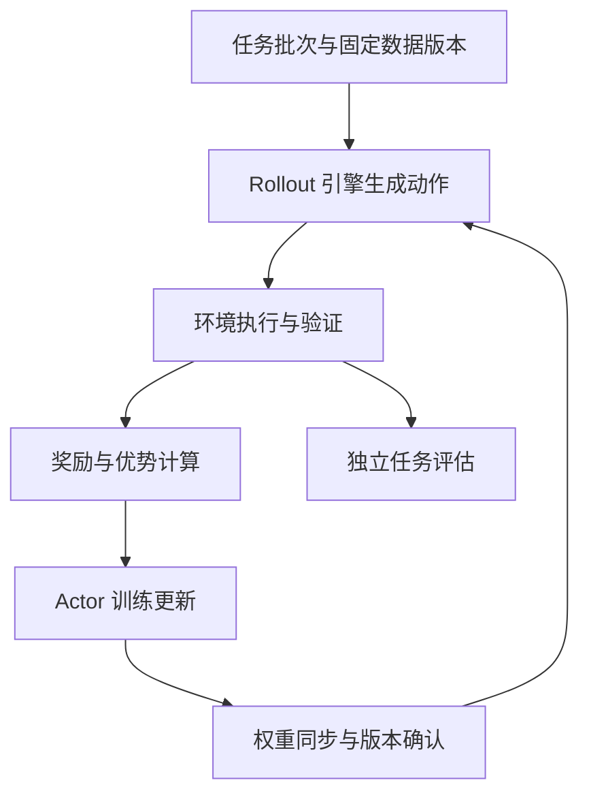

# 20 用 verl 读懂在线强化学习的完整工程

在线强化学习最容易被误写成一条公式加一条启动命令。实际系统里，生成、执行、评分、训练、权重同步分别运行在不同资源上；一次奖励上升可能来自能力提升，也可能来自旧权重、错误掩码或验证器漏洞。本章用一个受控代码修改任务，把这些环节串起来，再解释 verl、vLLM 或 SGLang 在其中承担的职责。

本章不是已完成的 GPU 实验报告。以下数字用于演算与容量规划，配置用于说明概念；真实运行须固定 verl、训练后端、生成引擎、模型和驱动版本，再从该版本的官方 recipe 开始。检索资料截至 2026-10-29，`latest` 文档可能继续变化。

## 20.1 从一个值得训练的任务开始

设想我们训练一个助手，修复自有测试仓库中的日期边界错误。它能读取文件、执行测试、提交补丁；环境有时间和工具调用预算。输入不是“请变强”，而是明确的问题描述、允许访问的仓库和输出契约。结果不是“看起来合理”，而是独立测试、现有功能回归以及约束检查的组合。

例如任务要求处理跨月区间，正确行为应是检查日期计算和调用方，再修改相应实现并运行测试。一次轨迹可能包含三轮模型生成、两次文件读取和一次测试执行。最后测试通过给出奖励，但只有模型生成的 action token 是策略的动作；工具返回的测试日志不是模型自己选择的文本，不能把它们当成同样的策略输出训练。这一分界从任务设计开始就要保留。

先用固定模型、相同工具和预算建立基线：一次采样的成功率、重复采样的成功率、失败类型、平均生成长度、环境执行时间和总成本。若基线失败主要是环境缺失依赖、仓库不可启动或题目答案有误，RL 会放大噪声而不是解决任务。如果模型连工具调用格式都无法稳定生成，通常应先修模板、数据或 SFT，而不是立刻扩大在线训练。

训练开始前应能对每次运行回答：是哪一个任务版本、哪一个模型版本，在什么环境里生成了哪些动作，由哪个验证器给出了什么反馈。缺少这个基本合同，后面的奖励曲线没有可解释性。

## 20.2 verl 管什么，生成引擎管什么

verl 是组织后训练数据流、角色、算法和训练后端的框架；vLLM 和 SGLang 是可选生成后端。Actor 是被优化的策略，rollout 是使用某个策略版本生成候选的过程，reference 是在需要约束时提供参照分布的模型，reward 可以是规则、执行结果、奖励模型或其组合。PPO 的一些配置还需要 critic；使用 GRPO 不应因此继续无条件保留所有 PPO 角色。

不同角色不意味着每个角色必须占一套永久独立 GPU。同一进程或设备可以按阶段复用，也可以把训练和生成分开部署。角色与资源布局是两种不同的划分，不能从图上画了四个方框就推断需要四套模型副本。



图 20-1：在线训练的闭环。独立评估使用冻结的评测协议；不能用训练奖励代替它。

实际选型时，训练后端决定参数、梯度和优化器如何分布，生成后端决定自回归采样与 KV cache 如何执行。两者可能使用不同的张量分片、内核、精度和批处理，所以“加载的是同一个模型名称”还不足以保证概率一致。verl 官方的安装、配置和 rollout correction 文档都应与选定版本一起读，而不是从不同年份教程拼接字段。[^install] [^config] [^correction]

## 20.3 一条轨迹应保留哪些信息

把轨迹当成只有 `prompt`、`response` 和 `reward` 三列的表格，无法支持严谨调试。最少应保留任务 ID、输入 token、输出 token、有效动作 mask、行为策略版本、采样设置、生成时的对数概率或其可追踪来源、环境观察、终止原因、奖励组成和验证器版本。涉及多轮工具调用时，还要保留消息边界与工具执行状态。

以下记录只是教学数据合同，不是 verl 内部对象的逐字段拷贝。设计自己的导出格式时应避免覆盖框架保留的语义。

```python
trajectory = {
    "task_id": "date-boundary-0042",
    "task_version": "dataset-v3",
    "policy_version": "actor-step-120",
    "tokenizer_revision": "固定的 tokenizer 修订版",
    "sampling": {"temperature": 0.8, "top_p": 1.0},
    "prompt_token_ids": [101, 205, 306],  # 教学占位 ID
    "action_token_ids": [411, 512, 613],
    "action_mask": [1, 1, 1],
    "behavior_log_probs": [-1.1, -0.4, -2.0],
    "termination": "completed",         # completed / timeout / invalid 等
    "reward_parts": {"correctness": 1.0, "regression": 0.0},
    "verifier_version": "verifier-v5",
}
```

为什么记录 token 而不只记录文本？生成时使用聊天模板、特殊 token、工具标记和 tokenizer。把输出解码成文本，再重新编码，不一定还原原 token 序列；空格合并、特殊 token 处理和模板二次插入都可能改变它。训练时若对着另一段 token 算 log probability，重要性比率就不再对应真实采样动作。多轮工具环境还可能将观察插入历史，必须知道这些 token 的来源。

为什么记录终止原因？超时、长度截断、程序崩溃和正常结束不是同一种失败。若把基础设施超时全部记为零奖励，模型会因环境不稳定被惩罚；若全部丢弃，又可能偏向短而容易完成的任务。应先区分环境故障与策略行为，并统计丢弃率。需要惩罚无效行为时，明确它属于模型输出错误，而不是验证器不可用。

为什么记录概率来源？当前 actor、采样时的行为策略、冻结 reference 是不同分布。把三者都命名为 `old_log_prob` 会让系统难以审查。本书采用 `behavior`、`old_actor`、`current_actor` 和 `reference` 表达概念；映射到代码时再核对该版本字段。

## 20.4 从 log probability 到可训练的目标

模型对某个动作 token 给出概率 (p)，存储其对数 \(\log p\) 可以让序列概率的乘积变成求和。假设行为策略对一个动作给出概率 0.2，当前策略给出 0.24，两者比率为 1.2；用 log probability 算就是 `exp(log(0.24)-log(0.2))`。这一比率说明当前策略比采样时更倾向产生该动作。

注意这个例子只比较一个 token。同一序列中有多个条件概率，其前缀包含此前动作与环境观察；token 级和序列级比率有不同方差与实现代价，不能不加说明互换。长序列的比率可能极端，因此会涉及裁剪、拒绝或其他校正。算法与工程实现共同决定实际目标。[verl rollout correction 的数学说明](https://verl.readthedocs.io/en/latest/algo/rollout_corr_math.html)

在同步训练里，可以先用行为策略生成一批数据，冻结它作为 old policy，再对同一批数据进行一个或多个 mini-batch 更新。第一次更新前 current 与 old 接近；之后它们逐渐偏离。PPO 类目标通过比率与裁剪改变优化激励，但它并不构成参数步长或 KL 的硬约束，也不是任意多次重用数据仍然安全的保证。[^ppo]更新轮数、学习率、批量和数据新鲜度共同决定偏离程度。

Reference 的用途又不同。它常用于限制策略不要过度远离某个基座或初始 SFT 模型。当前 actor 与 reference 的 KL 约束不是在修复 stale rollout；行为策略校正也不能替代能力回归评测。有些实现把 KL 放进奖励，有些把它放进损失，估计方式也有差异；如果两边重复施加却没有意识到，实际约束强度会与配方设想不同。[^config]

## 20.5 手算一次 GRPO 的组内反馈

GRPO 为同一个 prompt 生成一组候选，用组内结果形成相对反馈。为了看清计算，假设四条轨迹的最终奖励为 `[0, 1, 1, 2]`。平均值是 1，按总体标准差计算得到 \(\sqrt{0.5}\approx0.7071\)。若采用标准化形式，则四个优势约为 `[-1.4142, 0, 0, 1.4142]`。第一条低于同组平均，第四条高于平均，中间两条在该标准化下没有相对优势。

这个结果不意味着奖励为 1 的轨迹没有价值，而是组内标准化只给出相对方向。若所有候选奖励都是 0，标准差为 0；数值实现用 epsilon 可以避免除零，却不会凭空创造有意义的组内学习信号。若所有候选都正确，也可能同样缺少相对差异。这时应观察题目难度、采样多样性和奖励设计，而不是只调大 batch。

下面是可运行的标准库算例；它演示一种标准化定义，不代表所有 GRPO 变体与框架默认值。标准差用总体还是样本估计、是否归一化、epsilon 如何处理，都需要按实现核对。[^grpo]

```python
import math

def group_advantages(rewards, eps=1e-8):
    if not rewards:
        raise ValueError("组内至少有一条轨迹")
    mean = sum(rewards) / len(rewards)
    variance = sum((r - mean) ** 2 for r in rewards) / len(rewards)
    std = math.sqrt(variance)
    # 同分组显式返回零，便于监控无差异组，而不伪造学习信号。
    if std < eps:
        return [0.0] * len(rewards)
    return [(r - mean) / std for r in rewards]

print(group_advantages([0, 1, 1, 2]))
print(group_advantages([0, 0, 0, 0]))
```

组内比较要求候选确实来自同一个任务和同一组定义。若任务在分布式传输后顺序改变，把四个不同题目的候选误分一组，损失仍可能是有限值、训练仍能运行，但学习方向已错误。工程上应保留 `prompt_group_id`，在优势计算前断言组大小、任务 ID 与候选数量一致。

再看一种常见误解：把每题生成数从 4 提高到 16，就以为有效训练信息增加四倍。更大的组可能提供更好的相对反馈，也会把生成与环境执行成本放大；如果 16 条都相同或同分，新增信号很少。应同时统计组内奖励标准差、重复输出比例、全对与全错组比例，以及每成功任务成本。

## 20.6 动作 mask 决定模型究竟因什么被更新

一条工具轨迹可能按顺序包含用户问题、助手工具调用、工具结果、助手解释、第二次工具调用和最终补丁。用于策略损失的 mask 应覆盖模型选择的动作位置，通常不包括用户 prompt、padding 和环境返回的观察。对工具 schema、系统约束或多模态 token 的处理还要依实现定义。不能把“这个 token 在序列里”直接等同于“这个 token 是策略动作”。

假设总序列有 1000 个 token，其中助手动作有 200 个。若损失错误地除以总长度而不是有效动作数，这条轨迹的权重可能被缩小；若一个 batch 各轨迹动作长度不同，按序列均值再平均与按所有有效 token 平均也不相同。两者都可能有明确设计动机，但不应悄悄发生。长回答是否获得更大权重，取决于归约口径和优势分配，而不是仅由算法名称决定。

下面的伪代码把重要边界写出来。它不包含分布式归约、KL 或完整 rollout correction，不能作为生产损失直接替换框架实现。

```python
# 说明用伪代码：张量形状均为 [batch, response_length]。
# new_logp：当前 actor 在相同历史下对已采样动作的对数概率。
# old_logp：本轮固定旧策略的相应对数概率。
# advantage：按所选算法广播到有效动作位置。
ratio = exp(new_logp - old_logp)
clipped = clamp(ratio, 1 - clip_epsilon, 1 + clip_epsilon)
per_token_objective = minimum(ratio * advantage, clipped * advantage)
valid_count = action_mask.sum()
# 分布式实现还需按全局有效数归约；不能独立求均值后盲目平均。
policy_loss = -(per_token_objective * action_mask).sum() / valid_count
```

对负优势，`minimum` 与裁剪的组合也应按完整目标理解，不能以“比率超过上限就切掉”简化所有情况。实现调试时，用正、负、零优势各构造一个极小样本，手算目标与梯度方向，再比较代码。token 对齐错误往往比优化器参数错误更难从总体曲线看出。

## 20.7 配置怎样连接到实际资源

以下是概念配置表，不是某个版本可直接复制执行的 YAML。verl 的配置 schema 会演变，实际运行应从选定版本的官方例子出发，保存解析后的完整配置，而不是只保存命令行覆盖项。特别要区分总 batch 与每 GPU micro-batch，避免使用已弃用字段。[^config]

| 决策 | 影响的实际工作 | 应观察的结果 |
| --- | --- | --- |
| 每批 prompt 数 | 任务分布、组数量与采样队列 | 有效组数、奖励方差、排队时间 |
| 每题候选数 | 生成和执行成本、组内反馈 | 同分组、重复率、样本利用率 |
| 最大 prompt/response 长度 | KV cache、训练激活、截断行为 | 截断率、峰值显存、长度与奖励关系 |
| Actor micro-batch | 单次前后向形状 | OOM 阶段、吞吐、累积次数 |
| rollout TP | 生成模型分片和层内通信 | 单请求延迟与总体 token/s |
| rollout 显存比例 | KV cache 与其他角色共享空间 | 可容纳并发、切换时峰值与 OOM |
| reference offload | 参照概率计算的常驻状态 | 主机内存、PCIe 传输与评分耗时 |
| 更新次数与学习率 | 数据重复使用和策略偏移 | KL、clip fraction、独立质量 |

假设有 8 张 GPU，模型、序列和训练状态能否放下尚待测量。布局 A 把 8 卡作为混合角色：先生成，再释放或让出生成工作空间，随后训练。它减少专用副本，适合先建立同步基线，但阶段之间有切换开销。布局 B 把 4 卡给训练、4 卡给 rollout，使二者重叠；训练阶段只剩 4 卡，模型状态和 batch 可能放不下，而生成端也需要独立权重与缓存。不能只因 GPU 时间线更满就认定 B 更好。

再假设每批 64 个 prompt、每题 4 条候选，总共 256 条轨迹；平均输出 1000 token，输出量约 25.6 万 token。若实测整个生成阶段有效输出吞吐是每秒 8000 token，则仅输出生成的理想近似时间是 32 秒；prefill、排队、工具等待和长尾还会增加时间。若环境平均每条耗时 5 秒、并发 32，理想工作量下界为 40 秒，但任务长度不均和资源争用会提高它。训练耗时若为 20 秒，串行总计至少约 92 秒再加同步与管理；这只是说明如何分解预算，不能作为任何硬件的性能预测。

如果生成 32 秒、执行 40 秒、训练 20 秒，优先优化训练 kernel 并不能消除执行瓶颈。提高环境并发需要更多 CPU、内存与存储 I/O，还可能让测试互相干扰。正确的扩容依据是每个阶段的实测服务时间、队列长度和资源约束。

## 20.8 同步与异步：吞吐之外的数据新鲜度

同步闭环最容易审计：版本 `v120` 生成一批轨迹，完成执行与评分，训练到 `v121`，同步后再生成。行为策略版本在一个批次内清楚，故障恢复也更直接。缺点是生成与训练可能轮流等待，尤其环境长尾会拖住整个批次。

异步系统用旧批次训练，同时继续生成新轨迹。它提高资源重叠，但数据会陈旧：训练器已经是 `v125`，队列里仍有 `v120` 的候选。陈旧程度不能只按秒计算，还应看跨了多少次更新、概率比率和任务长度。对 GRPO，组内候选的完整性也很重要：丢弃单条过期候选可能改变组分布，实际策略需要按组处理或采用明确算法。verl 的异步训练文档提供 staleness 与丢弃策略，应阅读对应版本，而不是假定异步与同步目标相同。[^asyncverl]

vLLM 提供暂停/恢复与权重传输相关接口，但这些机制不自动完成算法正确性。生成进行中更新权重，可能让一条序列的不同 token 来自不同版本；保留旧 KV cache 还会引入历史状态与新参数的混合。对初次实现，最易验证的办法是在明确边界完成整批，再更新并验证；需要跨版本继续生成时，必须追踪 token 级版本、缓存策略和校正方式。[^vllmasync]

重要性采样校正可以缓解行为分布与训练分布不一致，但极端比率会增加方差，裁剪会引入偏差，数据过旧也可能被丢弃。它不是无限扩大队列的许可证。应比较相同 GPU 小时下的独立成功率，而不仅是每小时产生多少 token。[^correction]

## 20.9 权重同步是协议，不是一次文件复制

训练后端保存的参数布局可能是 FSDP 分片或 Megatron 张量分片，而生成端使用另一种 TP 布局、融合权重名称或精度。同步需要完成参数收集/重分片、命名映射、传输、载入和版本确认。传输结束不一定意味着所有 rank 都安装了完整的一致版本。

一个可靠同步过程应有明确的开始、传输、完成与恢复状态：暂停适当范围的生成，发送本轮权重，确认所有参与者完成，再提交版本标签并恢复。某个 rank 失败时，必须知道旧版本是否仍可使用、是否有部分权重已被覆盖，以及是否需要重建生成实例。vLLM 官方权重传输文档将训练端和推理端分开说明；实际事务性、后端支持和错误恢复要按版本验证。[^weights]

版本标签只是元数据，不能独自证明参数正确。工程上可对受支持的权重做校验，或用固定 token 输入比较同步前后的 logits/生成结果与训练端预期；浮点内核不同不一定逐位相等，应制定合理容差，同时检查极端偏差。还要确认外部负载均衡后面的每个生成实例都更新，而不是只更新了一个入口连接到的实例。

恢复时至少需要 actor、优化器、调度器、训练步、随机状态、任务读取位置、队列或未完成任务处理策略、奖励与环境版本。只恢复 actor 权重，然后继续消费旧队列，会构成一次分布变更；如果这样设计，应显式标记并重新评估，而不是称为精确续训。

## 20.10 奖励设计如何避免优化错目标

代码任务常见的奖励是测试通过，但测试本身只覆盖一部分契约。模型可能硬编码公开测试样例、删除失败测试、修改测试入口或只输出让验证器误判的文件。训练环境应限制允许修改的范围，保护评测与奖励程序，并在独立环境验证提交产物。这里的隔离保护的是训练信号有效性，不是可有可无的部署附加项。

奖励组件必须解释清楚。假设正确性 1 分、违反修改范围扣 1 分、超时 0 分：一个正确但非法修改的轨迹得到 0，可能与完全失败混同。更稳妥的做法是先记录结构化判定和硬约束，再定义最终标量，并在日志保留各项，不让一个总数抹平不同原因。是否使用长度惩罚也要谨慎：惩罚输出越长越多，可能让模型少调用必要工具或过早结束。应先测长轨迹是否真的浪费，而不是把短当作普遍优点。

基础设施错误需要单独分类。环境镜像下载失败、测试依赖缺失、磁盘满不应悄悄成为“模型能力差”的零奖励。对于可重试故障，固定重试政策并记录；对于不可解或有歧义任务，应进入隔离集合，避免反复对模型施加随机方向。丢弃也有选择偏差，故障率要作为训练质量指标报告。

## 20.11 监控曲线如何读

训练奖励是第一层；组内奖励差异是第二层；动作概率变化是第三层；独立质量和成本是最终层。下面这些指标需要一起观察：

- 原始奖励及每个组件、任务分层成功率、超时与无效比例。平均值上涨可能只是批次变容易。
- response 长度、工具调用次数、截断率、重复输出、全零/全同分组比例。它们帮助解释奖励与成本。
- actor loss、梯度范数、熵、KL、clip fraction、比率分布与 staleness。不同实现的指标定义不能跨框架直接比较。
- 生成、环境、评分、log-prob 重算、训练、同步和保存各阶段耗时，以及每个 rank 的峰值显存。
- 冻结评测集上的成功率、回归、每成功任务成本和方差。训练时选择 checkpoint 应基于开发集，最终测试避免反复用于调参。

举例说，奖励上升而独立成功率下降，同时轨迹变短，可能是奖励鼓励过早终止；奖励不变但生成长度翻倍，可能是模型增加无益推理；clip fraction 快速增大且比率分布极端，可能是学习率、更新次数、旧队列或概率不一致问题。单独看到一个指标无法确定原因，需要取具体轨迹和对应版本回放。

性能分析也要遵守因果：先测一段代表性稳态运行，排除首次编译和模型加载，再分解阶段；然后只改变一个变量。verl 的 profiler 文档提醒混合角色进程的 trace 组织方式，找不到一个单独文件并不一定意味着对应工作没有发生。[^profile]

## 20.12 从最小正确闭环扩到真实任务

第一步使用少量、短输出、快速可验证的自有任务，只跑同步生成与一次更新。检查 token 对齐、mask、组 ID、奖励、有限 loss 和权重变化；保留输入与输出用于手工检查。第二步验证权重同步：固定输入在训练器与生成器之间做受控比较，确认所有实例都使用新版本。第三步主动中断作业，验证检查点与任务位置的恢复。

这些都通过后，再扩大 prompt 数、每题候选数或序列长度，分别观察生成、执行与训练瓶颈。添加多轮工具环境时，先用少量完整轨迹核查观察 token 不进入动作损失；添加异步时，先限制陈旧度并对照同步质量。换生成后端或精度时，重新测概率偏差和最终任务，而不只测吞吐。

最终应能交付一套可审计的实验：固定代码与依赖、完整解析配置、数据与环境版本、基线、训练曲线、轨迹样本、恢复记录、独立评测和成本。框架提供的是把这些事情实施出来的基础设施；“采用 GRPO + verl + vLLM”本身不是有效实验结论。真正值得学习的是：每一条轨迹如何成为可追踪的更新，以及为什么这次更新改善了最初定义的任务。

## 20.13 一次更新的账本：不要让 batch 名称掩盖实际数据量

继续使用 64 个问题、每题 4 条候选的例子。采样阶段共生成 256 条轨迹；假设其中 16 条是环境故障而非模型失败，需要按事先定义的政策处理。这时不能直接把剩下的 240 条任意重排成新的组。原来 64 个问题中，哪些组仍完整？哪些组需要重试？若算法要求固定组大小，就应恢复原组或丢弃对应整组，并报告损失的任务分布。如果失败集中在大型仓库，丢弃后训练集会偏向小仓库，平均奖励可能上升却不代表能力提高。

再假设最终保留 60 个完整组，即 240 条轨迹，每条平均有效动作 1000 token。则这批包含约 24 万有效动作 token。若每次 actor 更新处理 60 条轨迹，并对整批遍历一次，概念上是四个 mini-batch；但每个 mini-batch 的 token 数可能相差很大。一个 mini-batch 的六万 token 可以再按每卡允许 token 量拆成 micro-batch，并累积梯度。这里有问题批量、轨迹批量、优化 mini-batch、设备 micro-batch 和有效 token 五种尺度，配置里任何一个叫 `batch_size` 都不足以说明完整语义。

如果把每条轨迹的损失先除以自身长度，再对 240 条求平均，短轨迹与长轨迹拥有相同序列权重；如果所有有效动作 token 合并求平均，长轨迹在总目标中占更多权重。两种目标不相同。假设轨迹甲有 100 token、每 token 损失 0.2，轨迹乙有 900 token、每 token 损失 0.8。序列等权平均为 0.5，token 等权平均为 `(100×0.2+900×0.8)/1000=0.74`。把这种差别错当作“框架的 loss 波动”会导致错误调参。

多卡还多一层归约。如果两个 rank 分别有 100 与 900 个有效 token，本地各算均值再直接平均，同样得到 0.5，而全局 token 均值应为 0.74。分布式训练器通常有自己的归约合同；自定义损失时必须与其对齐，避免重复除以 world size 或梯度累积数。正确做法不是背一个通用乘法，而是写出本轮目标的分子、分母和框架自动归约的步骤，用极小的确定数据检查最终梯度。

## 20.14 三个教学故障场景：怎样从现象回到根因

以下是为解释诊断方法构造的假设场景，不是已发生的客户事故或本书实测记录。

### 复盘一：奖励突然提高，模型却越来越少执行测试

某次改动后训练奖励从低位快速上涨，输出长度与工具调用同时下降。团队最初以为模型学会了更高效的推理，但独立评估并未提高。抽取同一任务的前后轨迹发现，奖励脚本只要看见指定补丁文件就返回通过，没有在隔离副本中真正运行测试。模型学到的是提交满足文件存在条件的产物。

修复不仅是补一个检查。首先冻结受影响的模型、数据和验证器，记录奖励版本边界，避免把错误奖励产生的数据混入之后的训练。其次让验证器从原始仓库重建评测环境，只应用允许的修改，执行保护的测试和范围检查。再用人为构造的无效补丁回归验证器：空补丁、删除测试、修改测试入口、只生成标记文件都应得到符合契约的判定。最后从可信检查点重跑小规模对照，观察实际通过率、工具调用与成本。奖励曲线曾经上涨这件事应保留在实验记录中，而不是删除后只展示成功结果。

### 复盘二：更新一次之后 KL 爆炸，但梯度范数看起来正常

排查首先定位是训练器与 old actor 的 KL，还是与冻结 reference 的 KL；二者原因不同。随后用同一小批 token 比较采样端的行为概率、训练端更新前的重算概率和更新后的概率。若更新之前二者就明显偏离，问题不在学习率，而可能在 tokenizer、模板、温度处理、模型版本或后端数值路径。

一个常见错误是采样时使用带温度或 top-p 的分布，却把训练端未经相应处理的概率直接当作完全相同的行为概率。另一种错误是重新构造多轮消息时丢失了工具结果前后的特殊标记。定位时固定一个 prompt 与一条已采样响应，不再调用随机生成；保存原始 token，逐位置比较 log probability，找到首次明显差异。前缀第一次发生变化的位置通常比最终平均 KL 更有诊断价值。若 token 完全一致、版本一致而只有较小数值差异，再调查精度和内核，并评估相应校正，而不是任意把容差调大。

### 复盘三：GPU 利用率提高，单位成功任务成本反而变差

团队从同步改为异步，生成和训练同时进行，GPU 时间线更密集，但训练相同小时后独立测试成功率下降。日志显示队列增长、候选陈旧度增加，长轨迹常跨越多个策略版本；大量样本最终因过旧被丢弃。系统生产了更多 token，却没有生产更多可用更新。

应先画队列而不是只画 GPU 利用率：每分钟进入、完成、丢弃的 prompt 组数是多少，等待时间分布如何，按任务难度和轨迹长度分别怎样。限制队列和陈旧度后，生成器可能有更多空闲，但每条数据的学习价值上升。比较时固定预算和评测协议，报告有效训练 token、丢弃成本、环境成本和每个成功任务成本。异步不是最终目标；当任务环境很慢、模型很小、可用 GPU 数不足或权重同步昂贵时，简单同步闭环可能是更好的工程选择。

## 20.15 从配置覆盖到可复现实验目录

真实工作常以一串命令行覆盖项启动实验。这样很方便，却容易漏掉基础配置默认值或依赖版本变动。实验应保存解析后的配置快照、对应代码提交、完整环境锁定信息和模型修订版。不要只保存一条 `python ... actor...=...` 命令：这条命令在基础配置变化后可能执行不同目标。

一个合理实验目录可以包含 `manifest.json`、解析配置、数据与模型哈希、训练和采样日志、奖励分项、固定数量的脱敏轨迹、检查点索引、恢复演练结果和独立评估。日志应能从任务 ID 追到轨迹、奖励、策略版本与训练批次；发生异常时无需重新跑整次训练才能知道模型看到了什么。敏感数据和不可公开仓库应有对应访问控制，导出的轨迹也需要检查密钥与个人信息。

一次正式运行前，可执行如下门禁：在少量样本上确认数据完整、组定义一致、动作 mask 正确，所有角色使用预期模型；运行一次生成、评分、更新和同步；确认参数确实改变而冻结 reference 没有改变；做一次保存和恢复；最后用固定评测验证没有明显破坏基线。门禁通过后才扩大规模，避免把大部分预算花在一个从第一步就错误的闭环上。

这些门禁不追求把随机训练变成逐位确定程序。它们追求的是因果可解释：当质量变化时，知道哪些输入、目标或资源发生变化；当系统失败时，知道哪些产物仍可信、从哪里恢复。工具链的工业价值在于把这些合同稳定实施出来，而不是用更多参数和更复杂架构掩盖不可追踪的实验。

## 20.16 评价算法收益时，先分开三种预算

比较监督微调与强化学习时，只让二者使用相同优化步数并不公平。在线强化学习还消耗生成、教师或奖励模型推理、环境执行与失败重试。相同训练步数可能对应数倍不同的总计算量。另一方面，相同生成 token 也不代表环境成本相同：一个只回答数学题的轨迹，与一个启动编译和测试的代码轨迹，对中央处理器、磁盘和时间的需求差别很大。

因此应分别建立计算预算、墙钟预算和人力维护预算。计算预算记录各类加速器与时长，墙钟预算记录从数据准备到可评估检查点的实际时间，人力预算记录环境修复、标注审查与故障排查。对于购买云计算的团队，可以用实际账单单价计算；对于自有硬件，也应说明是否计入折旧、闲置、存储和运维。不存在一个不需要假设的通用训练成本数字。

设某同步实验使用八张卡运行十小时，就是八十卡小时，但如果环境准备花了一天、训练后还需两小时评估，产品交付时间远超过十小时。异步实验用同样八十卡小时生成更多候选，却因为陈旧丢弃一半，未必更经济。把最终成功率除以卡小时也不总是有意义，因为成功率受模型、任务难度和采样预算影响；更稳妥的是报告相同独立任务下的质量与成本曲线，而不是压成一个看似精确的分数。

还应比较零训练的多采样基线。假设原模型单次成功率不高，但允许四次候选并用可靠验证器选出一个，已经达到目标，而训练后小幅改善只在单次采样下出现，那么是否训练取决于未来调用量。需要累计多少次推理节省，才能抵消数据与训练成本？如果任务规模很小，直接采样与验证可能更划算；如果调用频繁、延迟严格，训练收益则可能随部署规模放大。

### 训练停止并不只有一种理由

达到预设成功率是停止条件，固定预算用完也是停止条件；奖励无差异组过多、独立质量退化、环境故障过多，同样应该触发调查或暂停。停止规则应尽量在实验前设定，避免团队在看到不理想结果后不断追加预算，最后只报告偶然较好的检查点。

当训练奖励持续上升而独立指标停滞，先检查评测统计是否有足够样本，再检查奖励与目标是否脱节。若独立指标的差异小于任务抽样带来的不确定性，应报告不确定，扩大评估或重复实验；不能把小数点后第二位当作稳定提升。对代码任务，逐题保存原模型与新模型的成败配对，有助于区分真正修复的任务、回归任务和无变化任务。总体成功率相同，也可能是两组完全不同的问题被解决。

最终选择的不是“奖励最高的检查点”，而是满足质量、延迟、成本和维护约束的模型系统。系统还包括提示、工具、验证器和生成策略；如果发布时换了工具或采样设置，评测结论需要重新核查。在线强化学习的终点不是产生一个权重目录，而是形成能持续评估、解释和恢复的能力更新流程。

每次发布都应记录所采用的检查点、推理参数、工具版本和评测报告，让线上问题能够回到相同条件下分析，而不是只剩一个无法追溯的模型名称。

## 资料与注释

[^ppo]: Schulman 等，[Proximal Policy Optimization Algorithms](https://arxiv.org/abs/1707.06347)，2017。用于支持裁剪替代目标；裁剪本身不保证每次更新满足硬 KL 上界。

[^install]: [verl Installation](https://verl.readthedocs.io/en/latest/start/install.html)。用于核对训练与生成后端、依赖和安装路线；请切换到实际使用版本。
[^config]: [verl Config Explanation](https://verl.readthedocs.io/en/latest/examples/config.html)。配置字段、batch 语义、角色和 KL 设置应以该版本为准。
[^grpo]: [verl GRPO](https://verl.readthedocs.io/en/latest/algo/grpo.html)；[DeepSeekMath 原论文](https://arxiv.org/abs/2402.03300)。本章标准化算例仅说明组内相对反馈。
[^correction]: [verl Rollout Correction](https://verl.readthedocs.io/en/latest/algo/rollout_corr.html)；[数学说明](https://verl.readthedocs.io/en/latest/algo/rollout_corr_math.html)。区分后端数值差异与异步策略陈旧。
[^asyncverl]: [verl V1 Async Trainer](https://verl.readthedocs.io/en/latest/advance/v1_async_trainer.html)。异步架构和陈旧样本策略会随实现演变。
[^vllmasync]: [vLLM Async Reinforcement Learning](https://docs.vllm.ai/en/latest/training/async_rl/)。暂停、恢复、缓存与版本语义不能替代训练算法的校正与验证。
[^weights]: [vLLM Weight Transfer](https://docs.vllm.ai/en/latest/training/weight_transfer/)。训练端与推理端的权重同步机制，实际支持范围以版本和后端为准。
[^profile]: [PyTorch Profiling in verl](https://verl.readthedocs.io/en/latest/perf/torch_profiling.html)。用于理解 trace、角色共置和采样范围。
