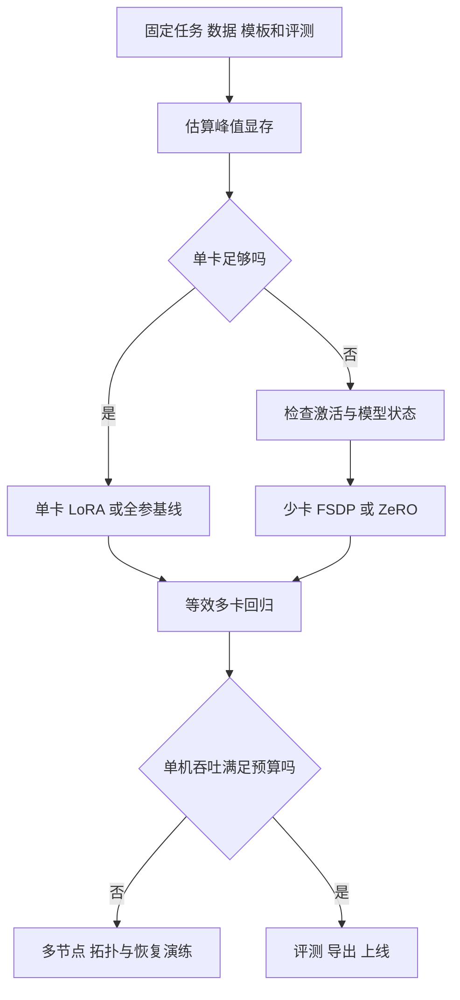

# 从单卡到多节点：同一训练任务如何改变工程设计

假设团队要对一个已有语言模型做代码任务的监督微调（SFT）。目标是给定问题和仓库搜索结果，输出要检查的文件与依据；独立评测按仓库划分，指标为文件召回、误选与下游修复成功率。这里分别设计一张 24 GiB 卡、单机 2–8 卡和多节点三条路线。它们的核心问题不同：单卡先解决峰值显存，少卡既要装得下又要排查复制与通信，多节点则必须把数据分片、网络、保存恢复和任务调度视为训练的一部分。

**实验边界：本章算术数字均为假设，不是型号推荐、硬件基准或训练结果。脚本是可执行的 PyTorch 合成实验，本环境未运行 PyTorch/GPU；实际训练前必须核对版本和硬件。**所给数据不含真实代码仓库，不代表模型训练效果。



图中的路线不是「设备越多越先进」。如果单卡成本可接受，跨机可能只增加调试和通信；如果模型在单卡无法加载，数据并行复制也不会解决容量问题。

## 一、先做统一的训练合同

同一数据要有稳定样本 ID、数据版本、模板、tokenizer、模型 revision、目标 mask、截断与 packing 策略。记录训练样本、序列 token、有效目标 token 和 padding token：它们回答不同问题。计算吞吐应该使用包含实际训练计算的序列 token，并说明是否排除 padding；目标 token 则用于理解损失分母，不应当作为全部前向计算量的替代。

假定有 60,000 条样本，每条经过截断和模板化后平均 1,024 个有效序列 token，其中 128 个是参与损失的助手回答。三轮处理的有效序列 token 为 `60,000×1,024×3=184,320,000`，而有监督目标 token 为 `60,000×128×3=23,040,000`。后者更少不意味着训练计算只处理了后者：上下文仍参与前向与反向。训练开始前，人工检查随机样本和 collator 最终 batch，把实际参与损失的 token 解码出来。[TRL SFT 的助手/补全损失选项](https://huggingface.co/docs/trl/sft_trainer)

样本分组要在生成扩写、教师标注和近似去重之前规划。不能把同一仓库的不同提交、复制的 issue 和派生数据拆到训练集与测试集而视为独立评测。单卡与多卡对比时固定样本、tokenizer、模板和目标掩码；调学习率或改变全局批量必须记作新实验。

## 二、单卡：先辨认显存由谁占用

训练峰值包括模型参数、可训练梯度、优化器状态、激活、临时工作区、allocator 保留和数据/通信开销。假设一个 7B 参数模型的权重和梯度均以 BF16 存储，每参数各 2 字节，Adam 的一阶与二阶状态各 4 字节；仅这些静态项为 `7×10^9×(2+2+4+4)=84 GB≈78.2 GiB`。此处 GB 为十进制，GiB 用 `2^30` 字节。若有 FP32 主权重则还要增加约 26.1 GiB；激活和临时分配也没算入。不同训练器实现的主权重、梯度、状态精度可能不同，所以 12 字节/参数只是这个假设的账本，不是通用定律。[PyTorch AMP](https://docs.pytorch.org/docs/stable/amp.html)

LoRA 冻结原权重，只更新低秩适配器，因此大部分基础权重不需要对应可训练梯度与 Adam 状态。但基础权重和反向需要的激活仍存在。假设基础权重 7B×2 字节约 13.04 GiB；额外需要的 adapter、梯度、优化器状态与激活取决于所选层、rank、序列长度和实现。24 GiB 减去 13.04 GiB 后仍需预留临时、CUDA 运行时和非模型占用，不能推断该模型在任何长度下都能训练。[PEFT LoRA 文档](https://huggingface.co/docs/peft/package_reference/lora)

观察 OOM 发生的位置：加载阶段检查权重精度和重复加载；首次 optimizer.step 才失败，检查延迟创建的优化器状态；前向/反向失败先查序列长度、micro-batch、激活与 kernel；保存失败查是否把分片权重聚合成完整权重。逐个改变量：例如先把 micro-batch 从 2 降为 1、用梯度累积维持有效批量，再测峰值及质量；不要同时更换模板、模型和精度，否则无法知道哪项产生了影响。激活检查点以重算交换内存，但可能影响随机数与带副作用的代码，不能与「保存训练检查点」混为一谈。[PyTorch checkpoint](https://docs.pytorch.org/docs/stable/checkpoint.html)

单卡上推荐的实验次序是：固定开发/测试集，运行基座生成基线；检查 tokenizer、模板和 labels；使用 10–50 个小批次验证 loss 有限、可训练参数有梯度且实际更新；验证中断恢复，再运行完整预算。仅依赖训练 loss 降低不能保证结构化输出或跨仓库泛化。若采用量化基础模型加 LoRA，必须核对量化格式、算子、驱动及训练库版本；「量化加载成功」也不等于达到同样精度与吞吐。[PEFT 量化指南](https://huggingface.co/docs/peft/developer_guides/quantization)

### 一张卡的参数选择例子

若每次 micro-batch 是 1 条、梯度累积 16 次，则每次优化更新处理 16 条，假定没有丢弃或额外的采样；同长度时序列 token 约 16×1,024。累积 16 次不会让一个 micro-batch 的激活扩大成 16 倍，但单个 micro-batch 中的激活仍须容纳；不同长度时平均每批 loss 并不等于按有效 token 求平均。若累计时每个微批的有效目标 token 数不同，按 token 数加权，见后面的多卡实验。优化器的更新次数和调度应以实际 optimizer.step 计，而不是以 dataloader 的 batch 数计。[PyTorch AMP 梯度累积](https://docs.pytorch.org/docs/stable/notes/amp_examples.html)

## 三、2–8 卡：复制、分片还是拆层

首先问目标是**提高吞吐**还是**使训练状态放得下**。DDP 在数据并行组每张卡复制模型，各 rank 读取不同数据并同步梯度；每卡仍需容纳一份模型和训练状态。FSDP2 按数据并行组分片模型参数、梯度和优化器相关状态，并按计算需要收集参数，降低常驻状态但引入通信和临时峰值。ZeRO 的 1、2、3 阶段分别逐步引入优化器状态、梯度和参数分片，具体实现和 CPU/NVMe offload 选项依配置而异。[PyTorch DDP](https://docs.pytorch.org/docs/stable/generated/torch.nn.parallel.DistributedDataParallel.html)；[FSDP2 官方教程](https://docs.pytorch.org/tutorials/intermediate/FSDP_tutorial.html)；[DeepSpeed ZeRO](https://www.deepspeed.ai/tutorials/zero/)

| 实际瓶颈 | 候选路径 | 必须检查什么 |
| --- | --- | --- |
| 模型和训练状态单卡能放下，数据处理足够快 | DDP | 数据不重复，归一化正确，梯度同步没有挂起 |
| 参数、梯度或优化器状态装不下，但通信网络尚可 | FSDP2 或 ZeRO | 按层分片、all-gather 峰值、检查点重分片、恢复开销 |
| 单层计算或激活仍过大 | 张量并行 TP，或结合流水线 PP | 层内频繁通信与卡间带宽，切分点及阶段不均衡 |
| 序列长度导致激活和注意力无法容纳 | 缩短上下文、激活重计算，再考虑上下文并行 CP | 真实长程能力、序列分布和跨设备注意力通信 |
| 部分专家模型占用不均或专家数量大 | 专家并行 EP | token 路由、专家负载、all-to-all、支持的并行布局 |

不同策略可组合，但不要盲目把每一种并行度全部相乘。某些实现中 EP 在已有维度上折叠或重排；按选定实现的 device mesh 和进程组规则计算。[Megatron Bridge 并行指南](https://docs.nvidia.com/nemo/megatron-bridge/latest/parallelisms.html)

### 全局批量与梯度：一个容易忽略的错误

假设单机 4 张卡均为数据并行副本，每 rank micro-batch 2 条、累积 4 次，则每次优化更新有 `4×2×4=32` 条。若改成 2 路 TP，每个数据并行副本由 2 张卡组成，同样 4 卡只有 2 个数据并行副本，因此 `2×2×4=16` 条。要恢复原来的 32 条，可调整累积、每副本样本量或数据并行规模，但它们对内存、同步、更新频率和收敛的影响不同。

更隐蔽的是变长目标的归一化。一个 rank 有 100 个有效目标 token，另一个有 300 个；分别得到 token loss 平均值 1 和 3。若 DDP 简单平均两个局部均值，结果为 2；按全部 token 平均应为 `(100×1+300×3)/400=2.5`。如果框架的 DDP 梯度归约是各 rank **求平均**，每个 rank 可以先计算其 token loss 总和 `S_r`，所有 rank 汇总目标 token 数 `N`，再对 `world_size×S_r/N` 求导。DDP 平均梯度后得到全局 token 平均梯度。这个系数只适用于所述归约行为；框架可能自己处理分母、累积或缩放，不能再重复修正。[PyTorch DDP 归约说明](https://docs.pytorch.org/docs/stable/generated/torch.nn.parallel.DistributedDataParallel.html)

下面是**可独立保存**的合成最小示例，演示 rank 分样本和按全局有效 token 求平均；它不是 Transformer 微调，也没有梯度累积或恢复能力。CPU 使用 `gloo`，CUDA 使用 `nccl`；需自行安装与硬件兼容的 PyTorch。不要把这段代码与框架已经处理过的 token 归一化叠加。

```python
# ddp_token_mean.py：合成数据，仅示范目标 token 的跨 rank 归一化。
import os
import torch
import torch.distributed as dist
import torch.nn.functional as F
from torch import nn
from torch.nn.parallel import DistributedDataParallel as DDP
from torch.utils.data import DataLoader, Dataset
from torch.utils.data.distributed import DistributedSampler

class Toy(Dataset):
    def __len__(self):
        return 48
    def __getitem__(self, index):
        # 同一 index 在所有进程中完全一致，避免各 rank 自行生成不一致的数据。
        generator = torch.Generator().manual_seed(1000 + index)
        tokens = torch.randint(0, 32, (9,), generator=generator)
        labels = tokens[1:].clone()
        # 不同样本目标数不一样，模拟 assistant-only loss。
        labels[: index % 5] = -100
        return tokens[:-1], labels

class Model(nn.Module):
    def __init__(self):
        super().__init__()
        self.embedding = nn.Embedding(32, 16)
        self.head = nn.Linear(16, 32)
    def forward(self, ids):
        return self.head(self.embedding(ids))

def main():
    local_rank = int(os.environ['LOCAL_RANK'])
    world = int(os.environ['WORLD_SIZE'])
    cuda = torch.cuda.is_available()
    if cuda:
        torch.cuda.set_device(local_rank)
    dist.init_process_group('nccl' if cuda else 'gloo')
    device = torch.device('cuda', local_rank) if cuda else torch.device('cpu')
    try:
        # 保证相同初始化；DDP 初始化也会同步模型参数。
        torch.manual_seed(42)
        model = Model().to(device)
        model = DDP(model, device_ids=[local_rank] if cuda else None)
        opt = torch.optim.AdamW(model.parameters(), lr=1e-3)
        data = Toy()
        sampler = DistributedSampler(data, shuffle=True, drop_last=True)
        loader = DataLoader(data, batch_size=2, sampler=sampler, drop_last=True)
        for epoch in range(2):
            sampler.set_epoch(epoch)  # 每轮采用新排序，所有 rank 协调一致。
            for ids, labels in loader:
                ids, labels = ids.to(device), labels.to(device)
                logits = model(ids)
                local_sum = F.cross_entropy(logits.flatten(0, 1), labels.flatten(),
                                            ignore_index=-100, reduction='sum')
                local_count = (labels != -100).sum()
                total_count = local_count.detach().clone()
                dist.all_reduce(total_count, op=dist.ReduceOp.SUM)
                if total_count.item() == 0:
                    raise ValueError('全局批次没有可训练的目标 token')
                # DDP 对不同 rank 的梯度取平均，乘以 world 抵消该平均。
                loss = local_sum * world / total_count
                opt.zero_grad(set_to_none=True)
                loss.backward()
                opt.step()
                # 指标的平均值也按总目标 token 计算，不是 rank 均值的平均。
                total_loss = local_sum.detach().clone()
                dist.all_reduce(total_loss, op=dist.ReduceOp.SUM)
                if dist.get_rank() == 0:
                    print(f'epoch={epoch} token_loss={(total_loss / total_count).item():.4f}')
    finally:
        dist.destroy_process_group()

if __name__ == '__main__':
    main()
```

本机实验可以尝试 `torchrun --standalone --nproc_per_node=2 ddp_token_mean.py`；CPU 的两进程仅验证同步语义，不代表多 GPU 性能。用 1 和 2 个进程比较前，先保证**同一组全局样本和同一个更新窗口**，而不是只让 `--nproc_per_node` 改变而保留每 rank batch 不变。上例是对每个 micro-batch 更新一次；如果累积多个微批，必须先取得整个更新窗口的全局 token 总数，或用等价方式对累积梯度统一缩放。一个 rank 先跳过 batch、其他 rank 继续 `all_reduce` 会造成挂起；异常批次应通过协调一致的控制流处理。`DistributedSampler(drop_last=True)` 与 DataLoader 的 `drop_last=True` 会丢弃部分样本；用在正式训练时必须记录覆盖率。多卡启动方式见 [PyTorch torchrun](https://docs.pytorch.org/docs/stable/elastic/run.html)。

### FSDP2 看起来是什么样

下面是结构示意而不是完整脚本；`blocks`、模型、设备和训练循环需要由具体架构提供。分片模块边界要在 optimizer 构造前确定，并按所选版本文档处理模型初始化、加载和保存。局部示例不能直接证明 Hugging Face 模型可以零改动启用。

```python
from torch.distributed.fsdp import fully_shard

# model.blocks 应替换为实际模型的 Transformer block 容器。
for block in model.blocks:
    fully_shard(block)  # 每个 block 成为一个参数通信/分片单元
fully_shard(model)      # 包含其余未单独包裹的参数
optimizer = torch.optim.AdamW(model.parameters(), lr=1e-4)
```

对每层分片常可缩小一次 all-gather 的单位，有利于与计算交错，但模块太小也可能产生许多短通信；把所有层作为一个单元则可能在需要完整参数时引起高峰。先观察每 rank 峰值、通信时间线及 step time，再决定是否改划分，而不是套用任何「层数越细越快」公式。FSDP2 的权重状态是分片张量；完整权重加载/导出和训练恢复需走所选版本支持的 state-dict/DCP 路径，不能假设 `torch.save(model.state_dict())` 就产生可移植完整模型。[FSDP2 `fully_shard`](https://docs.pytorch.org/docs/stable/distributed.fsdp.fully_shard.html)；[分布式检查点](https://docs.pytorch.org/docs/stable/distributed.checkpoint.html)

## 四、多节点：把网络与故障作为正常路径

假设有 4 台机器、每台 8 张 GPU，共 32 卡；采用 `TP=4`、`PP=2`、`CP=1`，则按照 Megatron Bridge 的常见布局 `DP=32/(4×2×1)=4`。当每个数据并行副本的 micro-batch 为 1、累积 8 次时，每次更新的全局样本数为 `4×1×8=32`，不是 `32×1×8`。这是 dense 模型算例；MoE 的 EP 与 DP/TP 进程组组织依具体实现而不同，实际配置要检查模型约束和支持矩阵。[Megatron Bridge 并行指南](https://docs.nvidia.com/nemo/megatron-bridge/latest/parallelisms.html)

TP 每层往往发生通信，宜先考虑高带宽、低延迟的域；PP 的阶段间通信和流水空泡影响不同。网络拓扑、NUMA、GPU 互联与跨节点交换网络会决定实际布局：不要将 TP 机械地跨慢链路扩展，也不要把网卡数量直接当成应用可用带宽。PP 的理想效率常用近似 `m/(m+p-1)`（`m` 个 micro-batch、`p` 个阶段）解释空泡，但这个公式忽略阶段不均衡、前后向调度、通信、内存及重计算，不能作为真实性能承诺。[Megatron Core 并行策略](https://docs.nvidia.com/megatron-core/developer-guide/latest/user-guide/parallelism-guide.html)

在真实集群，先用**每个节点相同版本**的容器验证：GPU 和网络可见性、驱动与运行时、每个 rank 的本地设备映射、存储读写、集合通信、小规模模型的前反向。再做一个跨机短跑：打印 rank/world size、数据 shard 与样本 ID、有效目标 token 总数、每步峰值显存和 loss，确认不重复/不丢失不该丢失的样本。不要把 NCCL 报错定位成网络故障：先查最早异常 rank，其他 rank 的超时也可能是某个进程先 OOM 或控制流不同造成的。[PyTorch 分布式概览](https://docs.pytorch.org/tutorials/beginner/dist_overview.html)

分布式检查点应保存模型、优化器、调度器、混合精度状态、随机数状态、训练进度、数据迭代位置及数据版本。写入完成前不能将目录视为可恢复；多节点异步保存还需防止「模型分片已写，优化器分片尚未写完」的半成品。要在正式长跑前主动终止一个短实验，并在新进程、需要时在不同数量的节点上恢复，检查下一批样本、优化器步数、学习率和损失连续性；但重分片可用性依检查点格式及并行策略/框架版本，并非任何拓扑都能任意改变。[Megatron Bridge 检查点](https://docs.nvidia.com/nemo/megatron-bridge/latest/training/checkpointing.html)

## 五、为什么加卡后不一定更快

假设一张卡短跑得到每秒 500 个有效序列 token，四卡得到 1,500，则加速比 `1500/500=3`，弱扩展效率约为 `3/4=75%`。这里假定所有实验的序列长度、模板、精度、数据管线及有效 token 口径相同，且每卡微批不变；这不等于固定总批量或固定训练效果下的训练时间缩短。四卡的优化更新频率和每次更新的全局批量如果变了，loss 曲线与最终质量也可能改变，必须同时报告质量和达到目标的总成本。

再假设训练预算为 184.32M 有效序列 token，四卡测得 1,500 token/s，纯训练约 `184,320,000/1,500=122,880 秒≈34.1 小时`；4 张卡共约 136.5 GPU 小时。若保存和评估让墙钟额外增加 20%，墙钟约 41.0 小时、约 163.8 GPU 小时。此为假设计算，不包括启动、失败重跑、教师数据生成或验证；如果三轮数据里有重复样本，此 token 数是处理量而非独立数据量。

性能分析从时间线出发：如果 GPU 等待读取，先检查 shard 读取、解压、tokenization 和 DataLoader 工作进程；如果集合通信占主导，检查跨节点通信与 all-gather/reduce-scatter 重叠；如果 PP 各阶段时间不同，检查最慢阶段及 embedding/输出头负载；如果只某个 rank 慢，检查长度偏差、专家路由和存储抖动。比较优化前后必须同时验证输入 token、目标 mask 和训练数据覆盖：错误地截断更多文本也会让吞吐看似提升。[Megatron Bridge 通信重叠指南](https://docs.nvidia.com/nemo/megatron-bridge/latest/training/communication-overlap.html)

## 六、选择与验收

| 运行规模 | 主要验收 | 常见错误 |
| --- | --- | --- |
| 单卡 | 批次标签、可训练参数、峰值显存、loss、独立基线 | 看见 loss 下降就宣布成功；混淆 LoRA adapter 与完整权重 |
| 2–8 卡 | 单卡/多卡短跑对照、有效 token 归一化、数据分片、每 rank 峰值 | 按总 GPU 而非 DP 副本计算批量；重复或遗漏样本 |
| 多节点 | 拓扑与网络、小规模一致性、分布式 checkpoint 故障恢复、成本与任务指标 | 只保存权重当续训检查点；将其他 rank 超时误认为根因 |

每次扩容都保留对照：同一个模型和输入、同样的目标掩码及规范化、尽量匹配全局批量与更新数，先比一个或几个 step 的梯度、更新方向和 loss，再运行训练并比较独立任务评测。浮点规约顺序、混合精度和不同 kernel 可能让逐位完全相同不可行；应预先定义数值容差和统计验收标准。最后交付实验配置、确切版本、数据 manifest、检查点、恢复演练结果、每阶段成本和已知限制。这样一来，更多设备是经过证据支撑的工程选择，而不是仅仅把启动命令里的进程数变大。
