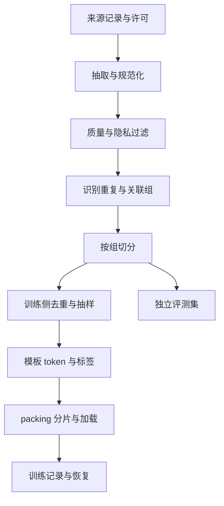

# 数据工程：从原始记录到可恢复的训练流

一个训练任务的最终输入不是「一批文本」，而是模型在某个步骤看到的 token、目标标签、注意力边界以及它们的顺序。数据管线的工程目标有三项：**数据能追溯、训练与评测隔离、每个训练进程拿到符合合同的数据**。数据处理失败时，模型可能照常训练、损失也可能下降，却学到了评测答案或错误的标签。这比明确报错更难发现。

本章以代码定位数据为例：输入是 issue 和候选代码，目标是需读取的文件。我们会先建立可审计的数据集，再解释如何转成训练批次，以及相同数据如何从单机扩展到多机。后文计算为教学算例；GPU 训练和大规模吞吐在本书环境尚未实测。



## 一、先定义一条样本是什么

例如原始记录包含 `id`、`repo_revision`、任务、提交前仓库快照、检索结果、目标路径及其证据。模型运行时只能看到当前允许提供的信息；训练时不能把未来提交 diff、隐藏测试答案或人工审核的最终结论直接拼进模型输入。如果目标文件是由最终补丁推导出来的，它是标签的一种来源，并不保证在模型可见的上下文里有足够证据。无证据任务可以标记为「继续搜索」，而不是强迫模型编造理由。

给每条记录记录来源 URI 或内部 ID、获取时间、使用权限、清洗脚本版本、仓库提交、内容哈希与去留原因。原始文本、清洗结果和用于训练的文本应能通过稳定 ID 关联。代码不能无条件去掉缩进、大小写或空白：Python 缩进有语义，字符串中的空格也可能是测试内容。隐私信息与凭据处理要覆盖衍生文件、缓存和日志；不把原始内容直接放进实验追踪系统。

有些教程把 `input`、`output` 拼接后当作一条字符串就直接训练，但在对话模型里还要决定系统、用户、助手、工具调用和工具响应的边界。这个决定影响两个不同问题：模型**能看到哪些 token**（注意力），以及**哪些 token 被要求预测**（loss）。这两个 mask 不等价。[TRL SFTTrainer 数据格式与损失选项](https://huggingface.co/docs/trl/sft_trainer)

## 二、先建立泄漏边界，再划分

如果同仓库中的函数训练在 train，另一个提交中的复制函数在 test，即便行号和文件名变化，评测也可能只是记住项目。先定义具有统计依赖关系的**组**：同仓库、fork、同源任务、模板复制，以及足够相似的代码。按组分配 train/dev/test，而不是按样本随机切分；时间切分时还要检查源仓库的其他镜像是否先出现在训练中。

精确去重用内容哈希；轻微改写需要近重复检测。MinHash 加局部敏感哈希（LSH）是识别相近文档的候选方案：首先为文档构造特征及签名，再从候选中判断相似度。签名匹配不是语义正确性的证明，阈值过低可能误合并，过高可能漏掉重复；针对代码、自然语言和短文本分别抽样评估。NeMo Curator 文档区分精确、模糊和语义去重路径。[NeMo Curator 去重概念](https://docs.nvidia.com/nemo/curator/about/concepts/deduplication)

**顺序陷阱。** 先根据全库去重保留一条，再随机切分，未必解决不同实现、轻微改写或相同仓库的泄漏；先随机切分，再仅在每个集合内部去重，也发现不了跨集合重复。更稳妥的思路是：用仓库和重复关系构建关联组，按组切分，然后在训练集内部执行保留策略，并检查跨集合近重复。测试集的保留策略和污染风险需报告，不能为了好看结果悄悄删掉难题。

### 一个可以运行的最小例子

仓库中 [`scripts/data_pipeline_demo.py`](../scripts/data_pipeline_demo.py) 用标准库演示关联组、固定种子切分、精确去重和计数检查：

```bash
python scripts/data_pipeline_demo.py
```

脚本用并查集合并「同仓库」和「内容哈希相同」的记录。若 A 与 B 属于同一仓库，B 的内容又出现在 C 所属仓库，那么 A、B、C 进入同一个关联分量再划分。玩具数据中六条输入有一条精确重复，运行后输出五条和被移除的 ID；脚本检查保留行的仓库、哈希和 split 一致性。它不访问互联网，不训练模型。**它没有实现近重复检测、人工审核、复杂分层或独立 test 集，不能直接作为生产切分器。**在真实流水线中应输出所有输入 ID 的去留、所属组和 split 清单，先检查原始关联图没有跨集合，再检查保留结果；这比只看最终数目更有用。

如果连接关系把 90% 样本串成一个巨大分量，按样本比例切分可能不再可行。这不是改变随机种子就能解决的问题：应调查复制模板、过宽的去重阈值或超大单仓库，选择新的评测单位，并如实报告样本分布与统计独立性的限制。

## 三、清洗和质量：统计不能代替抽样

数据入口应该先验证必需字段、编码、最大尺寸、来源许可证与空值，再检查任务和答案是否对应。一个标签是合法的路径，并不意味着它确实应该被读取；目标文件不存在、检索证据与正确答案矛盾、回答含泄漏内容等，都需要单独分类。可以用 JSON Schema 或程序检查格式，用可执行测试筛查部分代码标签，用分层人工审核评估语义；每种方式都应记录无法覆盖的情况。

不要只报告「过滤掉 20%」。至少按来源、任务类型、语言、长度和拒绝原因统计处理前后分布。假设某来源 10,000 条样本中 2,000 条被规则拒绝：其中 1,800 条因为任务字段为空，200 条因为路径不在提交前快照。抽检 100 条时要分别从保留和拒绝集合抽样，评估误删与漏放；若只抽保留集合，可能永远看不到规则误伤了哪类数据。不同来源应保留单独统计，避免整体通过率掩盖某个来源大量失败。

代码修复相关的自动测试也可能有缺陷。测试通过只证明当前验证器接受该答案；缺失的边界输入和隐藏副作用可能未被检查。对不可执行样本，评审须记录证据来源和置信度；对于自动生成的数据，保存教师模型版本、模板、采样参数、验证结果以及重试过程，以便定位教师错误或系统性偏差。

## 四、模板、token 与标签：做一条显微镜检查

假设对话模板将三个片段编码为以下**示意** token，不代表真实 tokenizer：

| 位置 | 片段 | token ID | label |
| --- | --- | --- | --- |
| 0–1 | 系统与用户提示 | 10, 11 | −100, −100 |
| 2 | 助手起始标记 | 12 | −100 |
| 3–4 | 助手回答 | 31, 32 | 31, 32 |
| 5 | 回答结束标记 | 2 | 2 |
| 6–7 | padding | 0, 0 | −100, −100 |

在常见 Hugging Face 因果语言模型实现里，`labels` 与 `input_ids` 同长度，模型内部会对 logits 和 labels 做右移对齐；不要再无条件在外部进行一次移位，否则目标错位。上表是否训练结束标记属于设计决定，需要与模板和目标一致。回答以外的位置使用 `-100` 是常见 PyTorch loss 忽略约定；不代表这些输入 token 不参与前向。应针对实际训练器确认其实现，尤其是不同模型或自定义 loss。[Transformers 因果语言模型说明](https://huggingface.co/docs/transformers/tasks/language_modeling)

构建第一批数据后，解码 `input_ids`，再分别解码 `labels != -100` 的位置，人工核对用户文本是否被错误标成目标、助手首 token 是否丢失、结束标记是否保留，以及截断是否把答案全部切掉。多轮对话中要决定训练所有助手轮次还是最后一轮；工具响应通常是环境观察，不应默认当作模型生成目标。TRL 的 `assistant_only_loss` 依赖适当的模板标记及具体版本支持，必须检查实际标签而不是只看配置名称。[TRL 的 assistant-only loss](https://huggingface.co/docs/trl/sft_trainer)

如果序列按最长样本截断到 4096 token，有效目标可能只有一个或零个。统计输入长度、目标长度、截断率、零目标比例和有效目标占比；零目标 batch 应被拦截或有明确策略。短跑时 loss 为 NaN 也可能来自整批目标全部被忽略，而不只是学习率或硬件问题。

## 五、packing：省 padding，同时保护语义

四条长度为 100、200、300、400 的样本，每条单独 padding 到 512，会得到 2048 个位置，其中真实 token 共 1000；按实际长度整理的理想利用率约 48.8%。如果能把它们安全装入两个 512 长度序列，分配位置为 1024，利用率约 97.7%。这是示意算术：实际 packer、边界标记、GPU kernel 与超长样本策略决定结果。

但「拼在一起」与「彼此独立」不必然相同。对于预训练，连续文档训练可能按设计允许跨文档上下文；对于独立指令任务，若希望样本互相隔离，需要 attention 实现支持边界隔离，并检查 position IDs 是否按预期重置。不同训练器的 packing 与 padding-free 实现存在差异；不要只看一次 batch 的 shape。实验要同时验证：

1. 同一组原始样本的有效目标 token 数；
2. 解码后的任务与回答边界、EOS 和 label mask；
3. 实际 attention 边界和 position ID；
4. 启用前后 loss/梯度在定义相同条件下是否合理；
5. 实际有效 token/s 和峰值显存，而非仅 samples/s。

例如 `sample_A` 与 `sample_B` 都短，打包后若 B 的 token 能看到 A，但部署时 B 没有 A 的上下文，训练目标与部署场景可能不一致。也可能发生样本标签边界错位，让 B 的用户提示被当成 A 的助手回答。先在小模型做一条可追踪的测试，再做吞吐实验。[TRL packing 文档](https://huggingface.co/docs/trl/sft_trainer)

## 六、从单卡缓存到多机分片

**单卡：**数据集较小可一次离线 tokenization 后存磁盘；训练读取本地缓存，首次运行与后续重用要分别测量。把 tokenizer revision、聊天模板、最大长度、截断、loss mask、处理代码版本和源数据哈希放入缓存标识。只看文件名 `train_tokenized` 容易把旧模板生成的缓存误当成新数据。

**少数几张卡：**每个数据并行副本应拿到正确的不同样本。对 map-style dataset，可使用框架提供的 sampler；启用 shuffle 时按框架约定更新 epoch，且确认尾部不足一个 batch 时是否重复或丢弃。模型并行维度内的 GPU 往往协作处理同一批次，不能简单按 GPU 总数切成互不相关样本；应按**数据并行组**计数。检查各 rank 的样本 ID、总有效 token 和重复率，而不是只验证作业成功启动。

**多节点：**训练数据通常是多个 shard 或对象存储文件。每个 shard 应有 ID、字节数、记录数、checksum、版本、内容范围与读取状态；工作进程按确定规则分配 shard，避免节点间重复和遗漏。为减少数据倾斜，分片数量通常应明显大于并发读取 worker 数，但过多极小文件也会放大元数据请求；应通过真实读取速率和等待时间选择。若源数据的各 shard 大小差异很大，仅按文件数平均分配也可能让某些 rank 长时间空闲。Hugging Face Datasets 的流式数据集提供分片机制，具体行为与格式、版本及重分片策略相关。[Datasets streaming](https://huggingface.co/docs/datasets/stream)

流式读取的数据不一定能像本地数组一样完整随机打乱：可能只对 shard 顺序和有限缓冲进行 shuffle。固定随机种子只能在输入版本、worker 数、分片与实现不变的前提下帮助复现，不能保证更换集群规模后逐 token 顺序完全一致。训练卡等待数据时先测 CPU 解码/tokenization 时间、存储吞吐、网络与 GPU 空闲区间；不要先盲目增加训练卡。把预处理移到离线、合理加大 shard、缓存高复用数据或增大 worker 都是候选，但也可能受内存、网络和存储限制。

## 七、失败恢复：保存的不只是模型

若每个 worker 从流式输入读取不同片段，只恢复模型权重和优化器后重新从头读取，可能重复训练之前处理过的数据；只记录全局 step 也不足以重建多 worker 的确切读取位置。可恢复的数据合同至少包括数据清单版本、分片分配、迭代位置、shuffle RNG 和 sampler/loader 状态，以及与之配套的模型、优化器和学习率状态。具体 loader 是否支持精确恢复由实现决定；变化 worker 数时尤其需要实测。[PyTorch DataLoader 与 IterableDataset](https://docs.pytorch.org/docs/stable/data.html)

**恢复演练**：用固定小数据记录每个样本 ID 与训练 step，在某个 checkpoint 后主动中断，重启并对比一条不停机运行的轨迹。报告重复/漏掉的样本、恢复位置、loss 和模型状态差异；允许非确定性时解释误差来源。对于无状态流式来源，只能保证近似恢复时，也需要明确可能重复的范围、对统计口径的影响和是否可接受。

## 八、把数据管线当成可观测系统

一个训练更新需要多少真实 token，而不是多少条记录？假设全局 batch 为 64 条，每条平均 1,500 输入 token 和 100 个训练目标 token，则每更新处理约 102,400 个序列 token、6,400 个目标 token。前向仍要处理输入；如果只报告目标 token/s，不能据此推算整个数据读取负载。长度分布不均、padding、packing 和截断会使这两个数字发生变化。

推荐在每次构建和训练运行中保存：

- 数据版本、输入与输出记录数、被拒绝/去重 ID 和原因；
- train/dev/test 的分组规则、重叠检查和污染抽检结果；
- tokenizer、模板、特殊 token、截断长度、packing 和 label mask；
- 各来源实际采样 token、样本长度分布、有效目标比例；
- 各 rank 消费的样本/分片、数据加载等待时间、有效 token/s；
- 检查点绑定的数据版本、读取状态与恢复演练结论。

最终交付的数据卡不是一张样本数量表，而是让另一个工程师能回答「来源是什么、为何可用、哪些变换发生了、如何切分、哪些数据被移除、是否可以重建，以及验证器还可能漏掉什么」。改变任何一个训练语义，应该生成新版本，并与旧数据在同一固定评估协议下比较。
