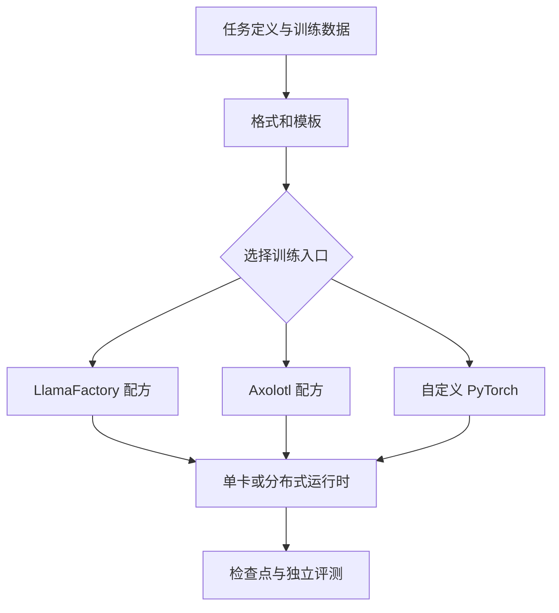

# 23 五种训练工具：让同一任务穿过不同工程栈

上一章说明了数据处理。本章固定一个目标：将一个已有语言模型训练为代码任务的文件定位助手。输入是问题描述与已检索到的文件摘要；输出是需检查的文件及理由。我们将同一个任务映射到 LlamaFactory、Axolotl、DeepSpeed、PyTorch FSDP2 和 TorchTitan，解释它们分别接手了什么、在哪一层分界、怎样检查结果。它们不是同一层的五个竞争产品，也并非依次安装就能解决一切问题。

本章依据 2026-10-30 能访问的项目文档写作；命令展示的是文档接口与配置思路，**本书环境没有对这些具体框架版本、模型或 GPU 执行完整训练验证**。YAML 和 JSON 是教学配置，使用前须按固定版本的示例调整数据路径、模型、依赖和硬件；不要把假设性数据与效果当成实际结果。



## 23.1 先分清产品层级：谁拥有训练语义

| 层次 | 代表工具 | 主要职责 | 不自动保证什么 |
| --- | --- | --- | --- |
| 模型和基本训练 API | Transformers、PEFT、TRL | 模型/分词器、适配器、训练器或后训练算法 | 数据是否正确、模型是否解决业务问题 |
| 配置式训练入口 | LlamaFactory、Axolotl | 解析配置、加载数据、准备训练器、启动与保存 | 不同默认模板、掩码、packing 下的实验等价 |
| 分布式运行时 | PyTorch DDP/FSDP2、DeepSpeed | 参数或训练状态分片、通信、部分检查点机制 | 自动解决数据泄漏、评测或训练不稳定 |
| 原生大规模训练系统 | TorchTitan、Megatron Core/Bridge | 把模型、并行、优化、数据加载等组织成可扩展训练作业 | 任意 Hugging Face 模型、硬件与自定义数据均无需适配 |
| 在线 RL 编排 | verl、NeMo RL | 组织采样、奖励、更新和训练/生成后端 | 任意验证器奖励都真实反映目标 |

因此，「Axolotl 还是 DeepSpeed」经常是错误的二选一：Axolotl 可以调用 DeepSpeed 作为后端；「TRL 还是 FSDP」也可能是在问两个层次。选型时先记录：**谁生成 token 和 labels，谁负责损失，谁同步梯度，谁保存模型与优化器**。训练完成后，同一 JSONL 被两个入口消费，不一定意味着实际输入等价。[Axolotl 多卡文档](https://docs.axolotl.ai/docs/multi-gpu.html)；[LlamaFactory 分布式训练](https://llamafactory.readthedocs.io/en/latest/advanced/distributed.html)。

### 公共实验合同

为做可比实验，假设模型、tokenizer 和聊天模板已固定到不可变 revision；按仓库分组得到训练集、开发集、最终测试集。下面是一条用于解释字段的示例，不对应真实仓库，也不足以训练模型：

```json
{
  "instruction": "定位会话刷新后失效的相关代码",
  "input": "候选：auth/session.py、ui/header.css；检索结果：session.py 在启动时读取 cookie。",
  "output": "先检查 auth/session.py 的 cookie 读取与恢复；不要仅凭文件名修改样式。"
}
```

在输入中只放模型实际会拿到的检索结果，不放仅在修复完成后才知道的真实补丁。固定对照条件至少包括：模板展开后的 token IDs、被忽略的标签位置、截断率、LoRA 模块和参数、有效目标 token 数、优化器更新次数、训练 token 数与独立仓库测试。用哈希与版本记录数据，保留训练成本和失败实例。

**等价性检查先于速度比较。** 两个框架只要一处不同，例如一个训练全部对话 token，另一个只训练助手输出，loss 和梯度就不再直接对应。假设每个输入有 1,000 token、回答有 100 token，前者可产生约 1,100 个目标位置，后者约 100 个；两者都需要处理输入上下文，训练目标却大不相同。还要确认截断方向：先截掉答案，loss 可能变成零或训练了错误目标；截掉重要证据，则任务变得无法回答。

## 23.2 LlamaFactory：从数据登记到 LoRA

LlamaFactory 支持配置文件驱动的 SFT。它的本地数据集通常需要在 `dataset_info.json` 登记名字和文件，并通过列映射告诉训练器哪列是指令、输入和答案。不要将自己的登记表直接覆盖掉团队已有清单；为项目设置独立数据目录，并备份和版本化。官方数据准备文档详细区分 Alpaca、ShareGPT、偏好数据及其字段。[数据准备](https://llamafactory.readthedocs.io/en/latest/getting_started/data_preparation.html)

一个独立目录的示例：

```text
my-data/
  dataset_info.json
  train.json
  dev.json
```

训练文件 `train.json` 包含上述对象组成的 JSON 数组；真实训练必须有足够数量、已清洗和分仓库切分的样本。登记表可如下填写：

```json
{
  "code_locator_train": {
    "file_name": "train.json",
    "columns": {"prompt": "instruction", "query": "input", "response": "output"}
  },
  "code_locator_dev": {
    "file_name": "dev.json",
    "columns": {"prompt": "instruction", "query": "input", "response": "output"}
  }
}
```

下面的 YAML 是**字段示意**：本地模型路径和模板需要换成经验证的一对；精度应根据 GPU 与当前软件支持选择。具体版本可能调整参数及模板名称，以实际 `examples/train_lora/` 和命令帮助为准。训练前应验证目录读取、完整模板和 label 掩码；不要在已有输出目录启用覆盖。[官方 SFT 示例及参数](https://llamafactory.readthedocs.io/en/latest/getting_started/sft.html)；[参数参考](https://llamafactory.readthedocs.io/en/latest/advanced/arguments.html)。

```yaml
# locator-lf.yaml：教学示意，模型和模板必须匹配
model_name_or_path: /models/pinned-instruct-model
stage: sft
do_train: true
finetuning_type: lora
lora_rank: 8
lora_target: all                 # 先核对最终被注入的层与可训练参数

dataset_dir: ./my-data
dataset: code_locator_train
eval_dataset: code_locator_dev
template: REPLACE_WITH_MODEL_TEMPLATE
cutoff_len: 2048                 # 截断率及目标是否保留需要检查

output_dir: ./runs/locator-lf
per_device_train_batch_size: 1
gradient_accumulation_steps: 8
learning_rate: 1.0e-4            # 示例值，不保证适合本任务
num_train_epochs: 3
logging_steps: 10
save_steps: 100
save_only_model: false           # 仍需核查实际保存了哪些恢复状态
report_to: none
```

在对应工作目录和已安装的固定版本中，入口形态为：

```bash
llamafactory-cli version
llamafactory-cli train locator-lf.yaml
```

读取训练日志时，不要只确认 `loss` 在下降。先检查每个数据集实际加载条数、对应模型 template、被截断样本数与一条具体样本展开后的目标标签。对于多轮数据，历史消息是否也参与损失需要核对版本与配置；不能假设只有最后一轮训练。训练后评测、推理应使用同一 base 模型 revision、tokenizer 与聊天模板；适配器目录不是包含基座所有权重的完整模型。[推理与适配器](https://llamafactory.readthedocs.io/en/latest/getting_started/inference.html)。

### 从一张卡扩到四张卡，哪些参数改变

假定四张 GPU 均参与纯数据并行，每个进程微批 1，梯度累积 8，则每次更新处理 `4×1×8=32` 条样本。单卡同配置是 8 条。若希望样本数全局批量仍为 8，可把累积次数调整为 2：`4×1×2=8`。这只固定了样本数；不同样本长度、padding、packing 和 loss mask 仍使有效 token 数可能变化。

多卡不是把模型目录里四份权重叠加。数据并行通常让每个副本处理不同样本并同步梯度；如果模型训练状态本身在一张卡上放不下，可能需要 DeepSpeed ZeRO、FSDP 等状态分片。LlamaFactory 的分布式文档展示了 DeepSpeed 启动和配置路径；环境中必须固定主机数量、可见设备、通信参数和实际 JSON，不能仅加一行 `deepspeed:` 就忽略 launcher。[LlamaFactory 多卡](https://llamafactory.readthedocs.io/en/latest/advanced/distributed.html)。

## 23.3 Axolotl：预处理、启动器和训练配置

Axolotl 同样提供 YAML 入口，但其数据格式映射、模板名称、adapter 参数和输出策略与 LlamaFactory 不应当逐字互换。先从当前版本自带的官方样例开始，把模型和数据替换为自己的固定版本，使用调试预处理观察前几条结果，再运行一次短训练。其 CLI 文档区分 `preprocess`、`train`、`inference`、`evaluate` 与 `merge-lora`，且支持显式选择 launcher。[Axolotl CLI](https://docs.axolotl.ai/docs/cli.html)；[配置参考](https://docs.axolotl.ai/docs/config-reference.html)。

假设已有与安装版本相匹配、字段全部解析通过的 `locator-ax.yml`：

```bash
# 获取当前安装版本配套示例；检查下载内容再修改
axolotl fetch examples --dest ./ax-examples
# 预处理并抽查五条训练结果
axolotl preprocess locator-ax.yml --debug --debug-num-examples 5
# 单机两卡：-- 后面的参数交给 torchrun
axolotl train locator-ax.yml --launcher torchrun -- --nproc_per_node=2 --nnodes=1
# 必须检查目录是否包含可恢复状态，而不只是模型权重
axolotl train locator-ax.yml --resume-from-checkpoint ./runs/locator/checkpoint-100
```

这些命令展示运行顺序，**不包含一份已经过本书 GPU 实测的 `locator-ax.yml`**。其中 `--` 是 CLI 与 launcher 参数的分界；不要把 `--nproc_per_node` 误当作 YAML 中的 LoRA 选项。预处理 `--debug` 有助于看到内容，但能显示文本并不充分：还应检查 tokenizer、目标 labels、丢弃比例与最终 batch。恢复前用独立短任务演练「训练 N 步 → 中断 → 从 N 步继续」，并比较学习率、数据位置、优化器状态和日志；加载一个 adapter 权重只能说明模型参数可用，不能证明训练过程连续。

Axolotl 官方多卡文档允许指定 DeepSpeed 配置，例如先通过 `axolotl fetch deepspeed_configs` 获取与版本匹配的样例，再在 YAML 或 CLI 中选择相应文件。[多卡配置](https://docs.axolotl.ai/docs/multi-gpu.html)。这比随意从网上复制旧 JSON 更容易发现版本差异。另一个选项是 FSDP2，但它与旧 FSDP1 的字段并不通用：迁移时查看 Axolotl 的迁移说明，不能把一个 YAML 里的所有 `fsdp_*` 原样复制到另一个版本。

## 23.4 DeepSpeed ZeRO：算出分片解决了什么

先算一个理想化状态账本，不能代替实际 profiler。假设有 7B 可训练参数，BF16 参数和梯度各 2 字节，Adam 一阶、二阶矩各 4 字节，另有 FP32 主权重 4 字节。只算这些模型状态：

| 组成 | 每参数字节 | 7B 的十进制大小 |
| --- | ---: | ---: |
| BF16 参数 | 2 | 14 GB |
| BF16 梯度 | 2 | 14 GB |
| FP32 一阶矩 + 二阶矩 | 8 | 56 GB |
| FP32 主权重 | 4 | 28 GB |
| 合计 | 16 | 112 GB |

四卡数据并行、理想均匀划分且不考虑临时缓冲时：ZeRO-1 分片优化器相关状态，近似 `14+14+(56+28)/4=49 GB/卡`；ZeRO-2 再分片梯度，约 `14+14/4+(56+28)/4=38.5 GB/卡`；ZeRO-3 再分片参数，常驻状态约 `112/4=28 GB/卡`。这些数字是示例而非 DeepSpeed 通用内存公式。不同框架、精度、优化器可能不保存这里假设的 FP32 主权重，梯度或状态类型也可能不同；尤其 LoRA 下绝大多数基座权重被冻结，不能把全部 7B 都按 Adam 可训练参数计算。真实峰值还要加激活、通信、参数 all-gather、临时 workspace、碎片，以及加载/保存时的聚合。DeepSpeed 提供相应内存估算工具和状态说明。[ZeRO 内存文档](https://deepspeed.readthedocs.io/en/latest/memory.html)；[ZeRO 配置](https://deepspeed.readthedocs.io/en/stable/zero3.html)。

由这个账本可以推断：ZeRO-3 虽然降低模型状态常驻显存，上例依然无法让 24 GB 卡容纳全部状态，更不用说激活。进一步调整需要结合冻结权重、低秩适配器、量化、CPU offload、模型并行或选择更小模型。CPU offload 换取 GPU 空间时也增加 CPU 内存及 PCIe/主机传输压力；有些 offload 还要求 pin memory，不能忽略主机端峰值。

以下仅展示 DeepSpeed JSON 中关于分片的**局部语义**，不是完整配置；不要把它与不同工具各自设置的 global batch、精度和 optimizer 重复定义而不核对解析结果：

```json
{
  "zero_optimization": {
    "stage": 2,
    "offload_optimizer": {"device": "cpu", "pin_memory": true}
  }
}
```

CPU offload 是实验选项而非必选项。先跑不 offload 的基线并测 GPU 和 CPU 峰值、有效 token/s；再在相同批量和训练目标下启用，比较总吞吐及质量。排障时区分显存问题发生在加载、前向、反向、第一次优化器 step 或保存阶段。第一次 step 才 OOM 可能是优化器状态延迟创建；保存时 OOM 可能与权重聚合有关，二者处理方式不同。

在 DeepSpeed 自定义循环中应遵循 engine 的累计与 step 语义，不要在 ZeRO-2/3 照搬 DDP `no_sync()` 假设：DeepSpeed 当前文档明确说明该调用对分片梯度的 ZeRO-2/3 不适用，并提供对应的归约机制。[DeepSpeed 训练 API](https://deepspeed.readthedocs.io/en/stable/training.html)。

## 23.5 FSDP2：分片粒度决定显存与通信

FSDP2 的入口是 `fully_shard`；它并非 LoRA 或损失函数，而是对模块参数及相关训练状态的分片机制。按模块设置分片组，可以在计算前按需收集参数、执行计算、按配置重新分片，反向传播中再完成所需的通信。配置组过大可能造成收集时峰值高；过小可能造成许多短通信与管理开销。具体策略应测量而非只凭模块数猜测。[PyTorch FSDP2 API](https://docs.pytorch.org/docs/stable/distributed.fsdp.fully_shard.html)。

下面是**接口层次示意**，并非独立可运行训练脚本：调用者还必须初始化分布式进程组、绑定设备、创建已支持的模型和数据分片，并保证所有 rank 同步调用；具体 PyTorch 版本、模型初始化与保存代码须按官方教程选择。

```python
# 说明分片层级：每个 Transformer block 独立设分片组，最后处理根模块。
from torch.distributed.fsdp import fully_shard

for block in model.layers:
    fully_shard(block)  # model.layers 仅为示意：真实模型结构各不相同
fully_shard(model)
# 应在完成分片后按当前 FSDP2 官方推荐方式构造优化器与训练循环。
```

对训练者而言，最重要的调试动作是让单卡与多卡的小样本实验在**相同初始化、样本、有效目标 token 和全局批量**下可比较。用固定种子与同一检查点比较数步 loss 和梯度范数，但浮点归约顺序、非确定性 kernel、数据拼包及随机 dropout 都可能产生差异，不应要求毫无条件逐 bit 相同。发现严重偏差时，先看数据是否重复/遗漏、labels 的 mask、loss 是否按 token 正确归一化，再检查多卡通信。

## 23.6 TorchTitan：从 debug recipe 到大规模训练

TorchTitan 是 PyTorch 原生的大规模训练平台，围绕具体模型 recipe 组织训练，能够组合 FSDP2 与多种模型并行策略。它与配置式 SFT 前端解决的问题不同：前者更适合深入模型实现、检查点及多维并行系统，是否支持自己的模型、数据与微调目标必须逐项验证。不要把 LlamaFactory 的自定义数据 YAML 直接交给 TorchTitan，二者的数据读取与模型接口并不相同。[TorchTitan 仓库](https://github.com/pytorch/torchtitan)。

官方 README 给出一张 GPU 的 debug 入口，使用项目自带测试 tokenizer 和短训练；其依赖与具体 recipe 是随版本变化的：

```bash
# 在已按固定版本官方说明安装依赖的 torchtitan 仓库内：
NGPU=1 ./run_train.sh
```

这不是生产预训练任务，也不使用本书的代码定位数据。它适合回答「安装、模型构造、训练循环和日志能否走通」；正确完成不能证明你的数据源或多节点通信正常。再切换到当前版本支持的模型 recipe 前，先用官方 `--print-config` 输出解析后的配置，核对并行维度、总 token、每 micro-batch token、模型权重、tokenizer 和检查点。TorchTitan 的当前文档还提供 fake process group 用于检查逻辑 mesh；fake 运行并不等价于真实 NCCL 通信、网络吞吐或真实多卡峰值测试。[TorchTitan 调试指南](https://github.com/pytorch/torchtitan/blob/main/docs/debugging.md)。

假设四节点、每节点八卡共 32 卡，设 TP=4、PP=2、CP=1，则在该简单布局下数据并行副本数为 `32/(4×2×1)=4`；这是忽略 EP 单独组织差异的示意。每个副本本身占八卡，所以 global batch 要乘以 4 个数据并行副本，而不是乘以 32 个 GPU。若每副本 micro-batch 2、累积 4 次，则每更新 `4×2×4=32` 条；但 pipeline 调度还可能对 micro-batch 数提出要求，具体以 recipe 为准。多节点执行之前先在一节点测 NCCL/通信和恢复，再扩规模；一次作业有 32 张卡，不等于同样规模的 PyTorch FSDP-only 作业通信形状相同。

## 23.7 一次框架迁移，如何防止「训练成功但语义变了」

例如从 LlamaFactory 切到 Axolotl，希望同样的四张卡跑得更快。操作应从可验证差异开始：

1. **固定工件**：模型 revision、tokenizer、训练数据哈希与分组、模板、输出格式。两边各导出一条实际 `input_ids`、`labels`、attention mask；逐 token 比较，不只看原始 JSON 字符串。
2. **固定训练目标**：核对序列截断、EOS、packing 中跨样本 attention、LoRA 注入层与数量、可训练参数总数。注意 label 的 shift 由模型还是数据管线执行，不能手工移动后又让模型移动一次。
3. **固定优化合同**：确定每次更新的全局有效样本和目标 token、优化器、学习率调度、累计和梯度裁剪。换 GPU 数后重算数据并行副本；启用 ZeRO 或 FSDP 后检查训练器是否已处理归一化和缩放，避免手动重复。
4. **短跑与恢复**：相同初始化、数据顺序下先进行少量更新，保存模型参数变化、损失、梯度和学习率，再演练中断恢复；数值不必强求完全相等，但大偏差需要解释。
5. **比较完整指标**：除了 token/s 和峰值 GPU 显存，记录 CPU 内存、预处理时间、保存恢复耗时、任务成功率、评测误差与总成本。更高利用率本身不是最终目标。

遇到 tokenizer 显示一样而训练效果不同，常见原因包括 system 角色模板差异、assistant 标签范围不一致、训练了错误的 EOS、早期截断、padding 方向及样本混合顺序。训练器通常不会把这些差异当作异常，因为它们在语法上完全合法。

## 23.8 从小作业到生产作业的验收

交付一套可维护的训练工程应包含：代码、配置、模型与 tokenizer 固定 revision、数据版本与许可记录、镜像/驱动、集群与并行布局、训练日志、检查点清单、恢复演练记录、评测与已知问题。只有权重文件，无法重建为什么得到这个结果；只有 YAML，无法判断样本是否泄漏或微调是否有效。

验收可分三层：第一层**管线正确性**，包括 mask、梯度、状态、数据切分和中断恢复；第二层**任务效果**，以未参与训练的仓库衡量文件召回、误选、端到端修复和泛化；第三层**运行可用性**，以训练及推理成本、资源峰值、延迟、部署兼容和回退为指标。每层出现问题时都可以回到对应原因，而不是盲目更换训练框架。
