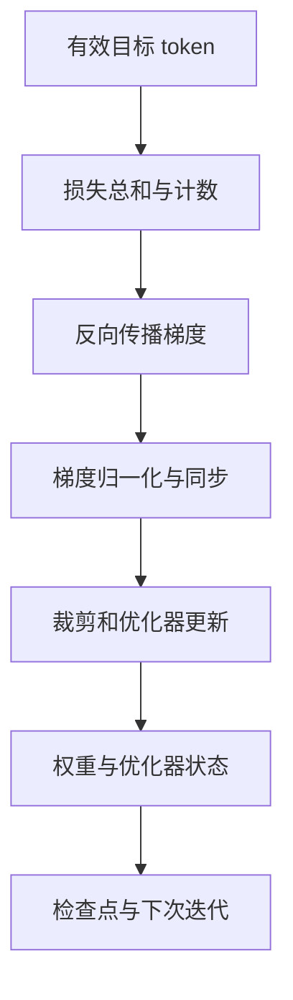

# 24 训练的物理账本：损失、参数状态与通信

同一个模型、同一批数据，单卡运行正常，扩到四张卡后损失却不同，或者显存下降了、速度反而更慢。原因往往不是「模型突然变了」，而是数据计数、梯度归一化、状态布局和通信时机发生了变化。本章跟踪一次参数更新，解释这些机制怎样在代码和硬件上发生。以下算例是便于检查的假设，不是某张 GPU 的实测结果。



## 24.1 预测误差怎样变成一次参数更新

把词表缩成三个 token，模型在某个位置给出 logits `[2, 1, 0]`，正确答案是第三个 token。softmax 得到约 `[0.6652, 0.2447, 0.0900]`，交叉熵为 `-log(0.0900) ≈ 2.4076`。对三个 logits 的梯度为概率减目标 one-hot，即 `[0.6652, 0.2447, -0.9100]`。这意味着梯度下降会降低前两个分数、提高目标分数；实际网络中这些梯度还会沿着输出投影、MLP、注意力、embedding 的计算图反传，并由共享参数汇总来自多个 token 的贡献。[PyTorch CrossEntropyLoss](https://docs.pytorch.org/docs/stable/generated/torch.nn.CrossEntropyLoss.html)；[自动微分机制](https://docs.pytorch.org/docs/stable/notes/autograd.html)。

训练样本中有提示词、回答和 padding，不一定所有位置都贡献损失。若 `labels` 用 `-100` 排除提示词和 padding，损失通常对剩下的有效目标位置做平均；提示词仍参与前向计算，并通过影响回答预测间接影响可训练权重。注意因果语言模型需要让位置 `t` 的 logits 对齐 `t+1` 的标签；一些模型内部完成 shift，外部重复 shift 会让目标错位。

一个批次有效目标数为 100，另一个为 10，若先各自求均值再等权平均，短批次的每个 token 实际权重更大。要按 token 等权，应该累计两个批次的 **损失和**、有效 token 计数，最终除以 110。示意代码：

```python
import torch
import torch.nn.functional as F

def causal_loss_sum(logits, labels):
    # logits: [B, T, V]；labels: [B, T]，非训练位置为 -100。
    scores = logits[:, :-1, :].contiguous()
    targets = labels[:, 1:].contiguous()
    total = F.cross_entropy(
        scores.view(-1, scores.size(-1)), targets.view(-1),
        ignore_index=-100, reduction="sum",
    )
    count = (targets != -100).sum()
    return total, count
```

这段函数用于说明目标对齐，不可与内部已经 shift 或预先移动过的标签同时使用。实际项目应检查具体模型的 `forward`、损失接口和数据模板，打印 token、标签与目标文本确认。这里仅给单步损失；多 rank 正确归一化还需要下面的全局计数。

## 24.2 梯度是瞬时结果，优化器是带状态的过程

最简单的随机梯度下降（SGD）更新 `θ ← θ − ηg`。假设当前标量 `θ=1.0`，梯度 `g=0.2`，学习率 `η=0.1`，不含其他项时更新为 `0.98`。现实的 AdamW 并不是只保存参数和当前梯度：它维护一阶矩 `m` 与二阶矩 `v`，根据历史梯度估计方向和尺度，并独立施加权重衰减。每次更新还可能改变学习率调度器、混合精度缩放器、随机数与数据游标。只保存模型权重再重启 AdamW，通常无法精确续训，因为优化器会从新的矩状态开始。[AdamW 原论文](https://arxiv.org/abs/1711.05101)；[PyTorch AdamW](https://docs.pytorch.org/docs/stable/generated/torch.optim.AdamW.html)。

以常见 BF16 参数和梯度各 2 字节、Adam 两个 FP32 状态各 4 字节为例，静态状态为每个可训练参数 12 字节。假设全参数训练 7B，则 `7×10⁹×12 = 84×10⁹` 字节，约 78.2 GiB；若另有 FP32 主权重再增加约 26.1 GiB。实际框架不一定采用这个组合，也可能分片、量化或延迟分配状态。这不是「7B 模型显存固定 78 GiB」，更没包含激活、通信 buffer、工作区、碎片及检查点暂存。

## 24.3 LoRA 真正节省了哪些东西

对线性层 `y = Wx`，LoRA 将可训练更新限制为 `ΔW = sBA`，其中 `W` 冻结，`A` 为 `[r, d_in]`、`B` 为 `[d_out, r]`。原层有 `d_out × d_in` 个权重，适配器有 `r(d_in+d_out)` 个参数。设两维均为 4096、秩为 16，原层为 16,777,216 个参数，适配器为 131,072 个，约为原层的 0.78%；这是**单个线性层**的参数比例，不是整模型训练显存比例。[LoRA 论文](https://arxiv.org/abs/2106.09685)。

冻结 `W` 后无需为它保留可训练梯度和 Adam 状态，但基础模型仍必须加载，前向仍需读它；为了计算适配器梯度，相关激活及上游链路通常仍需参与反向。若长上下文时主要瓶颈是激活，LoRA 并不保证显存按可训练参数比例下降。量化冻结基座进一步降低权重存储，但算子临时缓冲、解量化和实际质量、吞吐仍须测量。[QLoRA 论文](https://arxiv.org/abs/2305.14314)。

LoRA 的权重合并是一个显式交付选择：同架构与数值条件满足时将 `sBA` 加入基座矩阵，可得到单独部署的合并模型；但量化基座、不同 dtype 和重复合并可能引入误差或不被实现支持。保留未合并适配器、基座版本和合并脚本，并比较同一输入的 logits 与任务指标。

## 24.4 精度：不是把所有东西都改成 BF16

FP16 的动态范围较窄，较小梯度可能下溢；BF16 指数范围较大，但有效尾数更短。混合精度运行时按算子选择计算类型，参数、梯度、优化器状态和归约也可能采用不同 dtype。FP16 常通过梯度缩放减少下溢；缩放后要在梯度裁剪和更新前正确 unscale，否则裁剪阈值的含义改变。BF16 是否缩放取决于实现和任务，不能视为所有模型在 BF16 下一定稳定。[PyTorch AMP](https://docs.pytorch.org/docs/stable/amp.html)；[AMP 示例](https://docs.pytorch.org/docs/stable/notes/amp_examples.html)。

当 loss 变为 NaN，先从第一次异常的批次检查输入、mask、学习率、梯度、算子和缩放器，再固定该批次用 FP32 复现；同时记录是否在 softmax、归一化、反向还是优化器更新后首次发生。不能单凭「换成 BF16 不报错」就认定数据与优化目标无误。训练曲线、独立评测及检查点恢复也要一起比较。

## 24.5 两卡 DDP：本地均值为什么可能算错

DDP 中每个 rank 运行一个模型副本并处理不同数据，默认将梯度按进程组平均。假设 rank 0 处理 100 个有效 token，损失和为 200；rank 1 处理 10 个有效 token，损失和为 30。真正的全局 token 均值为 `(200+30)/(100+10)=2.0909`；若把本地均值 `2` 和 `3` 直接平均，得到 `2.5`。数值不同，优化的目标也不同。[PyTorch DDP](https://docs.pytorch.org/docs/stable/generated/torch.nn.parallel.DistributedDataParallel.html)。

设数据并行组大小 `D`、rank 的未归一化损失为 `S_r`、所有 rank 的有效 token 总数为 `N`。DDP 默认把各 rank 梯度求平均，所以每 rank 可以对 `D × S_r/N` 反向传播，最终得到 `Σ_r ∇S_r / N`。如果框架或通信 hook 不采用默认平均，或者它已经对 loss 做 token 归一化，就不能再次乘 `D`；必须检查具体实现和数据并行组，而不是用总 GPU 数代替。

下面展示 **一个 micro-batch、所有 rank 都有有效 token、默认 DDP 平均且未使用 AMP** 的局部计算。它不是完整训练程序；扩展到梯度累积时，先得到累积窗口全局有效 token 总数，才用同一个分母处理各 micro-batch。各 rank 必须以一致顺序执行集合通信。

```python
import torch.distributed as dist

# loss_sum 保持可求导；count 是整数标量，不参与求导。
loss_sum, count = causal_loss_sum(logits, labels)
count_global = count.detach().clone()
dist.all_reduce(count_global, op=dist.ReduceOp.SUM, group=dp_group)
if count_global.item() == 0:
    raise RuntimeError("所有数据并行 rank 都没有有效目标 token")
dp_size = dist.get_world_size(group=dp_group)
loss_for_backward = loss_sum * dp_size / count_global
loss_for_backward.backward()
```

如果某个 rank 没有有效 token，也不能直接跳过它的 backward 和集合操作：其余 rank 可能因此挂起。该 rank 必须产生与模型图相连的零损失并参加同样的同步，或由数据管线预先保证每 rank 有有效目标；同时需验证所用损失函数在全 ignore 情况下的行为。梯度累积时 `no_sync()` 可以避免前几个 micro-batch 不必要的同步，但最后一次仍需同步，且前向和反向都须按文档放在上下文内。[PyTorch 性能调优](https://docs.pytorch.org/tutorials/recipes/recipes/tuning_guide.html)。

## 24.6 DDP、ZeRO 与 FSDP：省的不是同一笔账

假设数据并行组有 4 个 rank，模型全部状态含参数 `P`、梯度 `G` 和优化器状态 `O`。忽略 buffer、激活和精度细节：

| 方法 | 每 rank 常驻训练状态示意 | 代价与条件 |
| --- | --- | --- |
| DDP | `P + G + O` | 反向同步梯度；模型状态复制 |
| ZeRO-1 | `P + G + O/4` | 分片优化器状态及更新，需要协调参数 |
| ZeRO-2 | `P + (G+O)/4` | 梯度和优化器分片；参数仍复制 |
| ZeRO-3 / 全分片 | `(P+G+O)/4` | 计算时需收集参数，存在临时峰值和通信 |

表格只是理想静态账本。真实 ZeRO/FSDP 的分组、精度、未均匀分片、参数聚合、梯度同步与 overlap 都会影响峰值。[DeepSpeed ZeRO 文档](https://www.deepspeed.ai/tutorials/zero/)；[ZeRO 论文](https://arxiv.org/abs/1910.02054)。

FSDP2 的 `fully_shard` 以分片参数为常驻状态，在模块计算需要时执行 all-gather 得到参数；反向后通过 reduce-scatter 汇总并分片梯度。`reshard_after_forward`、包装粒度、预取和进程组配置决定部分通信及显存行为。[PyTorch FSDP2 文档](https://docs.pytorch.org/docs/stable/distributed.fsdp.fully_shard.html)。一个非常粗的时间线如下，具体是否在前向后再次分片由配置决定：


包装粒度过大时，一次 all-gather 可能形成较高临时显存峰值；过小时，集合通信次数和调度开销可能增多。两者都要在目标网络、模型和批量上测。参数状态估算是容量起点，不能替代峰值测量。

## 24.7 一次 all-reduce 到底要多久

设梯度总量为 `S` 字节、rank 数为 `D`。如果理想 ring all-reduce 由 reduce-scatter 加 all-gather 组成，且各阶段的负载均匀，那么每 rank **发送量**近似 `2(D−1)/D × S` 字节，接收量也相同。4 rank、每 rank 需要同步 1 GiB 梯度时，理想发送约 1.5 GiB；这不是总集群流量，也不是任何网络的实测吞吐。算法、拓扑、分桶、协议、压缩和跨节点互联会改变路径。可用 `通信时间 ≈ 启动延迟 × 操作次数 + 传输字节/有效带宽` 建立初步认识，但真实情况还受到拥塞和计算重叠的影响。

DDP 把梯度分成 bucket，反向传播某些层的梯度准备好后即可发起通信，尝试与剩余计算重叠。如果 profiler 显示大量通信暴露在计算之后，先看网络拓扑、bucket 就绪时机和每 rank 的计算负载，再决定改 bucket 大小、数据管线或并行方案。GPU 利用率高并不保证有效训练 token/s 高：kernel 可能忙于 padding 或无效工作。[PyTorch DDP 设计说明](https://docs.pytorch.org/docs/stable/notes/ddp.html)。

## 24.8 激活检查点与训练检查点是两种东西

激活检查点在前向时丢弃一部分中间激活，反向时重新计算，以额外计算换显存。它可能改变随机数处理和执行时序；带随机算子时需遵循实现的 RNG 语义，带副作用的函数不应假定重算是安全的。[PyTorch activation checkpoint](https://docs.pytorch.org/docs/stable/checkpoint.html)。

训练检查点用于中断恢复。完整恢复一般需要模型分片、优化器、调度器、随机数、混合精度缩放器、训练 step、数据采样状态，以及代码/配置/数据版本。模型参数可加载并不等于可以精确续训：例如漏掉数据游标会重复或跳过训练样本。分布式保存需确认全部分片写完后才标记完成，恢复前检查元数据和版本；最可靠的验收是让短作业主动中断并恢复，比较恢复前后的步数、下一个样本、loss 和最终指标。[PyTorch Distributed Checkpoint](https://docs.pytorch.org/docs/stable/distributed.checkpoint.html)。

## 24.9 从原理落到一份实验记录

出现「四卡更慢」时，不先猜通信：记录相同模型和精度下的有效目标 token/s、序列长度分布、padding 比例、各 rank 的峰值显存、训练与数据等待时间、集合通信时间和检查点耗时。用固定总训练 token 和相同评测集比较单卡与多卡；若多卡改变了有效批量和归一化，loss 曲线差异也可能来自不同优化目标。一次只改变一个因素，并保存硬件与代码版本，才能把诊断从推测变成可复现结论。
