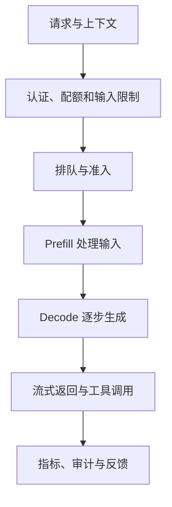

# 从模型文件到可靠服务：一次推理请求的完整旅程

训练出一个 checkpoint 不代表用户已经获得可用模型。模型文件要经过权重转换、运行时加载、请求排队、tokenization、推理调度、结果解码与网络传输；每一段都有独立的正确性、延迟与容量约束。在线运行还需要认证、配额、观测、回滚和数据治理。本章以一个代码助手服务为例，从用户体验倒推所需的推理系统。

**范围和证据。** 本章讨论自回归 Transformer 的文本推理，并使用 vLLM 官方文档解释若干具体能力。不同版本、模型架构和硬件的实现并不相同；文中数值是清楚标记的假设或算术演示，命令是需要按实际版本核对的示意，并非本书已经运行的基准。

## 从一次交互理解部署的目标

用户给代码助手一段任务和若干文件内容，希望流式收到分析和工具调用。一次请求依次经历：入口认证和配额、对话格式化、分词、等待可用计算资源、处理输入、生成输出 token、流式返回，最终写入指标。即使模型本身每秒能生成很多 token，排队太久也会让用户感觉慢；即使首字很快，后续生成断断续续也会让长回答难用。



部署验收首先要选择**工作负载**而不是服务器参数。记录输入长度、输出长度、到达速率、并发、共同前缀比例以及工具调用比例的分布；平均值不足以反映少量超长代码上下文可能引发的排队和显存压力。定义 TTFT（从服务测量起点到首个有效 token 的时间）、TPOT（输出阶段每 token 的平均生成时间，具体口径须注明）、请求总时延、成功率和每个成功任务的成本。若采用流式 HTTP，客户端时间和服务器内部指标的起点可能不同；例如入口网关排队或浏览器缓冲未必计入引擎 TTFT。[vLLM 生产指标](https://docs.vllm.ai/en/latest/usage/metrics/)

一个可执行的验收合同可以是：固定输入与输出长度分布、模型和生成参数，记录 p50/p95/p99 首 token 延迟与总延迟；在目标成功率下逐步增加真实到达率，找到队列不会持续增长的范围。这里没有给出通用阈值，因为交互式短问答、代码长上下文和离线批处理的需求并不相同。客户端若会重试，也应将重试产生的额外负载计入。

## 工件不只是权重

从训练交接到部署，应将以下内容作为一个版本化的**推理合同**：

- 模型权重及格式、模型配置、架构实现与固定版本；如果是 LoRA，还需准确的基座 revision、适配器和是否合并。
- tokenizer、词表、特殊 token、聊天模板和停止条件。输入模板决定用户消息、助手起始标记和工具调用如何变成 token；它不同于模型文件名。
- 推理引擎及版本、计算精度、量化格式、最大输入/输出、采样参数、硬件与驱动。
- 对照测试样本、期望的消息结构、工具 schema、已知限制及回滚目标。

例如 SFT 数据中的模板以特定助手起始标记结束，但线上服务套用另一个模板，模型收到的 token 序列就变了。此时出现重复角色名、提前结束或工具参数结构错误，并不一定是训练坏了。应先固定几条消息，分别打印训练侧和部署侧的完整 token ID 与 special-token 位置，检查两者是否一致。对合并后的适配器，选用相同输入、精度与解码参数比较加载基座加适配器的输出或 logits；如果使用量化，允许的误差和任务回归需要另行定义。聊天模板和特殊 token 的作用见 [Transformers 聊天模板文档](https://huggingface.co/docs/transformers/chat_templating)。

还应记录许可证、模型来源、数据访问权限和远程代码依赖。不要把一份无法追溯的权重放进生产环境后，再尝试从响应行为猜测它使用了哪个 tokenizer。

## Prefill 与 decode：为什么长输入会改变整个服务

在 **prefill** 阶段，模型处理用户当前输入，产生生成第一个输出所需的状态；在 **decode** 阶段，模型按自回归方式逐步生成 token。推理引擎通常缓存历史 token 的 key/value，避免每次生成时重新计算全部历史的 K/V；生成越长、活跃序列越多，缓存通常越大。[Transformers KV cache 原理](https://huggingface.co/docs/transformers/en/cache_explanation)

要注意以下区别：

1. 增大输入长度不只改变理论上能读多少内容，也会改变 prefill 的计算量、缓存占用以及其他请求的排队体验。
2. 增大 `max_tokens` 等输出上限不代表每个请求都会生成那么多 token；容量规划需要同时考虑引擎的分配机制、实际输出分布和最坏情况。
3. 并发请求占用的是各自活跃序列的状态。模型能装入显存，不等于它能在目标上下文和并发下稳定运行。
4. 多模态、混合注意力、滑动窗口或非 Transformer 架构可能采用不同状态和缓存方式；不能将下面的公式直接套给所有模型。

### 手算一个 KV cache 预算

对每层都保留完整历史、具有相同 KV 头维度的标准注意力模型，忽略分块取整和实现元数据时，一个 token 的 KV 数据可近似为：

\[
\text{bytes/token}=2\times L\times H_{kv}\times D_{head}\times B_{elem}
\]

其中 `2` 是 K 和 V，`L` 是层数，`H_kv` 是 KV 头数，`D_head` 是每头维度，`B_elem` 是每个缓存元素的字节数。**使用的是 KV 头数，不一定等于查询头数。**

假设一个教学模型有 32 层、8 个 KV 头、每头 128 维，缓存使用 2 字节元素。那么每 token 约为 `2×32×8×128×2 = 131,072` 字节，即 **128 KiB**。一个活跃序列若缓存 8,192 token，约占 **1 GiB**；若并发有四条相同长度且不共享前缀的序列，纯 KV 数据约 **4 GiB**。这是模型所有层的合计，不是保证每张卡各占这个数字；分片、复制、分页块、对齐、内存池、量化缓存或模型特殊结构都会改变各设备实际分配。

再假设一台 24 GiB 显存的单卡机器，以监控或配置实测发现模型权重与常驻运行时占 16 GiB，暂留 3 GiB 给峰值激活、工作区与安全余量，那么为 KV 缓存粗略留出的空间是 `24−16−3=5 GiB`。在上面的理想模型下，四条 8k 序列的 4 GiB 看上去可放下；但只剩 1 GiB 余量，额外输出 token、调度缓存、长输入混入或碎片开销都可能改变结果。因此结论只能是「值得用目标引擎压力测试」，不能保证该机器支持四路 8k。实际引擎可能预分配 KV 池，也可能采用不同的估算与准入方式；应看引擎指标和真实峰值，而不是从 `nvidia-smi` 某个瞬间推断每个请求的真实占用。分页机制通过块管理缓存，但并不消除 KV 的容量成本。[PagedAttention 说明](https://huggingface.co/docs/text-generation-inference/en/conceptual/paged_attention)

## 并发、批处理与排队

**并发**是同时在服务中的请求数，**到达率**是单位时间新增的请求数；吞吐又可能以请求/秒、输入 token/秒或输出 token/秒表示。长短请求混在一起时，单纯报告输出 token/秒不够：一个服务可能吞吐很高，但长 prefill 使短请求首 token p95 超出目标。

固定批处理等待一批请求集合完成后再处理下一批，短请求可能等待最长请求；**连续批处理**允许调度器在每个迭代中改变活跃请求集合，新请求和已在生成的请求可以共享计算资源。具体调度、chunked prefill、KV 分配和公平性由引擎与版本决定。把最大并发提高到很大可能提升某些场景下吞吐，也可能使排队、逐 token 间隔和超时恶化。[Hugging Face 连续批处理架构](https://huggingface.co/docs/transformers/v5.12.0/continuous_batching_architecture)

负载测试应同时覆盖三种输入：短交互、长代码上下文、以及多轮重复前缀。先固定输入/输出分布、生成参数和请求到达过程，再分别测冷启动与稳定期。固定并发的闭环测试中，客户端在上一请求结束后才发送新请求：服务器慢下来时客户端也会自然减小到达率，可能掩盖过载。要研究排队上限，还应使用受控到达率的测试，并记录请求被拒绝、超时和客户端取消的比例；这两种测试回答不同问题。

**准入控制**比无限排队更可预测：限制单请求上下文、输出上限、每租户并发和队列等待；对超过预算的请求明确拒绝或要求缩短输入。取消或超时后还应验证底层计算与 KV 资源是否释放，而不是只让 HTTP 客户端停止等待。限流阈值要在压测后设置，并按照交互流量和离线任务分别考虑优先级。

### 前缀缓存不是免费加速

如果很多请求共享完全相同的 token 前缀，引擎可以重用部分已计算的前缀状态，从而减少重复 prefill；是否能复用取决于 token、引擎和缓存策略。动态时间戳、随机 ID、不同的空格或聊天模板都可能使本来相同的自然语言产生不同前缀。优先保证行为正确，再测缓存命中与收益，不应为提高命中率把不该跨用户复用的数据拼到一起。不同租户的缓存隔离和敏感数据保留应按引擎能力及组织策略核实。缓存命中不能加快每一个输出 token 的 decode，也不能保证所有负载都得到同样收益。[vLLM 自动前缀缓存](https://docs.vllm.ai/en/stable/features/automatic_prefix_caching/)

## 单卡、少量多卡与多节点

| 规模 | 常见起点 | 适合的问题 | 主要限制 |
| --- | --- | --- | --- |
| 单卡 | 一份模型、一套 KV 池 | 模型和目标并发可以容纳，追求简单排障 | 显存同时受权重、KV、激活和运行时影响 |
| 同机少量多卡 | 一份模型跨卡张量并行，或每卡独立副本 | 前者解决单卡装不下，后者提升总请求容量 | 张量并行需要跨卡通信；独立副本各占一份权重 |
| 多节点 | 多个副本，或在受支持时组合张量/流水线并行 | 模型无法放在单机，或需要多机容量与冗余 | 网络、调度、检查点/工件分发、跨节点故障和操作复杂度 |

例如有四张 24 GiB GPU，模型一份含运行时占 16 GiB，目标请求的缓存需求让一张卡可提供可接受的并发。此时可以先比较四个独立副本与一个四卡张量并行副本：前者可独立重启和扩缩容，但每张卡都保存一份权重；后者共同服务一份模型，可能支持更大的单请求状态或模型，但要承担同步通信。哪一种的首 token、每 token 延迟和总吞吐更好，取决于模型实现、设备互联与负载，必须在同一个工作负载下测量。

如果模型权重本身超出一张卡，独立单卡副本无法解决容量问题；若采用张量并行，模型层内切分与相关通信需由引擎支持。跨节点时还需要考虑互联带宽、网络稳定性和 rank 同步；不要仅根据卡数选择并行度。vLLM 文档提供张量、流水线和数据并行的启动模式，但参数与模型支持会变化，应固定文档和镜像版本。[vLLM 并行与扩展](https://docs.vllm.ai/en/stable/serving/parallelism_scaling/)

## 观测：能定位瓶颈，才算运行起来

| 维度 | 观察什么 | 如何解释 |
| --- | --- | --- |
| 用户体验 | 首 token、输出 token 间隔、请求总时延、成功/取消/超时 | 区分网关和引擎起点；观察分位数及长度分组 |
| 调度 | 等待请求数、活跃请求数、准入拒绝与排队时长 | 请求队列持续增长说明当前到达率和可服务速率不平衡 |
| 模型计算 | 输入与输出 token/s、prefill/decode 时间、批次形态 | 同时记录输入输出长度，避免把不同工作负载直接比较 |
| 内存 | KV cache 使用率、预留/活跃显存、OOM 和驱逐 | 关联请求长度分布；引擎预留显存不等于每个请求实际使用 |
| 前缀复用 | 缓存命中 token、命中来源与缓存容量 | 观察命中率、prefill 延迟和租户隔离，确认实际收益 |
| 资源与费用 | GPU 利用率、显存、CPU、网络、每成功请求成本 | GPU 利用率高不保证达到延迟目标或任务成功 |

vLLM 文档列出首 token 延迟、KV cache 使用率等指标；名称和单位请按实际版本及 exporter 检查。[vLLM 指标列表](https://docs.vllm.ai/en/latest/usage/metrics/) 对每次发布记录模型 revision、引擎镜像、硬件、调度参数、压测数据集与时间窗口。对比两次发布时，要先确认测的是同一批请求和生成参数。

出现「GPU 显存还剩一点，但请求持续排队」时，先看引擎的 KV 池、调度上限和长短请求混合，不应只凭显卡总空闲内存判断能否接纳更多请求。出现「首 token 快但回答越来越慢」时，按输出长度分组看 decode、活跃序列数与流式网络；如果只是客户端卡住，还需检查反向代理缓冲、连接断开和服务端实际生成进度。

## 安全边界与可回滚发布

服务至少需要认证、TLS、访问权限、按身份的速率与并发限制、输入输出大小限制，以及可审计的管理操作。模型本身的输出也需要按用途验证：工具调用的名称和参数应由应用做 schema 和权限检查，文件读取、命令执行等能力必须由受控执行环境决定；不能因为输出 JSON 合法就默认操作有权限。日志中的提示词和工具结果可能含密钥、源码或个人信息，应遵循数据最小化、脱敏、访问控制和保留期限。

发布时先保存前一稳定版本的权重、tokenizer、模板、运行时配置与依赖镜像。新的候选先做离线回归，再用受控流量或影子测试验证延迟、错误率与任务质量；影子请求不得意外触发真实工具副作用。灰度放量之前写清回滚阈值、负责人以及恢复动作，并演练缓存与请求连接如何处理。如果只回滚模型文件却保留了新模板或量化配置，可能仍然无法恢复旧行为。

**发布检查**应覆盖：模型可加载、固定测试输入的 token/template 对齐、非流式和流式输出、停止条件、工具参数校验、长输入拒绝、超时取消、过载限流、隐私日志以及回滚演练。发布后对比固定分布的指标和真实反馈；当业务流量中的输入长度分布改变，过去压测得到的安全并发不再自动适用。

## 动手估算 KV 缓存

运行 [`estimate_kv_cache.py`](../scripts/estimate_kv_cache.py)，输入模型层数、KV 头数、每头维度、每条序列长度、序列数及每个缓存元素的字节数。例如：

```bash
python scripts/estimate_kv_cache.py \
  --layers 32 --kv-heads 8 --head-dim 128 \
  --tokens 8192 --sequences 4 --bytes-per-element 2
```

程序输出每 token 每序列 131,072 字节，四条 8,192 token 的序列共 4 GiB。乘以 2 是同时保存 key 和 value；此例按照每层都使用相同的全注意力 KV、无前缀共享和无分片计算。它是逻辑 payload，**不是每张卡的实际显存占用**。运行时可能按块预留、对齐或量化；滑动窗口、混合注意力、潜在注意力以及跨卡分片/复制也会改变结果。需要用模型配置、引擎实现和实测峰值校准。
