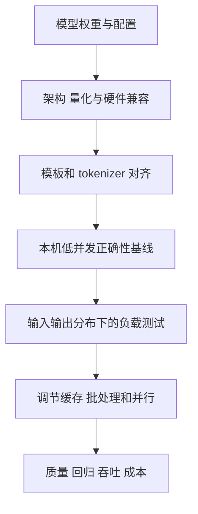

# 26 推理引擎实战：从模型文件到可观察的服务

同一个模型权重，使用不同推理引擎时可能得到不同的显存占用、并发能力和输出。原因并不止于算子速度：tokenizer、聊天模板、量化格式、模型架构、KV cache 管理、调度、生成参数及 API 协议都影响实际行为。本章沿同一任务比较 vLLM、SGLang、llama.cpp、Ollama 和 TensorRT-LLM，并说明从单卡扩到多卡时如何验证。**本章命令是依照官方文档编写的示意，未在本书环境执行 GPU 服务；具体版本、模型架构和平台兼容性必须自行核验。**资料核查日期 2026-10-31。

## 26.1 先选服务合同，再选引擎

假设我们有一个代码定位模型，需要为代码 Agent 提供流式对话、结构化输出和工具调用。系统既要服务交互请求，又要承担离线批量数据生成。前者关心排队和首 token 时延；后者更关注每小时完成的合格样本数。固定输入长度分布、最大输出、并发、测量时间、模板及准确率门槛，才有意义比较不同方案。

| 引擎 | 典型入口 | 常见选择原因 | 首先核验 |
| --- | --- | --- | --- |
| vLLM | `vllm serve` | 面向模型服务的批处理、并行和兼容 API | 特定模型架构、量化格式、GPU 和版本组合 |
| SGLang | `python -m sglang.launch_server` | 模型服务、结构化生成及缓存/调度等能力 | 模板、工具解析器、并行与特定模型支持 |
| llama.cpp | `llama-server` 或其上层封装 | GGUF、本地与异构设备、CPU/GPU 混合卸载 | GGUF 架构和量化、构建后端、上下文与并发 |
| Ollama | `ollama serve` | 本地模型管理、交互和 API 集成 | 模型构建、上下文设置、请求排队和支持的 API 子集 |
| TensorRT-LLM | LLM API、`trtllm-serve` 或 Triton backend | NVIDIA 平台下的推理优化与部署集成 | 容器/驱动/模型和功能支持；区分 PyTorch backend 与旧引擎编译路径 |

这里只指出入口，不声称某一引擎在所有任务更快。持续批处理能提高工作利用率，但排队、长 prompt 和输出长度不平衡可能恶化交互延迟。并发数不等于吞吐量，吞吐也不等于完成有用任务的速率。



## 26.2 基座、适配器与模板是同一个交付合同

训练产物可能只包含 LoRA adapter；推理引擎有时需要基础模型路径、adapter 权重、tokenizer、聊天模板、生成配置，或要求先合并并重新量化。模型名相同不代表 revision 相同。部署前记录每个文件的版本和 hash；把训练时实际使用的 system/user/assistant、工具消息和终止符写成回归样例。然后检查引擎实际生成的 token，而不是只检查 HTTP 200。

同样一个 OpenAI 兼容端点，也可能对工具调用、JSON schema、流式 usage、reasoning 字段、默认采样值和停止条件实现不同。兼容表示支持一部分接口，不是语义和边界完全一致；例如 Ollama 官方文档明确按支持的 API 子集列举能力。[Ollama API 兼容性](https://docs.ollama.com/api/openai-compatibility)

建议验收四类最小请求：普通聊天、中文与代码混排、格式约束或工具调用、多轮及流式终止。对比训练时模板渲染结果和引擎使用的最终 token 序列；先核验模板和分词，再讨论量化使模型变差。模型 revision、运行参数和输出一起记录，便于回归。

## 26.3 vLLM：把容量参数和请求负载分开看

以下例子假定已安装与 GPU、模型匹配的 vLLM，`/models/locator` 是**已准备的本地 Hugging Face 格式模型目录**，命令未做本书 GPU 实测：

```bash
# 在受控的本机环境运行；确保端口未被占用。
vllm serve /models/locator \
  --served-model-name locator \
  --host 127.0.0.1 --port 8000 \
  --tensor-parallel-size 1 \
  --max-model-len 8192
```

`--tensor-parallel-size 1` 表示一个模型副本不拆分到多张卡；并不表示系统只能处理一个请求。`--max-model-len` 约束序列上下文，prompt、生成及特殊 token 都要计入；它不是吞吐参数，也不能证明模型在该长度的任务质量。引擎是否按该数预留或动态管理内存依实现与版本而定。不要从另一个引擎的 `-c` 推断它的显存语义。[vLLM serve CLI](https://docs.vllm.ai/en/stable/cli/serve/)

使用低并发做通路检查：

```bash
curl -sS http://127.0.0.1:8000/v1/models
curl -sS http://127.0.0.1:8000/v1/chat/completions \
  -H 'Content-Type: application/json' \
  -d '{"model":"locator","messages":[{"role":"user","content":"解释 cache.py 的作用"}],"max_tokens":64,"temperature":0}'
```

确认返回的模型标识、输出、结束原因和 usage，再做流式与失败请求。上面监听回环地址；跨机器服务还需要身份认证、传输保护、访问控制、请求大小与速率限制，不能只把 `--host` 改为全网地址。

**单机多卡。** 模型无法放在单卡时，可评估 TP：在支持模型与硬件的前提下，把 `--tensor-parallel-size` 改为设备数。先确认设备可见、互联及每卡剩余显存；切分权重不保证每张卡使用完全相等，也不保证速度线性增长。能够单卡容纳时，多个独立副本可能更适合提高容量，但需要外部路由、队列和独立缓存，实际以负载测量为准。vLLM 也支持组合张量和流水线并行；多节点需核实实际版本对启动方式、模型路径、网络和进程通信的要求。[并行和扩展](https://docs.vllm.ai/en/stable/serving/parallelism_scaling/)；[数据并行部署](https://docs.vllm.ai/en/stable/serving/data_parallel_deployment/)。

如果启动 OOM，先看是加载权重还是 KV cache 初始化，记录各 GPU 峰值和其他进程显存；减小上下文上限或并发预算可能减少缓存需求，但会改变可接受工作负载。一个能通过单条短请求的服务仍可能在长输入和高并发下失败。需测最大允许输入、最大输出和混合长度，而非仅做启动检查。

### GGUF：格式兼容与架构兼容是两回事

GGUF 是文件格式及元信息容器，不是保证所有运行时都能识别的架构。若某运行时报告模型类型不支持，应分别检查：GGUF metadata 中的 architecture 名称；对应插件版本是否注册该架构；基础模型 config、tokenizer 和架构映射是否匹配；量化类型和硬件 kernel 是否支持。某个底层 `gguf` Python 包认识名称，不证明推理引擎的加载适配器也认识它。

例如 vLLM 的 [v0.18 GGUF 文档](https://docs.vllm.ai/en/v0.18.0/features/quantization/gguf/) 将当时的支持标为实验性并建议使用基础模型 tokenizer；新版本的组件分工可能变化，必须阅读对应版本与插件文档。不要将 vLLM-Omni 或 vLLM-Metal 的兼容范围直接套用到标准 CUDA vLLM，它们是不同项目和运行路径。临时回退到 llama.cpp 是可比较的工程路线，但也要验证该 GGUF 的实际架构、工具调用和质量。

## 26.4 SGLang：从相同请求比较模板与调度

SGLang 使用模型路径启动服务。以下命令是示意，应先确认本地安装版本的 `python -m sglang.launch_server --help`，且 `/models/locator` 是模型目录：

```bash
python -m sglang.launch_server \
  --model-path /models/locator \
  --host 127.0.0.1 --port 30000 \
  --tp 1
```

同样使用 `/v1/models` 和 `/v1/chat/completions` 做冒烟测试，之后比较 token IDs、完整输出、停止原因和工具调用对象。SGLang 官方列出了 OpenAI 兼容请求示例；`--tp` 等参数的名称和约束应以当前服务参数文档为准。[请求示例](https://docs.sglang.io/docs/basic_usage/send_request)；[服务器参数](https://docs.sglang.io/docs/advanced_features/server_arguments)。

当请求共享较长系统提示时，前缀缓存可能有帮助。但只有 token 序列和执行条件满足缓存规则时才可能命中：系统提示稍有变化、动态时间戳、不同模板或不同 adapter 都可能使共享减少。应记录首 token 延迟、缓存命中 token 和输入分布；不要拿重复完全相同短请求的性能，预测全部真实流量。缓存会影响容量和淘汰策略，也须评估多租户隔离与敏感数据保留策略。

多节点方案涉及服务 worker、调度入口及跨节点权重/通信；多副本与把一个模型拆到多节点是不同架构。对前者可以逐副本重启；对后者，一个 rank 故障可能让整个模型副本不可用。部署前明确路由器健康检查、就绪判断、失败切流和网络边界。[SGLang Model Gateway 官方示例](https://github.com/sgl-project/sglang/blob/main/docs/docs/advanced_features/sgl_model_gateway.mdx)。

## 26.5 llama.cpp：GGUF、上下文和并发要一起算

`llama.cpp` 的服务入口随构建及包装方式有所不同。上游二进制通常是 `llama-server`，某些应用可能将其包装为 `llama serve`；运行哪个命令以实际安装的 `--help` 为准。以下是上游二进制示意，假设已经以合适的 CUDA 或 Metal 后端构建，且本地文件实际可用：

```bash
./llama-server --list-devices
./llama-server \
  -m /models/locator-Q8_0.gguf \
  --host 127.0.0.1 --port 8090 \
  --alias locator \
  -c 65536 -np 2 -ngl 99
```

首先核验模型的模板和 `--jinja` 是否符合工具调用要求。`-ngl` 控制向 GPU 卸载的层数上限；是否全部卸载取决于模型、可用显存、设备和运行版本。`-c` 是服务的上下文容量配置，`-np` 是并行槽位数；实际每槽上下文如何分配及舍入必须读本版本的启动日志与帮助信息，不能把 `-c 65536 -np 2` 宣称为每槽都有 65536 token。槽位增加会改变可用上下文和缓存需求；长 prompt 还需要为输出和模板保留空间。[上游服务文档](https://github.com/ggml-org/llama.cpp/blob/master/tools/server/README.md)

多 GPU 时，`--split-mode` 和 `--tensor-split` 的含义由当前版本定义。例如上游文档列出 layer、row、tensor 等模式，并标明 tensor 模式的实验性；这些模式对权重、KV、临时缓冲分布不同，不能仅看模型文件大小估算每张卡占用。分配失败要逐卡看**实际空闲显存**，不要把四张卡的标称容量简单相加；启动时调整设备选择、层数、上下文和槽位，并保留余量。`CUDA_VISIBLE_DEVICES` 会改变进程看到的设备编号，检查启动日志比凭外部编号推断更可靠。

## 26.6 Ollama 与 TensorRT-LLM：两种不同的集成边界

Ollama 把模型获取、管理和服务体验封装得较高层，适合本地探索及兼容客户端集成，但应确认模型名称对应的实际版本、template 和运行参数。`ollama ps` 可以查看模型目前使用 CPU/GPU 的情况；上下文可通过对应服务环境变量或模型参数配置，具体服务管理方式与版本有关。[Ollama FAQ](https://docs.ollama.com/faq)。OpenAI 兼容客户端所需的占位 API key 不是本地服务已启用鉴权的证据；要按部署边界配置保护。

TensorRT-LLM 面向 NVIDIA 推理栈；Triton 可作为其服务集成层。应先看所选容器、后端、GPU、模型和版本矩阵，再决定是否需要离线构建引擎、量化和特定 kernel。官方现行 Triton 教程区分新的 LLM API / PyTorch backend 与正在淘汰的旧式 `convert_checkpoint.py` 加 `trtllm-build` 路径；不要拿旧教程中的文件结构当作新版本通用前提。[Triton 与 TensorRT-LLM 教程](https://docs.nvidia.com/deeplearning/triton-inference-server/user-guide/docs/getting_started/llm.html)。

## 26.7 对照测试：先确保等价，再比较价格和速度

把同一模型 revision 与评测任务复制到各引擎可能还不够。对照前应固定：实际权重及量化、tokenizer、模板、默认 system、上下文上限、停止符、采样参数、最大输出、并发与请求到达过程。相同温度也不必然产生逐 token 一致结果：实现、浮点数、随机数以及批处理顺序可能不同。因此先记录确定性条件和实际输出，比较任务级正确率及统计分布。

| 阶段 | 记录什么 | 用它判断什么 |
| --- | --- | --- |
| 启动 | 权重加载时间、各卡峰值显存、模型与模板版本 | 能否稳定启动和滚动更新 |
| 正确性 | 结构化输出成功率、工具调用语义、基准任务成功率 | 不同引擎是否真正满足业务合同 |
| 并发 | 负载分布、请求完成数、超时、首 token 和输出速度分位数 | 是否满足交互服务 SLO |
| 容量 | 每卡负载、缓存使用、排队长度、取消与回收 | 为什么发生排队、拒绝或 OOM |
| 成本 | GPU 小时、能耗与实例、重试及人工运维 | 每个成功任务的总成本 |

压测至少覆盖短输入短输出、长输入短输出、长输入长输出和混合队列；冷启动、预热及缓存命中分别报告。不要只给平均 token/s：平均值可能掩盖高并发下的长尾等待。输出 token/s 也不能和包括 prompt 的处理 token/s 混为一谈。固定测量窗口和请求到达方式，报告 p50/p95/p99、错误数及样本量。

最终选择应说明：哪一个引擎在**这一模型、这一硬件和这一负载**下满足质量与延迟，代价是什么，哪些功能依赖特定版本。官方兼容列表和示例帮助缩小候选范围；它们不能替代自己的端到端测量。
